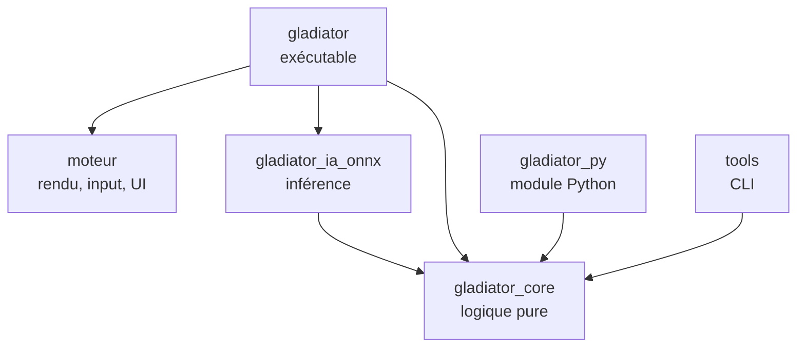

# Gladiator Manager — Feuille de route technique (Rust)

Version du 11 octobre 2026. Ce document remplace la partie technique du plan de conception du 27 septembre 2026 (architecture Godot, outils, feuille de route). Les règles du jeu (combattants, combat, économie, colisées, compétitions) restent décrites dans le plan de conception, qui demeure la référence pour le gameplay.

## Changement de cap

| Avant | Maintenant |
| --- | --- |
| Godot 4.7.2 .NET (C#) | Moteur maison en Rust, construit sur macroquad |
| Interface Godot (Control) | egui, avec un thème personnalisé |
| SubViewports | Render targets de macroquad |
| Godot RL Agents | Module Python compilé depuis Rust avec PyO3 + Stable-Baselines3 |
| ONNX dans Godot via C# | Crate `tract` (100 % Rust) |
| Steamworks.NET | Crate `steamworks` |
| Rider | VS Code + rust-analyzer |

Ce qui ne change pas : la règle d'or. La logique du jeu est séparée de l'affichage, pour pouvoir simuler sans rendu, entraîner l'IA et tester. En Rust, cette règle n'est plus une discipline : c'est le compilateur qui l'impose, puisque la crate de logique ne dépend d'aucune bibliothèque graphique.

## Pile technique

| Besoin | Choix | Remarque |
| --- | --- | --- |
| Langage | Rust stable, édition la plus récente | Installé avec `rustup` |
| Fenêtre, rendu, input, audio | macroquad | Simple, compile vite, Windows et Linux |
| Interface | egui (intégration macroquad) | Tableaux, listes, fiches, pop-ups ; thème à travailler |
| Hasard reproductible | `rand` + `rand_chacha` | Une graine par combat |
| Maths déterministes | `libm` | Mêmes résultats de `sin`, `sqrt`, etc. sur toutes les plateformes |
| Sérialisation | `serde`, `serde_json`, `ron` | JSON pour les sauvegardes, RON pour les données de design |
| Compression des sauvegardes | `flate2` | GZip, seulement si besoin |
| Historique volumineux | `rusqlite` | Seulement si le JSON devient trop lourd |
| Parallélisme des simulations | `rayon` | Simulation de masse, calibration |
| Rechargement à chaud des données | `notify` | Pratique pendant l'équilibrage |
| Inférence ML | `tract` (100 % Rust) | Derrière le trait commun d'IA ; préféré à `ort` en phase 0 : aucune bibliothèque native à livrer |
| Pont Python | `pyo3` + `maturin` | Le moteur de combat devient un module Python |
| Entraînement | Python, Gymnasium, Stable-Baselines3 (PPO) | Environnement virtuel `venv` |
| Steam | crate `steamworks` | Succès, sauvegarde cloud |
| Tests | `cargo test`, `proptest`, `insta` | Invariants, combats de référence |
| Mesures de performance | `criterion` | Vitesse de simulation |
| Qualité | `rustfmt`, `clippy` | Lancés en CI |
| Éditeur | VS Code + rust-analyzer + CodeLLDB | CodeLLDB pour le débogueur |
| Sprites | Aseprite, Kenney.nl, OpenGameArt | Export en spritesheets PNG, formats dans [Formats_graphiques.md](Formats_graphiques.md) |
| Versionnage | Git + Git LFS + GitHub | LFS pour les PNG, sons, fichiers Aseprite |

Toutes les versions de crates sont figées par le `Cargo.lock`, versionné dans le dépôt puisque le projet produit un exécutable.

## Moteur et jeu : un seul dépôt

### Décision

Un seul dépôt Git, organisé en **workspace Cargo** avec plusieurs crates. Le moteur et le jeu sont séparés en crates distinctes, pas en dépôts distincts.

### Pourquoi pas deux dépôts avec un fork

- Un fork sert à créer une copie qui diverge de l'original. Ici le jeu doit *utiliser* le moteur, pas en posséder une copie : on passerait son temps à synchroniser les deux.
- Au début, presque chaque fonctionnalité touche les deux côtés (une nouvelle animation demande du code moteur et du code jeu). Avec deux dépôts, chaque changement devient deux commits, deux pushes et une mise à jour de version.
- On ne sait pas encore ce qui est « générique » et ce qui est propre au jeu. Le découpage se clarifie en construisant le jeu.

### Ce qu'apporte le workspace

- La séparation reste stricte : `moteur` ne connaît pas `gladiator_core`, et `gladiator_core` ne connaît pas `moteur`. Toute dépendance interdite provoque une erreur de compilation.
- Un seul `cargo build`, un seul `cargo test`, un seul historique.
- Extraire le moteur plus tard reste simple.

### Si un jour le moteur doit vivre seul

Quand le moteur sera stable et réutilisé pour un autre projet :

1. Extraire son historique avec `git subtree split` ou `git filter-repo` vers un nouveau dépôt.
2. Publier des versions taguées (`v0.1.0`, `v0.2.0`…).
3. Dans le jeu, remplacer la dépendance locale par une dépendance Git :

```toml
# Aujourd'hui (workspace)
moteur = { path = "../moteur" }

# Plus tard (dépôt séparé)
moteur = { git = "https://github.com/<toi>/moteur", tag = "v0.2.0" }
```

Pas de fork, pas de sous-module Git : Cargo sait récupérer une dépendance depuis un dépôt et une version précise.

## Architecture du workspace

```
gladiator-manager/
├── Cargo.toml              # workspace, profils de compilation
├── Cargo.lock
├── crates/
│   ├── moteur/             # générique : boucle, sprites, animations, input, audio,
│   │                       # ressources, caméra, render targets, egui, pile d'écrans
│   ├── gladiator_core/     # logique pure : combat, IA scriptée, combattants, monde,
│   │                       # économie, classements, rivaux, sauvegarde
│   ├── gladiator_ia_onnx/  # inférence ONNX derrière le trait CombatAi
│   ├── gladiator/          # l'exécutable du jeu : écrans, rendu des combats, Steam
│   ├── gladiator_py/       # module Python (PyO3) pour l'entraînement
│   └── tools/              # binaires en ligne de commande
├── python/                 # environnement Gymnasium, entraînement, export ONNX
├── data/                   # classes, sorts, arènes, noms (RON)
├── assets/                 # sprites, sons, polices (Git LFS)
└── docs/                   # plan de conception, cette feuille de route
```

### Règles de dépendance



| Crate | Peut dépendre de | Ne doit jamais dépendre de |
| --- | --- | --- |
| `gladiator_core` | serde, rand, libm | macroquad, egui, tract, pyo3 |
| `moteur` | macroquad, egui | `gladiator_core` (il reste générique) |
| `gladiator_ia_onnx` | `gladiator_core`, tract | macroquad |
| `gladiator` | tout | — |
| `gladiator_py` | `gladiator_core`, pyo3 | macroquad, egui |
| `tools` | `gladiator_core`, rayon | macroquad |

### Modules de `gladiator_core`

| Module | Responsabilité |
| --- | --- |
| `state` | `GameState` : état global de la partie, point d'entrée de la sauvegarde |
| `calendar` | Semaines, saisons, grands événements, intersaison |
| `fighter` | Stats, forme, blessures, maladies, soins, progression, âge, retraite, mort |
| `combat` | Arène, déplacements, collisions, dégâts, sorts, équipement, pas de temps fixe |
| `ai` | Trait `CombatAi`, utility AI |
| `stat_model` | Résolution statistique des combats entre rivaux |
| `rivals` | Profils, effectifs et décisions hebdomadaires des clubs rivaux |
| `economy`, `market`, `staff` | Argent, achats, ventes, libérations, personnel |
| `colosseum` | Colisées, résidents, classement Elo, champion et défis de chaque colisée |
| `rankings` | Titres, défis, compétitions |
| `save` | JSON versionné, migrations entre versions |
| `achievements` | Succès du jeu, indépendants de Steam |
| `design_data` | Chargement des classes, sorts et arènes depuis `data/` |

### Principes Rust pour ce projet

- **Le code est en anglais.** Modules, types, fonctions, variables, constantes, tests, fichiers de code et commentaires sont en anglais. Restent en français : les textes affichés au joueur et les documents de `docs/`. Les abréviations des stats du plan de conception sont traduites (PV → `hp`, AC → `melee_attack`, AL → `ranged_attack`, VIT → `speed`, DC → `melee_defense`, DL → `ranged_defense`).
- **Des identifiants plutôt que des références.** Les combattants vivent dans des `Vec` ou des tables, et se désignent par un `FighterId(u32)`. Un combattant qui cible un adversaire stocke son identifiant, jamais une référence. C'est ce qui évite de se battre avec le borrow checker.
- **Une semaine est une fonction.** `fn next_week(state: &mut GameState, decisions: &Decisions)`. L'interface ne fait que construire les décisions et lire l'état.
- **Un combat est une fonction.** `fn tick(arena: &mut Arena, ais: &mut [Box<dyn CombatAi>])`. Le même code tourne à l'écran, en arrière-plan, dans les outils et dans Python.
- **Les données de design hors du code.** Classes, sorts et arènes en fichiers RON, rechargés à chaud pendant l'équilibrage.

### Déterminisme : les pièges à éviter

| Piège | Pourquoi | Parade |
| --- | --- | --- |
| `HashMap` / `HashSet` | Ordre de parcours aléatoire à chaque lancement | `BTreeMap`, `Vec` triés, ou un hasher fixe ; une règle clippy `disallowed_types` pour l'interdire dans `gladiator_core` |
| `f32::sin`, `sqrt`, etc. | Peuvent différer entre Windows et Linux | Passer par `libm` partout dans la logique |
| `thread_rng()` | Hasard non reproductible | Un seul `ChaCha8Rng` par combat, créé depuis la graine |
| Temps réel (`Instant::now`) | Dépend de la machine | La logique ne connaît que des ticks |
| Parallélisme | Ordre d'exécution variable | Paralléliser entre combats indépendants, jamais à l'intérieur d'un combat |

Ce point compte d'autant plus qu'une sauvegarde peut passer de Windows au Steam Deck par la sauvegarde cloud, et que les graines servent à revoir les combats.

### Boucle de jeu

La logique avance à cadence fixe (par exemple 30 ticks par seconde), l'IA décide quelques fois par seconde (par exemple 5), et l'affichage interpole entre deux ticks pour rester fluide à n'importe quelle fréquence d'écran. Les vitesses x0,5, x1 et x1,5 exécutent simplement moins ou plus de ticks par image ; « passer au résultat » exécute tous les ticks restants sans rendu.

## Feuille de route

Le développement se fait en onze phases, chacune terminée par un jalon vérifiable. Par rapport au plan Godot, une phase est ajoutée (phase 2 : le socle du moteur). À la fin de la phase 6, le jeu est complet avec l'IA scriptée ; le machine learning arrive ensuite comme amélioration.

| Phase | Contenu | Jalon |
| --- | --- | --- |
| 0. Préparation | Outils, workspace, Git, trois prototypes techniques | Une fenêtre avec un sprite et un bouton egui ; Python importe le module Rust |
| 1. Combat de base | Moteur de combat en duel, sans affichage | La même graine redonne le même combat ; 10 000 duels simulés en ligne de commande |
| 2. Socle du moteur | Crate `moteur` : boucle, sprites, animations, UI, écrans | Le duel de la phase 1 s'affiche en sprites animés avec contrôles de vitesse |
| 3. Le combattant complet | Forme, blessures, maladies, personnalité, mort, progression | Un combattant enchaîne 10 semaines avec des effets visibles |
| 4. Management | Calendrier, économie, écrans principaux, sauvegarde | Une saison entière jouable avec un seul club |
| 5. Le monde | Colisées, Elo, rivaux, marché, personnel, modèle statistique | Plusieurs saisons où les classements vivent sans le joueur |
| 6. Formats et spectacle | Mêlée, King of the hill, équipement refusable, vue multi-combats | Regarder 4 combats du joueur en même temps |
| 7. IA apprenante | PyO3, Gymnasium, PPO en self-play, export et inférence ONNX | Le modèle appris bat nettement l'IA scriptée |
| 8. Grands événements | Championnat du monde, Inter-Coliseum, succès, tutoriel | Un cycle complet de 4 saisons avec les deux événements |
| 9. Contenu et équilibrage | Classes, sorts, arènes, simulations de masse, finitions | Taux de victoire par classe entre 45 et 55 % |
| 10. Publication Steam | Steamworks, page du magasin, builds, test Steam Deck | Le jeu est disponible gratuitement sur Steam |

### Phase 0 — Préparation

Objectif : un projet qui compile, et la preuve que les briques risquées fonctionnent ensemble avant d'écrire du gameplay.

- Installer `rustup`, VS Code, rust-analyzer, CodeLLDB, Git et Git LFS, Python 3 avec `venv`. Sous Linux, aussi les en-têtes ALSA (`libasound2-dev`), nécessaires à l'audio de macroquad ; la CI les installe.
- Si Rust est nouveau : lire les chapitres 1 à 10 du *Rust Book* (possession, emprunts, structs, enums, traits, gestion d'erreurs), puis les chapitres 13 et 15 au besoin.
- Créer le dépôt GitHub, le workspace et les crates vides.
- Configurer `.gitignore` (`target/`, `python/.venv/`, `*.onnx` de travail), `.gitattributes` (`* text=auto eol=lf` et les règles LFS pour `*.png`, `*.ogg`, `*.wav`, `*.aseprite`).
- Profil de développement rapide pour les dépendances, sinon les simulations seront lentes en debug :

```toml
[profile.dev.package."*"]
opt-level = 2
```

- Profil de publication : `lto = "thin"` et `codegen-units = 1` dans `[profile.release]`, pour `batch` et le build Steam. Version minimale de Rust déclarée dans `[workspace.package]` (`rust-version = "1.91"`, la plus haute exigée par les dépendances, `tract`), héritée par chaque crate avec `rust-version.workspace = true`.

- Prototype 1 : une fenêtre macroquad qui affiche un sprite Kenney et un bouton egui. Vérifier tout de suite la compatibilité des versions entre macroquad et l'intégration egui. Fait : macroquad 0.4.16 avec egui-macroquad 0.17.3 (egui 0.31.1), figés par `Cargo.lock`. egui-macroquad suit egui avec retard, donc ne pas mettre egui à jour séparément.
- Prototype 2 : un module PyO3 minimal (`gladiator_py.addition(1, 2)`) compilé avec `maturin develop`, importé depuis Python. Fait : `lanista_py.addition`, compilé avec `maturin develop`.
- Prototype 3 : charger un petit modèle ONNX factice avec `ort`, puis avec `tract`, sous Windows et Linux. Fait : les deux fonctionnent ; `tract` est retenu (100 % Rust, lié statiquement, rien à livrer avec le jeu) et `ort` est retiré. Aucun des deux ne garantit des flottants identiques d'un processeur à l'autre (noyaux SIMD choisis à l'exécution) : en phase 7, enregistrer les décisions de l'IA dans les replays, ou écrire l'inférence du MLP à la main.
- CI GitHub Actions : `cargo fmt --check`, `cargo clippy`, `cargo test` sous Windows et Linux.
- Convention Git : `main` toujours fonctionnelle, commits directs sur `main` jusqu’à la publication, puis une branche par fonctionnalité, un tag par phase (`phase-0`, `phase-1`…).

**Jalon :** `cargo run -p gladiator` ouvre une fenêtre avec un sprite et un bouton ; `python -c "import gladiator_py"` fonctionne ; la CI est verte. Atteint : tag `phase-0`.

### Phase 1 — Combat de base

Objectif : le cœur du jeu, sans aucun affichage. Tout se passe dans `gladiator_core` et `tools`.

- Structures `Arena`, `Fighter` (version simple : six stats, classe, deux ressources : mana et endurance), `FighterId`. Fait : `fighter.rs` et `combat.rs` ; la classe est un `ClassId` qui renverra aux données de `data/`.
- Pas de temps fixe, déplacements, collisions cercle contre cercle, bords de l'arène. Fait : `combat::tick`, 30 ticks par seconde, décision des IA tous les 6 ticks (5 par seconde), arène rectangulaire, un seul rayon et une seule échelle de vitesse (`VIT × 0,1 m/s`) pour tous en attendant `data/` ; trait `CombatAi` minimal dans `ai` (actions : `Wait`, `Move`).
- Formule de dégâts du plan de conception (attaque × 100 / (100 + défense)). Fait : `combat::damage` (AC contre DC au corps à corps, AL contre DL à distance), en entiers arrondis vers le haut pour qu'une attaque non nulle inflige toujours au moins 1 ; `Fighter::take_damage` retire les PV sans passer sous 0. Aucune action d'attaque dans `tick` pour l'instant : portée et cadence viendront avec les classes et les sorts.
- 2 classes, 3 sorts chacune, avec temps de recharge et coût en ressource, décrits dans `data/` en RON. Fait : `data/classes.ron` (Mirmillon au corps à corps sur l'endurance, Augure à distance surtout sur le mana ; valeurs provisoires), lu par le module `design_data` (serde + ron, champs inconnus refusés). Chaque sort a une portée de dégâts (corps à corps ou distance), une allonge en mètres, une puissance en % de la formule de dégâts, un temps de recharge en ticks et un coût en mana ou en endurance. `ClassId(i)` désigne la i-ème classe du fichier. Les sorts ne sont pas encore lancés en combat.
- Trait `CombatAi` et une utility AI : chaque action reçoit un score, la meilleure est jouée. Fait : `ai::UtilityAi` vise l'ennemi vivant le plus proche ; attendre vaut 0, un sort lançable (prêt, payable, cible à portée) vaut ses dégâts, se rapprocher vaut 1 et n'est proposé que si aucun sort n'atteint la cible ; à égalité, la première action l'emporte. Pour que l'IA ait de quoi choisir, les sorts se lancent en combat : action `Cast { spell, target }`, chaque `Fighter` copie les sorts de sa classe et tient un temps de recharge par sort, `tick` décompte les recharges puis résout les sorts dans l'ordre des indices (dépense de la ressource, dégâts = formule × puissance / 100, arrondis vers le haut). L'allonge se mesure entre les bords des deux combattants. Pas encore de régénération du mana ni de l'endurance, et les combattants à distance ne gardent pas leurs distances.
- Graine par combat, `ChaCha8Rng`, règles de déterminisme appliquées dès le premier jour. Fait : `Arena::new` prend une graine `u64` et garde `seed` et `rng` (`ChaCha8Rng::seed_from_u64`), seule source de hasard du combat. Seule `rand_chacha` est ajoutée : en version 0.10 elle ne sait pas tirer une graine du système, donc aucun hasard non reproductible n'est possible. `rand` viendra quand il faudra des tirages dans un intervalle. Un test fige les premiers tirages de la graine 42 : la CI vérifie qu'ils sont les mêmes sous Windows et Linux.
- Journal d'événements du combat (qui frappe qui, dégâts, sorts) et compte rendu simple. Fait : module `log`. `Arena::log` reçoit un `Event` par sort lancé (tick, lanceur, cible, sort, PV réellement perdus) et par mort. `Report::new` en tire le compte rendu : durée, vainqueur, puis pour chaque combattant les PV restants, les dégâts infligés et reçus et le nombre de sorts lancés. `log_text` et l'affichage de `Report` donnent un texte qui ne contient que des entiers, donc identique sous Windows et Linux. `combat::run` joue le combat jusqu'à la fin ou jusqu'à une limite de ticks.
- Outil `simulate --seed 42` : affiche le déroulé et le résultat dans le terminal. Fait : crate `tools`, binaire `simulate` (graine 42 par défaut). Comme le combat ne tire encore aucun hasard, la graine choisit la mise en place : classes des deux combattants, au hasard, et points de départ, l'un dans le quart gauche, l'autre dans le quart droit d'une arène de 20 × 20 m. Tous ont les mêmes stats (`tools::STATS`) pour que seules les classes comptent. `data/classes.ron` est lu à l'exécution : rééquilibrer ne demande pas de recompiler.
- Outil `batch --fights 10000` avec `rayon` : taux de victoire par classe, durée moyenne. C'est la parade au risque d'équilibrage, en place dès maintenant. Fait : binaire `batch`, graines 0 à n − 1, combats en parallèle, résultats additionnés dans l'ordre des graines, donc identiques d'un lancement à l'autre. Un duel miroir compte pour les deux combattants. Il affiche aussi les combats sans vainqueur après une minute et ceux sans survivant. Premier résultat (10 000 combats, en release en moins d'une seconde) : Augure 75 %, Mirmillon 24 %, 6,5 s en moyenne.
- Tests : combats de référence avec `insta` (une graine donnée produit toujours le même journal), invariants avec `proptest` (les PV ne dépassent jamais le maximum, un combat se termine toujours). Fait pour `insta` : `crates/lanista_core/tests/reference_fights.rs` fige le journal et le compte rendu de deux duels entre utility AI (Mirmillon contre Augure, Mirmillon contre Mirmillon, graine 42). Les snapshots sont dans `tests/snapshots/`. Fait pour `proptest` : `crates/lanista_core/tests/invariants.rs` joue des duels entre utility AI aux classes, positions et graines tirées au hasard. Avec des stats au hasard, à chaque tick, les PV, le mana et l’endurance ne dépassent jamais leur maximum et les combattants restent dans l’arène. Avec les stats égales des outils, le combat se termine toujours avant une minute. Ce dernier point n’est pas vrai pour des stats quelconques : sans régénération, deux combattants peuvent épuiser leurs ressources sans que l’un tombe.

**Jalon :** deux combattants s'affrontent ; la même graine redonne exactement le même combat ; 10 000 duels sont simulés et les taux de victoire s'affichent. Atteint : tag `phase-1`.

### Phase 2 — Socle du moteur

Objectif : la crate `moteur`, générique, et un premier rendu du combat.

- Boucle de jeu à cadence fixe avec interpolation de l'affichage. Fait : `reesch::FixedStep`. `advance(temps de l'image)` accumule le temps réel et renvoie le nombre de ticks logiques à jouer ; `alpha()` donne la fraction de tick écoulée, dans [0, 1), pour interpoler l'affichage. La cadence est passée par le jeu (`TICKS_PER_SECOND` de `lanista_core`), puisque `reesch` ne connaît pas `lanista_core`. Une image compte au plus 0,25 s : après un blocage (fenêtre déplacée, point d'arrêt), la logique ralentit au lieu d'enchaîner des centaines de ticks. La vitesse du combat multiplie le temps de l'image donné à `advance`.
- Gestionnaire de ressources : textures, spritesheets, sons, polices, chargés une fois et désignés par un identifiant. Fait : `reesch::Assets`. L'identifiant est le chemin du fichier sous le dossier `assets/` (`set_pc_assets_folder`), comme les données RON le désigneront. `load_texture`, `load_sound` et `load_font` chargent un fichier s'il ne l'est pas déjà ; `texture`, `sound` et `font` le retrouvent, et paniquent s'il n'a pas été chargé, puisque c'est une erreur de programmation. Les textures sont en filtrage « nearest » (pixel art), une spritesheet est une texture (le découpage viendra avec les animations), une police est gardée en octets pour egui. Tout se charge avant `reesch::run(assets, premier écran)`, qui passe `&Assets` à `update` et `draw` de chaque écran. Le dossier `assets/` est relatif au répertoire courant : à résoudre à côté de l'exécutable pour la publication Steam.
- Animations par spritesheet : découpage en frames, durée par frame, boucle ou non, événements (impact, fin d'animation). Fait : module `reesch::animation`. `SpriteSheet` découpe une texture en grille de frames égales, numérotées de gauche à droite puis de haut en bas (`frame_rect` donne le rectangle source). `Animation` décrit des frames consécutives : première frame, nombre, durée par frame en secondes, boucle ou non, et des marqueurs nommés (`impact`…) déclenchés au début d'une frame. `AnimationPlayer`, un par entité affichée, avance du temps de l'image et renvoie les événements franchis, dans l'ordre, même si une image en saute plusieurs : `Marker(nom)` et, pour une animation sans boucle, `Finished`, après quoi elle reste sur sa dernière frame. Les animations ne servent qu'à l'affichage et avancent en temps réel ; la logique ne dépend jamais d'elles. Les définitions sont en code pour l'instant ; elles passeront en RON avec les sprites des combattants.
- Input clavier, souris et manette (Steam Deck). Fait pour le clavier et la souris : module `reesch::input`. Le jeu déclare ses actions dans son propre enum ; `Bindings<A>` associe chaque action à une ou plusieurs touches ou boutons de souris (`Button::Key`, `Button::Mouse`), et `pressed` / `down` répondent pour l'image en cours. Une entrée qu'egui utilise (champ de texte actif, pointeur au-dessus d'une fenêtre) n'atteint pas le jeu. La position de la souris dans le monde se lit avec `mouse_position()` et `Camera2D::screen_to_world` de macroquad. Dans le prototype, Échap quitte. La manette est repoussée en phase 10 (Steam Input) : macroquad ne la gère pas.
- Caméra 2D, mise à l'échelle selon la résolution, gestion du 16:10 du Steam Deck. Fait : module `reesch::camera`. `fit_camera(zone)` renvoie une `Camera2D` de macroquad qui montre toute la zone du monde demandée (en unités du monde, y vers le bas), aussi grande que possible et centrée, quels que soient la taille et le format de l'écran ; on l'appelle à chaque image pour suivre les redimensionnements. L'espace en trop montre davantage du monde plutôt que des bandes noires : une arène de 20 × 20 m sur l'écran 1280 × 800 du Steam Deck occupe 40 px par mètre et l'écran montre 32 m de large. Le calcul est dans `fit_view`, testé sans fenêtre. `from_display_rect` de macroquad met y vers le haut à l'écran (textures à l'envers) : `fit_camera` inverse le zoom vertical. Le dessin en pixels d'écran se fait après `set_default_camera()`. Pas de mise à l'échelle entière pour le pixel art : à voir avec les vrais sprites.
- Audio : effets sonores et musique, volumes séparés. Fait : module `reesch::audio`. `Audio` joue des effets (`play_effect`, une fois, au volume des effets) et une musique en boucle (`play_music`, qui ne fait rien si ce morceau joue déjà et remplace sinon le précédent), chacun avec son volume de 0 à 1 ; changer le volume de la musique s'applique au morceau en cours, celui des effets aux effets suivants. `run` crée l'`Audio` et le passe à `update` de chaque écran (`draw` ne joue rien). Dans l'écran de combat, `advance` renvoie les sons à jouer : un coup au marqueur `impact` de l'animation de sort, un cri quand un combattant passe en pose de mort ; la musique tourne pendant le combat, et une fenêtre « Son », repliée en haut à droite, règle les deux volumes (musique 0,5 et effets 0,8 au départ, pas encore sauvegardés). Un test vérifie un seul cri par mort et un coup par sort dont la frame d'impact est montrée. Sons provisoires générés par un script, en WAV 16 bits mono à 22 050 Hz : `assets/placeholder/hit.wav`, `death.wav` et `music.wav` (boucle de 8 s).
- Intégration egui et un premier thème (couleurs, polices, tailles adaptées au Steam Deck). Fait pour l'intégration : `reesch` dépend d'egui-macroquad et réexporte sa version d'egui (`reesch::egui`), que le jeu utilise sans dépendre d'egui lui-même. `reesch::run(premier écran)` est la boucle de jeu : une passe egui par image, où l'écran du dessus reçoit le `egui::Context` dans `update`, puis `draw` de l'écran, egui par-dessus, image suivante ; elle s'arrête quand la pile est vide. Le prototype de la phase 0 est devenu un écran de `lanista`, avec un bouton « Quitter ». Fait pour le thème : `run` prend aussi une fonction `setup_ui`, appelée une fois pour régler egui, et met l'interface à l'échelle de la hauteur de la fenêtre : elle est dessinée pour les 800 px du Steam Deck et garde la même disposition à toute taille (facteur de zoom d'egui = hauteur / 800). Le thème est dans `lanista` (`theme.rs`) : bois sombre, texte couleur parchemin, accents bronze, rouge sang pour les erreurs ; texte courant et boutons en 18 px, titres en 26 px, petit texte en 14 px (Valve demande au moins 9 px à 1280 × 800) ; boutons hauts de 32 px pour le doigt sur l'écran tactile. La fenêtre s'ouvre en 1280 × 800. Police : celle d'egui par défaut, en attendant d'en choisir une (sous licence libre, chargée avec `Assets::load_font`).
- Pile d'écrans : empiler, remplacer, revenir en arrière ; chaque écran a `update` et `draw`. Fait : module `reesch::screen`. Le trait `Screen` a `update`, qui renvoie une `Transition` (`None`, `Push`, `Replace`, `Pop`), et `draw`. L'interface egui se construit dans `update`, puisque ses clics décident de la transition ; egui est dessiné par-dessus après `draw`. `ScreenStack` ne met à jour et ne dessine que l'écran du dessus ; quand le dernier écran est retiré, la pile est vide et le jeu peut quitter. Les écrans ne partagent pas encore d'état (le `GameState` viendra en phase 4).
- Dans `gladiator` : un écran de combat qui lit l'état de l'arène et l'affiche en sprites animés, avec les contrôles x0,5, x1, x1,5 et « passer au résultat ». Fait pour l'écran de combat : `combat_screen.rs` dans `lanista`. L'écran possède l'`Arena` et une utility AI par combattant ; à chaque image, `FixedStep` donne le nombre de ticks à jouer, et les positions d'avant le dernier tick servent à interpoler l'affichage avec `alpha()`. Chaque combattant a une pose, donc une animation : attente, déplacement (action `Move`), sort et mort. Un sort se résout en un seul tick et l'action repasse aussitôt à `Wait` : c'est un événement `Cast` du journal qui lance l'animation de sort, jouée une fois jusqu'au bout. Les morts sont dessinés en premier, les combattants se tournent vers leurs adversaires, et chacun a sa teinte pour les distinguer dans un duel miroir. Les sprites sont provisoires : une planche grise de 4 × 4 frames de 16 px générée par un script (`assets/placeholder/fighter.png` : attente, déplacement, sort, mort), à remplacer par les vrais sprites, et les animations sont décrites dans le code en attendant `data/`. Le duel est mis en place par `lanista_core::duel::random_duel`, comme dans `simulate`. Échap quitte. Le prototype de la phase 0 est retiré. Fait pour les contrôles de vitesse : une barre egui en bas de l'écran propose x0,5, x1, x1,5 et « Passer au résultat » (touches 1, 2, 3 et Entrée). La vitesse multiplie le temps de l'image donné à `FixedStep`, donc le nombre de ticks par image, et ralentit ou accélère les animations d'autant (x2 et x4 ont été remplacés par x0,5 et x1,5). « Passer au résultat » appelle `combat::run` jusqu'à la fin ou à la limite d'une minute, sans rendu ni animation de sort pour les coups non vus. Le combat fini, la barre affiche le résultat (vainqueur, aucun survivant ou temps écoulé). Pour la graine 42, l'écran donne le même vainqueur que `simulate` (combattant 0). Fait pour le choix de la graine : la mise en place du duel standard est passée de `tools` au module `lanista_core::duel` (`ARENA_SIZE`, `MAX_TICKS`, `STATS`, `random_duel`, `utility_ais`, `play`), que partagent le jeu, `simulate`, `batch` et les tests (qui n'ont plus leurs propres copies de `STATS` et de `MAX_TICKS`) ; `lanista_core` dépend donc maintenant de `rand` pour les tirages dans un intervalle. La lecture de `data/classes.ron` est devenue `DesignData::load()`, chemin des sources en attendant la publication. `tools` ne garde que la lecture des options et le formatage. Dans le jeu, le duel de la graine 42 s'affiche au lancement, et la barre de contrôles montre la graine en cours, un champ pour en choisir une autre et un bouton « Lancer » qui recommence le combat avec cette graine, en gardant la vitesse. `simulate` et `batch` donnent les mêmes résultats qu'avant le déplacement. Fait pour la vérification du jalon : le passage des ticks de l'écran est sorti de `update` dans `CombatScreen::advance(dt)`, qui n'appelle pas macroquad. Deux tests de `lanista` (`cargo test -p lanista`) jouent l'écran pour les graines 42, 0, 1 et 7 et comparent le journal (`log_text`) et le `Report` à ceux de `duel::play`, c'est-à-dire de `simulate --seed <graine>` : l'un avec des temps d'image (1/60, 1/144, 0,05 et 0,3 s) et des vitesses qui changent à chaque image, l'autre en passant au résultat après une demi-seconde. La cadence d'affichage et la vitesse changent la façon de montrer le combat, jamais son déroulé.

**Jalon :** le duel de la phase 1 se regarde à l'écran en sprites animés, avec les contrôles de vitesse ; le résultat est identique à celui de l'outil en ligne de commande pour la même graine. Atteint : tag `phase-2`, vérifié par les tests de `lanista`. Toutes les tâches de la phase sont faites (render targets repoussés en phase 6, manette en phase 10).

### Phase 3 — Le combattant complet

- Forme (0 à 100) et formule de risque du plan de conception. Fait : module `lanista_core::fighter::form`. `Form` garde une valeur de 0 à 100 ; `Form::after(FormEvent, &FormRules)` applique un combat, une défense de titre, une semaine d'entraînement (pertes) ou de repos (gain), sans sortir des bornes ; `Form::risk(base, &FormRules)` donne `base × (1 + k × (1 − forme / 100))`, plafonné à 1. Les valeurs sont des données de design dans `data/fighter.ron` (k = 2 ; provisoirement combat −20, défense de titre −30, entraînement −5, repos +15, à régler pendant l'équilibrage), lu avec `data/classes.ron` par `DesignData` (`DesignData::from_ron(classes, fighter)`, champ `fighter.form`). Tests : valeurs exactes de la formule (risque de base à forme 100, doublé à 50, triplé à 0) et `proptest` (une forme plus basse ne baisse jamais le risque, le risque reste une probabilité). La forme n'est pas encore portée par un combattant : elle le sera avec le combattant de carrière de cette phase.
- Blessures avec localisation et gravité, main dominante, blessures permanentes. Fait : module `lanista_core::fighter::injury`. Une `Injury` a une localisation (`Head`, `Body`, `Arm(Side)`, `Leg(Side)`), une gravité (`Light`, `Medium`, `Severe`, `Permanent`) et un nombre de semaines avant guérison. La main dominante est un `Side` : un bras blessé est le bras dominant s'il est du même côté. `roll_injury(rng, forme, …)` tire après un combat s'il y a blessure, avec la chance de base de `data/fighter.ron` relevée par la formule de risque de la forme, puis la localisation, la gravité et la durée selon des poids. `heal_week` avance la guérison d'une semaine et retire les blessures guéries ; une blessure permanente ne guérit jamais. `injured_stats` applique les malus en pourcentage de chaque stat, additionnés puis plafonnés (80 %). Les malus suivent le tableau du plan : tête, attaques (la précision n'existe pas encore en combat, l'étourdissement attend aussi) ; corps, PV et DC ; bras dominant, AC et AL ; bras secondaire, DC ; jambe, VIT. Un malus temporaire est donné pour une blessure moyenne, réduit de moitié si légère, doublé si grave ; les séquelles ont leurs propres malus (perte d'un bras : −50 % d'AC et d'AL, le changement de style viendra plus tard). Toutes les valeurs (chance 15 % par combat, poids, durées 1-2, 3-5 et 6-8 semaines, malus) sont provisoires, dans `data/fighter.ron`. `Stats` se lit maintenant depuis RON (stats absentes à 0) pour écrire ces malus. Tests : malus du bras dominant et du bras secondaire, effet de la gravité, cumul et plafond, guérison, blessures plus fréquentes à forme basse, poids nuls jamais tirés, et `proptest` (durée dans l'intervalle de sa gravité, une blessure ne monte jamais une stat). Les blessures ne sont pas encore portées par un combattant ni tirées après un vrai combat : ce sera avec le combattant de carrière.
- Maladies sur trois niveaux. Fait : module `lanista_core::fighter::illness`. Une `Illness` a un niveau (`Mild`, `Moderate`, `Severe` : faible, moyenne, sévère) et un nombre de semaines avant guérison ; un combattant a au plus une maladie. `roll_illness(rng, forme, …)` tire chaque semaine si un combattant sain tombe malade, avec la chance de base de `data/fighter.ron` relevée par la formule de risque de la forme, puis le niveau selon des poids et la durée. `ill_stats` retire le même pourcentage à toutes les stats (5, 15 et 30 % selon le niveau) ; `rest` réduit le gain de forme d'une semaine de repos (100, 50 et 25 % du gain normal) ; `fight_advised` est faux pour une maladie sévère (combat déconseillé, pas interdit) ; `after_fight` peut l'aggraver (une chance sur deux d'ajouter 2 à 4 semaines) ; `heal_week` avance la guérison. Durées : 1-2, 3-5 et 6-8 semaines ; chance de 5 % par semaine à forme 100 ; toutes ces valeurs sont provisoires. Le tirage pondéré et les opérations stat par stat (`Stats::map`, `Stats::zip`, `percent_of`, en entiers) sont partagés avec les blessures dans `fighter`. Tests : malus par niveau, repos ralenti, aggravation seulement si sévère, guérison, maladie plus fréquente à forme basse, et `proptest` (durée dans l'intervalle de son niveau, une maladie ne monte jamais une stat).
- Soins décidés par le joueur. Fait : module `lanista_core::fighter::care`. Soigner est un acte ponctuel, jamais automatique : `treat` sur une `Injury` ou une `Illness` garde la moitié des semaines restantes (arrondi au supérieur, au moins une) et renvoie le prix à payer ; `care_cost` donne ce prix à l'interface sans rien changer. Le prix ne dépend que de la gravité (blessure : 20, 60, 150 ; maladie : 15, 50, 120, valeurs provisoires dans `data/fighter.ron`), donc soigner tard rapporte moins pour le même prix, et attendre qu'une blessure légère guérisse seule est un vrai choix. Un soin inutile (blessure permanente, ou guérison trop proche pour gagner une semaine) n'est pas proposé (`None`) et ne change rien. Le prix est un simple nombre : l'argent et son débit arrivent avec l'économie en phase 4, comme le médecin (niveaux 1 à 5 : prix, guérison plus rapide, moins de séquelles). Tests : effet et prix d'un soin, même prix en fin de guérison, soin inutile refusé, et `proptest` (un soin raccourcit sans jamais guérir d'un coup).
- Personnalité (agressivité, prudence, goût du spectacle, détermination), seuil d'abandon, mort. Fait : module `lanista_core::fighter::personality`. `Personality` a quatre traits de 0 à 100 (`TraitValue`, plafonné à 100 comme `Form`), fixés à la naissance ; `Personality::random(rng)` les tire uniformément pour la génération des combattants. La détermination donne le seuil d'abandon, `surrender_hp(pv_max, …)` : de 50 % des PV max à détermination 0 jusqu'à 0 % à détermination 100 (valeurs provisoires dans `data/fighter.ron`) ; le joueur n'a aucune prise dessus. En combat, le `Fighter` a un `surrender_hp` (0 par défaut : combat à mort, si bien que le duel standard, `simulate`, `batch` et les snapshots ne changent pas) et un état `surrendered`. Un coup qui laisse le combattant en vie à son seuil ou en dessous le fait abandonner : il sort du combat vivant, n'agit plus, n'est plus ciblé ni touché, et le journal note un événement `Surrender` (« gives up »). Un coup qui amène les PV à 0 tue (`Death`). Un peureux abandonne donc tôt et meurt rarement ; un déterminé continue à PV critiques et un coup trop fort l'achève. Le combat se termine quand au plus un combattant combat encore (`Fighter::is_fighting`) ; c'est lui le vainqueur, dans le compte rendu (« gave up » à côté de l'abandon), dans `batch` et à l'écran (« Vainqueur : combattant 0 (abandon : combattant 1) »). Agressivité, prudence et goût du spectacle n'ont pas encore d'effet : ils deviendront des entrées de l'utility AI avec la tâche dédiée de cette phase. Les conséquences de la mort pour la carrière (retrait de l'effectif) viendront avec le combattant de carrière, la représentation à l'écran avec sa propre tâche. Tests : seuil selon la détermination, tirage reproductible, abandon au seuil (vivant, vainqueur, journal et compte rendu), coup mortel sous le seuil, et `proptest` (plus déterminé n'abandonne jamais plus tôt ; dans des duels aux seuils au hasard, un combattant qui a abandonné n'est plus jamais touché et le combat se termine).
- Moral, renommée. Fait : modules `lanista_core::fighter::morale` et `lanista_core::fighter::fame`. Le moral (`Morale`) va de 0 à 100, neutre à 50 ; `after(MoraleEvent, …)` le monte avec une victoire (+10) et la renommée gagnée (+50 % des points gagnés ; une perte de renommée ne le touche pas) et le baisse avec une défaite, abandon compris (−10), une blessure (−8) ou une maladie (−5). En combat, `combat_stats` applique un petit bonus ou malus à toutes les stats, linéaire de −5 % à moral 0 à +5 % à moral 100. Son effet sur la progression viendra avec la progression. La renommée (`Fame`) va de 0 à 100. `FightOutcome::from_arena(arène, combattant, adversaire_plus_fort, …)` lit un combat fini : résultat (`Won`, `Lost`, `GaveUp`, `Unfinished`) et coups spectaculaires (au moins 30 % des PV max de la cible). `fame_change` en tire les points : victoire +5, victoire contre plus fort +5 de plus, +1 par coup spectaculaire, abandon −8, combat sans relief (arrêté par la limite de temps, pour les deux) −3. « Plus fort » est donné par l'appelant en attendant l'Elo de la phase 4 ; les fuites, défis refusés (phase 4), King of the hill et équipement refusé (phase 5) s'ajouteront avec leurs phases, et l'effet sur les recettes avec l'économie. Toutes les valeurs sont provisoires, dans `data/fighter.ron`. Tests : effets de chaque événement et bornes, bonus et malus de combat, résultat et points d'un combat gagné, abandonné ou arrêté par le temps, coups spectaculaires, et `proptest` (un meilleur moral ne combat jamais moins bien).
- Progression sans niveaux, potentiel caché, effets de l'âge, retraite décidée par le combattant. Fait : modules `lanista_core::fighter::progression` et `lanista_core::fighter::retirement`. Le potentiel caché est un plafond par stat (un `Stats`) ; `random_potential` le tire de 20 à 80 % au-dessus de chaque stat à la génération. `progress(rng, stats, potentiel, ProgressEvent, âge, moral, …)` s'applique après chaque séance d'entraînement (`Training`) et chaque combat (`Fight`) : chaque stat a une chance de gagner ses points (2 PV ou 1 point ailleurs), sans dépasser le potentiel. La chance (30 % à l'entraînement, 20 % au combat) est multipliée par la tranche d'âge (`age_brackets` : 100 % jusqu'à 27 ans, 40 % jusqu'à 35, 10 % jusqu'à 39, rien ensuite) et par le moral (±20 % de la chance à moral 100 et 0). Le tirage se fait en entiers sur un million, une fois par stat même plafonnée, pour rester reproductible. `age_decline` applique le déclin annuel à partir de 40 ans : chaque stat perd un pourcentage arrondi au supérieur (2 %, 5 % pour la VIT). La retraite est vérifiée une fois par an (`decides_to_retire`) : `retirement_chance` vaut 0 avant 30 ans, puis 5 % par année depuis 30 ans (comprise), plus 15 % par blessure permanente, le tout modulé par la détermination (+50 % de la chance à détermination 0, −50 % à 100), plafonné à 100 %. Le joueur n'a pas de prise : libérer un combattant l'envoie au marché (phase 4). L'âge est un nombre d'années ; le vieillissement et l'appel annuel viendront avec le combattant de carrière et le calendrier. `Stats::to_array` et `Stats::from_array` permettent de parcourir les stats. Valeurs provisoires dans `data/fighter.ron`. Tests : tranches d'âge et rythme, effet du moral, plafond du potentiel, déclin à 40 ans, chances de retraite selon l'âge, les blessures et la détermination, et `proptest` (une progression reste entre les stats et le potentiel, le potentiel tiré reste dans son intervalle, la chance de retraite ne baisse jamais avec l'âge).
- Tous ces éléments deviennent des entrées de l'utility AI : un combattant blessé ou peureux se bat différemment. Fait : le `Fighter` du combat porte une `Condition` (personnalité, moral, forme, blessures, maladie), neutre par défaut ; ses `stats` en intègrent déjà les effets. L'utility AI en tire trois comportements, tous nuls à l'état neutre, si bien qu'un combattant neutre décide exactement comme avant : snapshots, `simulate` et `batch` inchangés (Augure 75,2 %, 6,5 s). La peur (`ai::fear`, de 0 à 1) monte avec la prudence, les blessures (0,15 chacune), la maladie (0,1 à 0,3), la fatigue et un moral bas, et baisse avec l'agressivité et la détermination. Blessé dans le combat, un combattant qui a peur recule face à un adversaire menaçant (à portée de son plus long sort plus 1 m) au lieu de frapper ; il prend quand même un coup mortel s'il en a un, et se bat s'il est acculé à un mur. Les sorts valent maintenant la part des PV restants de la cible qu'ils enlèvent (1 = coup mortel), ce qui garde l'ordre d'avant entre eux et rend le recul comparable. Un combattant agressif avance au contact pendant que ses sorts rechargent. Un combattant qui a le goût du spectacle attend son sort le plus fort s'il est prêt dans moins de 2 s (à goût du spectacle 100) plutôt que de placer un coup plus faible. Les poids sont des constantes de `ai.rs`, à passer dans `data/` quand l'équilibrage le demandera. Sur 2 000 duels standard aux personnalités et seuils d'abandon tirés au hasard : 236 morts, 1 681 abandons, 83 combats arrêtés par le temps (deux combattants craintifs qui se tiennent à distance : des combats sans relief). Tests : peur nulle à l'état neutre et selon chaque élément, recul d'un combattant peureux blessé ou d'un combattant blessé et malade, coup mortel pris malgré la peur, combat quand il est acculé, avancée de l'agressif, attente du sort fort par le showman, et `proptest` des bornes avec des personnalités au hasard.
- Représentation de la mort à l'écran : tache de sang et petite animation. Fait dans `combat_screen.rs` : à la mort, en plus de l'animation de mort et du cri déjà en place, une tache de sang s'étale sous le corps en 1,2 s (vite au début puis plus lentement, `blood_spread`), dessinée sous tous les combattants ; elle est faite de quatre cercles rouge sombre opaques, en miroir d'un combattant à l'autre pour que deux taches diffèrent, et décalée de 25 cm vers le bas pour tomber sous le corps couché. Une fois l'animation finie, le corps est assombri (60 % de sa teinte). Le temps de la tache suit la vitesse du combat ; un combattant qui abandonne ne saigne pas. Formes provisoires, à remplacer par un sprite avec les vrais graphismes. Tests : étalement de 0 à 1 puis arrêt, et sur la graine 42 la tache du mort démarre à sa mort et continue après le combat, le vainqueur ne saigne pas. Vérifié à l'écran.
- Outil `career --seed 7 --weeks 10` pour suivre un combattant en ligne de commande. Fait : module `lanista_core::fighter::career` et binaire `career` de `tools`. `CareerFighter` est le combattant qui dure de semaine en semaine : classe, stats entraînées, potentiel caché, main dominante, âge, personnalité, moral, renommée, forme, blessures, maladie et statut (actif, retraité, mort). `CareerFighter::random` le génère : classe au hasard, stats à ±20 % de celles du duel standard, âge de 20 à 30 ans, droitier à 85 %. `fighting_stats` applique blessures, maladie puis moral aux stats entraînées, et `combat_fighter` en fait un `Fighter` de combat avec son seuil d'abandon et sa `Condition`. `play_week(WeekPlan, rng, …)` joue une semaine : soins (tout ce qu'un soin raccourcit, si le plan le demande ; le choix blessure par blessure viendra avec la fiche en phase 4), puis repos, entraînement ou combat, puis guérison, tirage de maladie et, à chaque fin de saison (30 semaines depuis le calendrier de la phase 4, 33 avant), anniversaire, déclin et décision de retraite. Le combat oppose le combattant à un adversaire généré, en duel standard depuis une graine tirée (affichée) ; il donne la renommée (adversaire « plus fort » si la somme de ses stats de combat est plus haute, en attendant l'Elo), le moral, la perte de forme, l'aggravation d'une maladie sévère, une blessure tirée selon la forme d'avant le combat et la progression. Mort, le combattant ne joue plus de semaine. Le binaire tient le rôle du joueur avec une règle simple : soigner ce qui est moyen ou pire, se reposer si la forme est sous 50, en cas de blessure moyenne ou grave ou de maladie qui n'est pas faible, sinon combattre les semaines impaires et s'entraîner les paires. Il affiche le combattant (potentiel caché compris), puis chaque semaine : activité, soins payés, combat (adversaire, graine, résultat, durée, renommée), blessures, guérisons, maladie, forme, moral et renommée avant et après, stats quand elles changent, état restant. `tools::options` lit plusieurs options. Exemple, graine 7 sur 10 semaines : un Mirmillon de 22 ans abandonne ses deux premiers combats, se blesse légèrement à la jambe et guérit, progresse à l'entraînement, gagne deux combats, tombe malade une semaine. Sur 400 semaines, il prend une blessure permanente au corps et prend sa retraite à 32 ans (depuis la saison de 30 semaines : séquelle à la jambe gauche à 31 ans, retraite à 35 ans). Tests : génération reproductible et dans les règles, repos et entraînement, combat (forme, renommée), guérison signalée, stats de combat, anniversaire, plus de semaine après la retraite ou la mort, même graine même carrière ; et `options` dans `tools`.

**Jalon :** un combattant enchaîne 10 semaines avec des effets visibles (forme, blessure, guérison, progression), à l'écran comme dans l'outil. Atteint. Dans l'outil : `career --seed 7 --weeks 10`. À l'écran : le jeu s'ouvre maintenant sur un écran de carrière (`career_screen.rs` dans `lanista`), celle de la graine 7. À gauche, la fiche du combattant : classe, âge, main dominante, jauges de forme, moral et renommée, stats entraînées et stats de combat (blessures, maladie et moral compris), personnalité, blessures et maladie ; le potentiel reste caché. À droite, les décisions de la semaine : repos, entraînement ou combat (le choix de `suggested_plan`, la règle de l'outil désormais dans `lanista_core::fighter::career`, est présélectionné et le joueur peut le changer), « Soigner » avec son coût quand un soin sert, l'avertissement « Combat déconseillé » pour une maladie sévère, et « Semaine suivante » (Espace). Dessous, le journal des semaines, la plus récente en haut, en français (combat et résultat, blessure, guérison, maladie, anniversaire, forme, moral et renommée avec leur variation, stats gagnées ou perdues, retraite) ; « Duel standard » ouvre l'ancien écran de duel à graine. Une semaine de combat ouvre l'écran de combat sur ce combat-là : `FightSummary::start` garde l'arène avant son premier tick, et `CombatScreen::watch` la rejoue (sans choix de graine ; le résultat nomme « votre combattant » et « l'adversaire » ; « Continuer » ou Échap revient à la carrière, déjà mise à jour). Échap sur la carrière quitte le jeu (en phase 4, l'écran de carrière devient l'écran du club). Tests de `lanista` : dix semaines à l'écran donnent le même combattant que l'outil pour les graines 7, 0, 1 et 42, une semaine de combat donne le combat à regarder et regarder ce combat image par image redonne exactement celui de la carrière, le journal, un plan changé par le joueur, plus de semaine après la fin de carrière, les textes des blessures. Vérifié à l'écran sur la carrière 7 : semaine 1, combat regardé (abandon face à un Augure), retour, semaine 2 d'entraînement. La police du thème n'a ni flèche ni signe moins : les variations s'écrivent « Forme 80 (-20) ».

### Phase 4 — Management

- `GameState` et `next_week`. Fait : module `lanista_core::state`. `GameState` tient la semaine à jouer (à partir de 1), le club du joueur (`fighters`, des `CareerFighter` désignés par leur place dans le `Vec`) et l'unique `ChaCha8Rng` de la partie : même graine et mêmes décisions, même partie. `GameState::new(graine, données)` crée un club d'un seul combattant, celui que tire `CareerFighter::random` en premier avec cette graine (l'effectif viendra avec la liste des combattants et le marché). `Decisions` porte un `WeekPlan` par combattant, dans l'ordre du club ; un combattant sans plan suit `suggested_plan`, et `suggested_decisions` les donne tous. `next_week(&mut GameState, &Decisions, &DesignData)` joue la semaine de chaque combattant dans l'ordre du club, puis passe à la semaine suivante, même sans combattant actif ; elle renvoie le `WeekReport` de chacun (`None` pour un retraité ou un mort). Les données de design restent hors de l'état : elles ne font pas partie de la sauvegarde. L'écran de carrière et l'outil `career` passent maintenant par `GameState` et `next_week` (même sortie qu'avant pour `career --seed 7 --weeks 10`). Tests : nouvelle partie, décisions suivies et semaine suivante, plan absent égal au plan suggéré, la semaine avance sans combattant actif, même graine même partie.
- Calendrier : semaines, saison de 30 semaines, phases de la saison. Fait : module `lanista_core::calendar`. La saison passe de 33 à 30 semaines : 22 de compétition (25 avant), 4 de grand événement, 4 d'intersaison, comme dans le plan de conception mis à jour. Ces durées sont des données de design dans le nouveau fichier `data/calendar.ron` (`CalendarRules`, champ `calendar` de `DesignData`, que `from_ron` lit en troisième texte ; une saison sans semaine est refusée au chargement). La partie ne compte que les semaines depuis le début (`GameState::week`) ; `Date::of(semaine, …)` en tire la saison et la semaine de la saison (à partir de 1), et `Date::phase` la phase (`Competition`, `GreatEvent`, `OffSeason`). `GameState::date` donne la date de la semaine à jouer, et l'écran de carrière l'affiche en titre (« Saison 1, semaine 3 : compétition »). L'année d'un combattant est maintenant une saison : `weeks_per_year` disparaît de `data/fighter.ron`, et l'anniversaire (déclin, décision de retraite) tombe à la fin de chaque saison de 30 semaines, en phase avec le calendrier pour les combattants présents dès la semaine 1 ; le vieillissement de tous à l'intersaison viendra quand le marché amènera des combattants en cours de saison. Le contenu des phases (Classique, championnat du monde ou Inter-Coliseum selon la saison, rookies) arrivera avec les phases 5 et 8. `career --seed 7 --weeks 10` ne change pas. Tests : saison de 30 semaines dans les données livrées, dates et changements de saison, enchaînement des phases, saison vide refusée, date d'une nouvelle partie.
- Économie : flux d'entrée et de sortie, filet de sécurité (free agents, colisée gratuit). Fait : module `lanista_core::economy` et argent du club dans `GameState` (`money`, un `i64`). Les prix sont des données de design dans le nouveau fichier `data/economy.ron` (`EconomyRules`, champ `economy` de `DesignData`, quatrième texte de `from_ron`), provisoires : 500 au départ, entretien de 10 par semaine et par combattant actif, 5 par séance d'entraînement, soins aux prix de `data/fighter.ron`. En attendant les colisées de la phase 5, tous les combats ont lieu dans un seul colisée de bas niveau à entrée gratuite (`colosseum` : inscription 0, prime de victoire 50, recettes de 20 plus 1 par point de renommée des deux combattants, versées gagnant ou perdant). `next_week` paie chaque combattant à son tour, dans l'ordre du club : un choix que le club ne peut pas payer à ce moment est abandonné (pas de soin, repos au lieu de l'entraînement ou d'un combat payant) ; l'entretien est toujours prélevé, quitte à s'endetter. Elle renvoie maintenant un `WeekSummary` : les rapports des combattants et le livre de comptes (`ledger`, des `Transaction` : combattant, poste `Flow` et montant signé), seule voie par laquelle l'argent bouge. Filet de sécurité : le colisée gratuit, et `Decisions::hire_free_agent` qui fait signer gratuitement un combattant généré avant la semaine, même endetté ou sans combattant actif ; le choix parmi des free agents viendra avec le marché de la phase 5, la vente et le bonus de champion avec leurs phases, les salaires avec le personnel. `CareerFighter::care_cost` donne le prix des soins (repris de l'écran). L'écran de carrière affiche l'argent, grise « Soigner » quand le club ne peut pas payer et ajoute au journal une ligne « Argent 510 (+10) : recettes +20, entretien -10 » ; l'outil `career` affiche l'argent de départ et chaque semaine les mouvements (le combattant de la graine 7 fait exactement la même carrière). Tests : argent de départ, entretien et entraînement payés, club fauché qui se repose sans soin et s'endette, soins payés, recettes et prime de victoire seulement en cas de victoire, combat possible sans argent, free agent recruté gratuitement qui joue la semaine, l'argent ne bouge que par le livre de comptes, et la ligne d'argent du journal.
- Écrans : menu général, liste des combattants, fiche combattant, résumé de combat. Fait : l'écran de carrière devient l'écran du club (`club_screen.rs` dans `lanista`), qui possède le `GameState` et les `Decisions` de la semaine ; les textes français sont regroupés dans `texts.rs`. Les quatre écrans du plan sont des vues de ce seul écran (`View`), choisies dans une barre du haut qui montre aussi la date, l'argent et « Duel standard » : ainsi elles partagent l'état sans `Rc<RefCell>`, et la pile d'écrans ne sert qu'au combat. Menu général : alertes (dettes, blessure moyenne ou grave, maladie qui n'est pas faible, forme sous 50, plus aucun combattant actif), nombre de combattants en activité, case « Recruter un free agent (gratuit) en début de semaine », « Semaine suivante » (Espace) et le bilan de la semaine passée (ligne d'argent, puis une ligne par combattant). Liste des combattants : nom, âge, forme, moral, renommée, état, et la semaine de chacun en un clic (repos, entraînement ou combat, soins avec leur prix, grisés si le club ne peut pas payer) ; le rang attend l'Elo de la phase 5. En attendant les noms générés du marché, un combattant s'appelle par sa classe et son numéro dans le club (« Mirmillon n° 1 »). Fiche combattant : la fiche de la phase 3, les décisions de sa semaine et son historique semaine par semaine ; le bouton « libérer » viendra avec le marché. Résumé de combat : pour chaque combat de la semaine, adversaire, résultat, durée, graine, puis pour les deux combattants dégâts infligés et reçus, sorts lancés et PV restants (`FightSummary` garde maintenant le `log::Report` du combat), et pour celui du club l'argent du combat (inscription, recettes, prime), la renommée, la forme et la blessure reçue ; « Revoir le combat » le rejoue. Une semaine avec des combats les fait regarder l'un après l'autre dans l'écran de combat, puis ouvre le résumé. Échap revient au menu, et quitte depuis le menu. Tests de `lanista` : dix semaines à l'écran égales à l'outil `career` pour quatre graines, combat à regarder et résumé fidèle au combat regardé, bilan du menu et historique de la fiche, plan changé par le joueur, free agent recruté après le dernier combattant. Le menu général a été vérifié à l'écran ; les autres vues seulement par les tests.
- Sauvegarde : JSON avec numéro de version, fonction de migration par version, sauvegarde automatique après chaque combat regardé, sauvegarde manuelle. Emplacement par plateforme avec la crate `directories`. Fait : module `lanista_core::save` et `saves.rs` dans `lanista`. Une sauvegarde est le `GameState` entier en JSON (`serde_json`) dans une enveloppe `{ "version": 1, "state": … }`, générateur aléatoire compris (feature `serde` de `rand_chacha`) : une partie rechargée continue exactement comme l'originale. `to_json` écrit la version courante (`VERSION`) ; `from_json` lit la version, applique dans l'ordre les migrations depuis celle-ci (`MIGRATIONS[i]` passe de la version i + 1 à i + 2, en travaillant sur le JSON pour ne pas garder les anciens types ; une assertion à la compilation exige une migration par version), puis lit l'état. Une sauvegarde sans version, d'une version inconnue (jeu plus récent), illisible ou avec un combattant d'une classe absente des données est refusée (`SaveError`) ; forme, moral, renommée et traits de personnalité relus passent par leur `new`, donc une valeur modifiée à la main reste dans ses bornes. Dans le jeu, les fichiers sont dans le dossier de données de la plateforme donné par `directories` (`%APPDATA%\Lanista\data` sous Windows, `~/.local/share/lanista` sous Linux et sur le Steam Deck) : `autosave.json` et `save.json`, écrits dans un fichier temporaire puis renommés, pour qu'un arrêt pendant l'écriture laisse la sauvegarde précédente intacte. La sauvegarde automatique est écrite après chaque semaine jouée, donc aussi après chaque semaine de combat, et avant de regarder ses combats : quitter pendant un combat ne permet pas de le rejouer autrement. Au lancement, le jeu reprend la sauvegarde automatique s'il y en a une (« Partie reprise »), sinon commence la partie de la graine 7 ; une sauvegarde illisible est signalée et une nouvelle partie commence. Le menu général propose « Sauvegarder » (`save.json`), « Charger » et « Nouvelle partie » (graine tirée de l'horloge, permise hors de `lanista_core`), et ces deux derniers réécrivent aussitôt la sauvegarde automatique, pour que le lancement suivant reprenne la partie chargée ou nouvelle et pas celle qu'elle a remplacée ; le résultat s'affiche dans la barre du haut. Le journal des semaines et les résumés de combat ne sont pas sauvegardés : ils repartent vides après un chargement, en attendant que l'historique entre dans `GameState`. `directories` dépend d'`option-ext`, sous MPL-2.0 : exception ajoutée dans `deny.toml` (copyleft par fichier, sans effet sur le jeu tant que ce crate n'est pas modifié). Tests : une partie sauvegardée puis relue est identique et joue ensuite les mêmes semaines, versions inconnues et JSON invalide refusés, classe inconnue refusée et forme modifiée bornée, fichier écrit puis relu, et à l'écran semaines sauvegardées, partie reprise au lancement et sauvegarde manuelle rechargée.
- Tests de sauvegarde : une partie sauvegardée puis rechargée donne exactement le même état ; des fichiers de sauvegarde anciens sont gardés dans les tests pour vérifier les migrations. Fait : tests d'intégration `crates/lanista_core/tests/saves.rs`. Un `proptest` sauvegarde puis relit la partie d'une graine quelconque après 0 à 39 semaines et retrouve exactement le même état (le test du module `save` vérifie en plus que la partie relue joue ensuite les mêmes semaines). Le dossier `crates/lanista_core/tests/saves/` garde une sauvegarde par version (`v1.json` : graine 7, un free agent recruté en semaine 3, jouée jusqu'à la semaine 196 où un combattant est à la fois blessé et malade, pour que chaque champ ait une valeur). Les tests vérifient qu'il y a un fichier pour chaque version jusqu'à `VERSION`, que chacun se charge (donc passe par ses migrations), se réécrit et se relit à l'identique et joue encore 10 semaines, et que le fichier de la version courante est réécrit octet pour octet : un changement des types sauvegardés sans nouvelle version fait échouer ce test. Quand `VERSION` augmente : écrire la migration, garder les fichiers existants et créer celui de la nouvelle version avec `cargo test -p lanista_core --test saves -- --ignored` (le test ignoré refuse d'écraser un fichier gardé).

Ajouté après la vérification du jalon, sur les retours du jeu : un club compte au plus 3 combattants en activité (règle ajoutée au plan de conception ; `max_fighters` dans `data/economy.ron`, refusé à 0 au chargement). `GameState::active_fighters` compte les combattants ni morts ni retraités, `GameState::can_hire` dit s'il reste une place, et `next_week` ignore `hire_free_agent` quand le club est complet ; un mort ou un retraité libère sa place. Une partie sauvegardée avec plus de combattants les garde, mais ne peut plus recruter. Le menu général affiche « 2 / 3 combattants en activité » et grise le recrutement quand l'effectif est complet. Ses alertes disent maintenant où est la blessure (« Augure n° 3 : blessure, Bras droit (dominant) : moyenne, 3 semaines ») et le niveau de la maladie. Tests : un club complet ne recrute plus et une place libérée se reprend, alerte avec l'endroit de la blessure.

**Jalon :** une saison entière jouable avec un seul club, sauvegarde et rechargement compris. Atteint. Vérifié par le test `a_whole_season_is_played_saved_and_reloaded` de `lanista` : l'écran du club joue les 30 semaines de la saison 1 de la graine 7 ; à mi-saison, une seconde partie est ouverte depuis la sauvegarde automatique, comme au lancement du jeu, et les deux jouent les 15 semaines restantes avec les mêmes combats et finissent dans le même état, en saison 2, semaine 1, le combattant ayant pris un an. Dans l'outil, `career --seed 7 --weeks 31` montre la même saison (anniversaire en semaine 30). Vérification d'ensemble de la phase : formatage, clippy, 154 tests avec `CI=true`, `cargo machete`, `cargo deny` et build release sans erreur. À l'écran, seul le menu général a été vu ; liste, fiche, résumé de combat et boutons de sauvegarde ne sont vérifiés que par les tests.

### Phase 5 — Le monde

- Colisées : type d'arène, prestige, classement, champion. Commencer avec 2 colisées. Fait : module `lanista_core::colosseum` et nouveau fichier `data/world.ron` (`WorldRules`, champ `world` de `DesignData`, cinquième texte de `from_ron`). Chaque colisée y a un nom, un type d'arène (`ArenaKind` : `Sand`, `Pillars`, `Narrow`, sans effet sur le combat avant la phase 6), un prestige de 1 à 5, un nombre de résidents et ses bourses (`Purses` : inscription, prime de victoire, recettes), qui remplacent le colisée unique de `data/economy.ron`. Deux colisées pour commencer, aux valeurs provisoires : Capoue (sable, prestige 1, entrée gratuite, prime 50) et Rome (piliers, prestige 3, inscription 20, prime 150, recettes plus fortes). Le chargement refuse des colisées sans aucun gratuit (le filet de sécurité) ou un colisée sans résident. En attendant les clubs rivaux, chaque colisée a ses résidents (15), des combattants générés au début de la partie, plus forts avec le prestige (+10 % de stats par niveau au-dessus de 1, `prestige_stats_percent`) : ce sont les adversaires des combats du club, tirés au hasard (un adversaire choisi passe par un défi), et ils deviendront les combattants des clubs rivaux. Un résident ne garde d'un combat que la renommée et la mort ; il ne vieillit ni ne se fatigue encore, et un mort est remplacé en fin de semaine par un nouveau résident, qui repart de l'Elo de départ. `GameState::colosseums` garde, dans l'ordre de `data/world.ron`, les résidents, le classement (`ranking`, Elo du meilleur au moins bon, les égalités gardant leur ordre) et le champion (`Contender::Club(i)` ou `Contender::Resident(i)`) de chaque colisée. Le classement utilise déjà l'Elo en duel (départ 1000, K = 32, dans `data/world.ron`, calcul avec `libm`) : victoire 1, nul (combat arrêté par le temps) 0,5, défaite ou abandon 0, et ce que l'un gagne, l'autre le perd. Un combattant du club entre au classement d'un colisée à son premier combat là-bas. Le titre est distinct du rang 1 : au départ, le résident le plus fort est champion, et battre le champion prend le titre (seulement dans un combat pour le titre depuis la puce des titres) ; un titre dont le détenteur meurt, prend sa retraite ou est remplacé va au premier du classement encore en activité. Le plan de la semaine choisit le colisée : `Activity::Fight(ColosseumId)` ; `suggested_plan` combat à Capoue, et `next_week` ramène au repos un combat dont le club ne peut pas payer l'inscription ou dans un colisée absent des données. `CareerFighter::play_week` reçoit l'adversaire (un nouveau combattant au hasard sans adversaire, pour les tests). Sauvegarde en version 2 : la migration ajoute une liste de colisées vide, et `from_json` ouvre les colisées des données que la partie n'a pas encore (`GameState::open_colosseums`, aussi pour un colisée ajouté plus tard) ; un résident d'une classe inconnue est refusé comme un combattant du club. Écran : vue « Colisées » de l'écran du club, les colisées côte à côte avec type d'arène, prestige, inscription et prime, champion, et le classement (rang, nom, Elo ; les 50 premiers, les combattants du club marqués « votre club », ceux qui ne combattent plus retirés) ; dans la liste et la fiche, un bouton de combat par colisée, avec l'inscription, grisé quand le club ne peut pas payer ; le résumé de combat et le journal nomment le colisée (« Combat à Capoue »). L'outil `career` aussi (`fight in Capoue`) ; comme l'adversaire est maintenant un résident, ses combats changent : le combattant de la graine 7 gagne son premier combat et prend sa retraite à 36 ans. Tests : Elo (gain égal, nul, surprise), ouverture d'un colisée (résidents, champion le plus fort, prestige), titre pris en battant le champion et perdu en abandonnant, remplacement des morts et titre vacant, adversaire donné rencontré et mortel, combat à Rome qui fait payer l'inscription et bouge les deux Elo, club qui ne peut pas payer Rome, données sans colisée gratuit refusées, résident d'une classe inconnue refusé, sauvegarde v2 gardée.
- Elo par colisée, top 50 affiché, adaptation à la mêlée selon l'ordre d'élimination. Fait : l'Elo par colisée et l'affichage des 50 premiers (`RANKS_SHOWN` de l'écran du club ; les autres, non classés, gardent leur Elo caché) sont venus avec les colisées. Pour la mêlée, `log::places(arène)` donne la place de chaque combattant d'après l'ordre d'élimination (mort ou abandon) du journal : 1 pour ceux encore en lice à la fin, puis plus un combattant sort tard, meilleure est sa place ; sortis au même tick ou encore en lice ensemble quand le temps s'écoule, ils partagent une place. `Colosseum::record_places` compare chaque participant à tous les autres : place meilleure 1, égale 0,5, moins bonne 0, moins le score attendu d'après les deux Elo d'avant le combat. Chaque comparaison pèse K / (n − 1), donc le vainqueur d'une mêlée à 20 au même Elo que les autres gagne autant qu'en duel (+16) et le premier éliminé perd autant (−16). Le duel en est le cas à deux : `record` passe maintenant par `record_places` et donne les mêmes points qu'avant. Une mêlée ne touche pas au titre, défendu en duel. Les mêlées elles-mêmes arrivent en phase 6 ; elles n'auront qu'à passer leurs places à `record_places`. Tests : places selon l'ordre d'élimination, égalités et temps écoulé, Elo d'une mêlée à 20 (vainqueur, premier éliminé, milieu, ordre), égalité entre deux sortis ensemble, titre intact après une mêlée, et les tests de duel réécrits avec les places.
- Titres de champion et défenses obligatoires. Fait, dans `lanista_core::colosseum` et `state`. Le titre ne change plus de mains que dans un combat pour le titre que le champion perd (défaite ou abandon ; un nul le lui laisse), et tout combat pour le titre compte comme une défense : `Colosseum::title_since` garde la semaine où le titre a été pris ou défendu, et `defense_deadline` la dernière semaine pour le défendre (`title_defense_weeks`, 4, dans `data/world.ron`). Le plan de la semaine a une nouvelle activité, `Activity::TitleFight(ColosseumId)`, gratuite et qui coûte la forme d'une défense (`FormEvent::TitleDefense`, 30 au lieu de 20), au champion comme au challenger. Un combattant du club y a droit comme champion, contre le meilleur résident du classement, ou s'il est parmi les 5 premiers du classement (`challengers`) quand le champion est un résident, contre ce champion (`Colosseum::title_opponent`, `GameState::title_opponent`) ; sinon sa semaine devient du repos. Les ayants droit sont fixés avant que la semaine se joue, d'après les classements du moment. Une défense réussie (titre gardé) du champion du club rapporte le bonus champion du colisée (`champion_bonus` des bourses : 30 à Capoue, 100 à Rome ; poste `Flow::ChampionBonus`), en plus des recettes et de la prime de victoire. En fin de semaine (`Colosseum::end_week`), après le remplacement des résidents morts et l'attribution d'un titre vacant : un champion résident arrivé à son échéance défend contre le meilleur autre résident du classement, un vrai combat dont les deux ne gardent que la renommée et la mort (`CareerFighter::duel`, `take_fame_and_death` et `stronger_than`, sortis du combat de carrière) ; un champion du club qui a laissé passer son échéance perd le titre, qui va au premier du classement encore en activité. `WeekSummary::titles` rapporte ce qui est arrivé aux titres (`TitleNews` : combat pour le titre, titre retiré faute de défense, titre vacant). Le plan suggéré (`GameState::suggested_plan`, utilisé aussi pour les combattants sans plan) fait défendre le titre au lieu de combattre ou de s'entraîner pendant les deux dernières semaines avant l'échéance ; s'il doit se reposer, le titre est perdu. Il ne demande jamais de combat pour le titre comme challenger. En attendant les défis, un champion résident ne rencontre que des résidents dans ses défenses obligatoires : c'est au joueur de demander le combat pour le titre de ses combattants. Sauvegarde en version 3 : la migration date chaque titre de la semaine de la sauvegarde. Écran : dans la liste et la fiche, un bouton « Combat pour le titre à … » par titre auquel le combattant a droit ; le menu alerte sur l'échéance de chaque titre du club et raconte les nouvelles des titres de la semaine (« Titre de Capoue : Résident n° 4 (Augure) le garde face à Résident n° 9 (Mirmillon) ») ; la vue Colisées montre le bonus champion et les semaines de la dernière défense et de l'échéance ; le livre de comptes nomme le « bonus champion ». L'outil `career` écrit `title fight in …` ; comme les défenses des résidents tirent aussi dans le générateur, la carrière de la graine 7 change encore : retraite à 34 ans. Tests : seul un combat pour le titre le fait changer, nul gardé, échéance ; adversaire d'un combat pour le titre selon qu'on est champion, dans les 5 premiers ou non, ou retraité ; défense d'un champion résident à son échéance et pas avant ; titre retiré au champion du club en retard ; titre vacant ; combat pour le titre du club (gratuit, forme d'une défense, titre pris en gagnant), bonus champion, repos sans droit au titre ; défense suggérée avant l'échéance ; défenses des résidents toutes les 4 semaines sans le joueur ; alerte et nouvelles dans le menu ; sauvegarde v3 gardée.
- Défis proposés et reçus. Fait, dans `lanista_core::colosseum` et `state`. En attendant les clubs rivaux, les défis se font entre les combattants du club et les résidents. Le plan de la semaine a une nouvelle activité, `Activity::Challenge(ColosseumId, résident)` : un combat contre ce résident, payé comme un combat ordinaire (inscription, recettes, prime) et qui bouge les deux Elo. Défi proposé : un résident accepte si l'Elo lui donne au moins 30 % de chances de gagner (`Colosseum::accepts_challenge`, `accept_percent`), donc refuse un combattant trop au-dessus de lui ; un combattant pas encore classé dans le colisée part de l'Elo de départ. Défi reçu : en fin de semaine, pour la semaine suivante, chaque combattant du club en état de combattre (celui que `suggested_plan` ne ferait pas reposer) reçoit, dans chaque colisée où il est classé, avec 25 % de chances (`received_percent`), le défi du résident le plus proche de lui en Elo (`Colosseum::challenger`). Les défis reçus sont gardés dans `GameState::challenges` le temps d'une semaine ; un défi reçu peut toujours être accepté, même si le résident aurait refusé de le proposer. `GameState::may_challenge` dit si un défi est permis ; sinon la semaine devient du repos. Le refus n'est pas sanctionné en soi : un combattant qui refuse un défi reçu et combat ailleurs cette semaine ne perd rien, mais s'il se repose ou s'entraîne, il perd 2 de renommée et 8 d'Elo dans le colisée du défi (`refusal_fame`, `refusal_elo`, `Colosseum::lose_elo`) ; `WeekSummary::refusals` liste ces refus payés. Si le résident défié meurt plus tôt dans la semaine, le combattant rencontre un autre résident au hasard. Valeurs dans la section `challenges` de `data/world.ron`. Le plan suggéré accepte un défi reçu au lieu de combattre ou de s'entraîner, si le club peut payer l'inscription ; la défense d'un titre passe avant. Sauvegarde en version 4 : la migration ajoute une liste de défis vide ; la sauvegarde gardée `v4.json` recrute un free agent chaque semaine pour avoir un défi en attente. Écran : le menu alerte sur chaque défi reçu (« Mirmillon n° 1 : défi de Résident n° 1 (Augure) à Capoue (refus sans combattre : renommée -2, Elo -8) ») et raconte les refus payés ; dans la liste et la fiche, un bouton « Défi de … » par défi reçu ; la fiche a une liste par colisée pour proposer un défi, les résidents du mieux classé au moins bien classé avec leur Elo, ceux qui refuseraient grisés. L'outil `career` écrit `challenge to resident N in …` ; la graine 7 accepte maintenant des défis et prend sa retraite à 33 ans. Tests : résident le plus proche, acceptation selon l'Elo, perte d'Elo ; défi proposé contre le résident choisi, refusé par un résident trop faible ; défi reçu accepté par la suggestion, refusé gratuitement en combattant ailleurs, payé en s'entraînant ; défis reçus seulement dans un colisée où le combattant est classé et en état de combattre ; alerte et combat du défi à l'écran ; sauvegarde v4 gardée.
- Clubs rivaux avec profils (prudent, agressif, marchand) et règles hebdomadaires. Fait, dans le nouveau module `lanista_core::rivals` et dans `state`. `data/world.ron` décrit trois clubs rivaux aux valeurs provisoires (`rivals` : Ludus Magnus, prudent ; Ludus Gallicus, agressif ; Ludus Dacicus, marchand ; au moins un, refusé à vide au chargement) et les seuils de chaque profil (`profiles`, `ProfileRules`) : forme sous laquelle un combattant se repose (`rest_form` : 70, 35, 50), argent gardé en réserve après des soins (`care_reserve` : 0, 100, 300), chance Elo minimale pour s'inscrire (`fight_percent` : 45, 20, 35), chance Elo minimale pour accepter un défi du joueur (`accept_percent` : 50, 20, 35) et chance de défier chaque semaine un combattant du joueur (`challenge_percent` : 10, 40, 20). Ces deux dernières remplacent les 30 % et 25 % communs de l'étape des défis. Les résidents deviennent les combattants des clubs rivaux : ils leur sont répartis à tour de rôle d'après leur place (`rivals::owner`, `WorldRules::owner`), 10 par club, et un résident remplacé rejoint le même club. `GameState::rivals` garde l'argent de chaque club (`Rival`), qui part de l'argent de départ du joueur. Chaque semaine, avant les combats du club, `GameState::rival_plans` applique les règles du club à chacun de ses combattants (`rivals::plan`) : repos sous la forme du profil ou en cas de blessure moyenne ou grave ou de maladie (`career::badly_hurt_or_ill`, partagé avec la suggestion du joueur), avec soins si le club garde sa réserve après les avoir payés ; sinon inscription dans son colisée si l'Elo lui donne la chance du profil contre la moyenne des autres résidents (`Colosseum::chance`) et si le club peut payer l'inscription ; sinon entraînement s'il peut le payer, sinon repos. L'argent de la semaine est réservé dans l'ordre des colisées puis des résidents. Un combattant du joueur rencontre maintenant un résident tiré au hasard parmi ceux inscrits cette semaine et pas encore combattus (n'importe lequel s'il n'y en a aucun) ; un défi ou un combat pour le titre fait combattre le résident visé, quel que soit son plan. Après les combats du club (`rival_weeks`), dans chaque colisée, les résidents inscrits qui n'ont pas rencontré le club sont appariés dans l'ordre du classement, donc d'Elo proche, et chaque paire joue un vrai duel qui bouge les deux Elo ; celui qui reste seul s'entraîne. Les autres se reposent ou s'entraînent selon leur plan. Les résidents vivent maintenant de vraies semaines : forme, blessures, maladies, moral, progression, âge et retraite ; un résident retraité est remplacé comme un mort. Un combat fait désormais subir à l'adversaire les mêmes suites qu'au combattant (moral, blessure, forme, maladie, progression ; `CareerFighter::after_fight`), et un résident qui a combattu un combattant du joueur finit sa semaine avec `end_fought_week`. Chaque club paie l'entretien de ses combattants, les soins, l'entraînement et les inscriptions, et touche les recettes et les primes, y compris dans les combats contre le joueur. Les défenses de titre entre résidents restent des duels qui ne donnent que la renommée et la mort. Simplifications : un combattant rival combat seulement dans son colisée tant que le marché ne déplace pas les combattants ; le profil marchand ne se distingue que par ses seuils jusqu'au marché ; les combats entre rivaux sont de vrais duels en attendant le modèle statistique ; les clubs rivaux s'enrichissent vite (environ 200 par semaine), à équilibrer avec le marché. L'écran « Colisées » liste les clubs rivaux (« Ludus Magnus, prudent : 10 combattants, argent 500 ») et ajoute une colonne « Club » au classement. Sauvegarde en version 5 : la migration ajoute une liste de clubs vide, que `from_json` remplit avec l'argent de départ (`GameState::open_world`, qui ouvre aussi les colisées manquants). Les parties changent : la graine 7 meurt maintenant en semaine 11, et le test `career` de l'outil suit la graine 1, retraitée à 34 ans. Le test du jalon de la phase 4 vérifie maintenant que les résidents présents toute la saison ont pris un an. Tests : seuils de chaque profil (repos, combat, entraînement, argent), soins seulement au-dessus de la réserve, répartition des résidents, chance Elo contre la moyenne, acceptation selon le seuil du club, plans des résidents et adversaire inscrit, 60 semaines sans joueur où les classements s'écartent, les résidents se fatiguent et sont remplacés et l'argent des clubs bouge, liste des clubs à l'écran, sauvegarde v5 gardée.
- Marché : achat, vente, free agents, rookies, fourchettes d'observation. Fait, dans le module `lanista_core::market` et dans `state`, puis repris sur les retours du jeu (vrais effectifs, négociation, liste des transferts, stats révélées peu à peu). **Effectifs des clubs rivaux** : chaque club a maintenant sa propre liste de combattants (`Rival::fighters`) et les colisées ne gardent plus que leur classement et leur champion. Un combattant rival est désigné par son club et sa place dans l'effectif (`RivalId`, `Contender::Rival`) ; comme au club du joueur, un combattant qui part y garde sa place avec son statut. À l'ouverture, les résidents de chaque colisée (aussi forts que son prestige) sont répartis à tour de rôle entre les clubs et classés dans ce colisée. Chaque semaine, un combattant rival en forme s'inscrit dans le colisée où son Elo lui donne les meilleures chances (seuil `fight_percent` du profil) parmi ceux dont son club peut payer l'inscription ; les combattants du joueur rencontrent des inscrits, puis les rivaux inscrits sont appariés par Elo dans chaque colisée. Les défenses de titre se jouent contre le meilleur autre rival classé, et ceux qui ne combattent plus sortent des classements. Un club sous `roster.wanted` (10) combattants en activité recrute les free agents les plus chers ; un club à `roster.max` (12) n'achète personne (`data/world.ron`). **Prix** : la valeur d'un combattant (`market::value`) vient de ses stats (2 par point), de sa renommée (5 par point) et de son bilan (+15 par victoire, +5 par nul, −10 par défaite, abandons compris), sans descendre sous un dixième de la part des stats. Le bilan (`CareerFighter::record`) compte tous les combats, défenses de titre comprises. Les clubs rivaux demandent `sell_percent` de la valeur et offrent `buy_percent` (prudent 150 et 60, agressif 130 et 80, marchand 100 et 90). **Free agents et rookies** : `GameState::free_agents`, recrutés gratuitement (le filet de sécurité) : au moins 6, complétés en fin de semaine par des combattants aussi forts qu'un colisée tiré au hasard, au plus 20. Ils se reposent chaque semaine et quittent le marché s'ils meurent ou prennent leur retraite. Au début de chaque intersaison arrivent 8 rookies de 20 ans, et chaque club rival libère ses combattants de 33 ans et plus qui valent moins que la moyenne de son effectif : un ancien toujours performant reste. **Décisions** : `Decisions::moves` porte les opérations de la semaine (`Move`), chacune faite si `GameState::may_move` l'autorise à son tour : observer (une par semaine), recruter un free agent, libérer, mettre en vente ou retirer de la vente, accepter une offre, faire une offre pour un combattant rival (une par semaine). **Achat par négociation** : l'offre est jugée en fin de semaine. Au prix demandé ou plus, le club accepte et le combattant décide : il refuse avec 20 % de chances, plus la moitié de sa renommée au-dessus de celle du combattant le plus connu du club du joueur (moins en dessous), plus un cinquième de sa prudence au-dessus de 50, entre 0 et 90 % (`market::refuses_to_join`). S'il accepte et que le club a une place et l'argent, il rejoint le club (`Flow::Purchase`). Entre 75 % du prix demandé et ce prix, le club fait une contre-offre à son prix, valable la semaine suivante (`GameState::counter_offer`) ; en dessous, il refuse. Le prix demandé reste caché ; l'écran montre une valeur estimée. **Vente par la liste des transferts** : un combattant mis en vente (`GameState::transfer_list`) reste au club et continue de combattre ; chaque fin de semaine, chaque club rival qui a une place et garde sa réserve de soins après avoir payé fait une offre (`SaleOffer`, `GameState::sale_offers`), que le joueur peut accepter la semaine suivante (`Flow::Sale`). **Statuts** : un combattant qui quitte un club est vendu (`Status::Sold`), libéré (`Status::Released`, il devient free agent) ou retraité (`Status::Retired`), en plus de mort. **Observation** : hors du club, 2 stats entraînées sont visibles en fourchette (40 % de la stat) et les autres cachées ; chaque semaine d'observation en révèle 2 de plus, puis une semaine de plus resserre les fourchettes à 20 % (`market::stat_ranges`, `CareerFighter::observed_weeks`). L'ordre des stats révélées et la place de la stat dans sa fourchette viennent du potentiel caché. `WeekSummary::market` raconte ce qui s'est passé (`MarketNews`). Simplifications : l'ordre de révélation et la place dans la fourchette sont tirés du potentiel au lieu d'être tirés au hasard et sauvegardés ; la valeur estimée affichée est la valeur arrondie, en attendant le recruteur ; un combattant qui change de club repart de l'Elo de départ. Écran « Marché » : opérations de la semaine (annulables), contre-offre à accepter, offre en cours de rédaction, free agents puis combattants rivaux (âge, renommée, bilan, stats vues, valeur estimée ; « Observer », « Recruter » ou « Négocier »), puis les combattants du club (« Mettre en vente », offres reçues à accepter, « Libérer »). L'écran « Colisées » nomme les combattants rivaux « Augure n° 3 (Ludus Magnus) ». Sauvegarde en version 7 : la migration donne aux clubs les résidents de chaque colisée, à tour de rôle comme avant, renomme classements, champions et défis, remplace « observé » par une semaine d'observation et le statut « parti » par « libéré ». Les parties changent encore : les tests de l'écran suivent les nouvelles semaines de la graine 7, et le test `career` de l'outil suit la graine 2, retraitée à 33 ans. Tests : valeur selon stats, renommée et bilan, stats révélées puis resserrées, refus selon la renommée et la prudence, ouverture des effectifs, achat par négociation (refus, contre-offre, accord), liste des transferts et offres (pas d'offre d'un club plein), libération, observation, libérations à l'intersaison (l'ancien performant reste), recrutement de free agents par les clubs rivaux, titres des rivaux, choix du colisée par un rival, nouvelles du marché à l'écran, sauvegardes v5 et v6 migrées, v7 gardée.
- Personnel : entraîneur, médecin, recruteur, niveaux 1 à 5.
- Modèle statistique : l'outil `calibrate` lance des milliers de combats, enregistre les résultats et ajuste une régression logistique (vainqueur), puis des tables de probabilités (blessures, morts). Les coefficients sont exportés dans `data/` et lus par `stat_model`.
- Outil `compare` : vérifie que les taux de victoire, de blessure et de mort sont proches entre vrais combats et modèle statistique.
- Écrans : colisées, marché, personnel.

**Jalon :** plusieurs saisons s'enchaînent où les classements, les champions et les marchés évoluent sans intervention du joueur.

### Phase 6 — Formats et spectacle

- Mêlée de 3 à 20 et King of the hill, sans alliance entre combattants d'un même club.
- Équipement refusable, malus et bonus de renommée.
- Types d'arène : sable qui ralentit, piliers qui bloquent les tirs, arène étroite.
- Apparence aléatoire des combattants, pour les distinguer dans une mêlée à 20. Le personnage est composé de calques superposés (tête, corps, bras gauche, bras droit, jambe gauche, jambe droite), tous sur la même grille que la spritesheet du combattant ; un seul `AnimationPlayer` donne l'index d'image à tous les calques. Une variante par forme seulement (chauve, cheveux courts, longs…) : les couleurs (cheveux, peau, tunique) sont des teintes appliquées au dessin, à partir de sprites dessinés en gris clair. La tête peut n'être qu'une image par variante, avec un décalage par image d'animation pour suivre le corps. `lanista_core` tire une `Appearance` (indices de forme et de teinte) avec la graine du combattant et la garde dans la sauvegarde ; `lanista` dessine les calques. Les blessures et l'équipement refusé pourront s'ajouter comme calques par membre. Les personnages uniques sont une spritesheet dessinée en entier, sur la même grille : leur `Appearance` désigne cette feuille au lieu des calques. Commencer avec 2 formes de cheveux et 3 teintes. Formats et export Aseprite : [Formats_graphiques.md](Formats_graphiques.md).
- Render targets dans `reesch` : dessiner une scène dans une texture (repoussé de la phase 2, dont le jalon n'en a pas besoin).
- Vue multi-combats : un combat principal en grand, les autres dans des render targets en vignettes cliquables.
- Optimisations : IA appelée quelques fois par seconde, regroupement des sprites, mesure avec `criterion` d'une mêlée à 20.

**Jalon :** regarder 4 combats du joueur en même temps, dont une mêlée à 20, sans ralentissement. **Le jeu est complet avec l'IA scriptée.**

### Phase 7 — IA apprenante

- `gladiator_py` expose une classe `Environment` : `reset(seed)`, `step(actions)`, observation, récompense, fin de combat. Compilée avec `maturin` en mode `abi3` pour ne pas dépendre d'une version précise de Python.
- Côté Python, une enveloppe Gymnasium autour de cet environnement, et plusieurs environnements en parallèle.
- Observation : stats, forme, blessures, maladie, personnalité, moral, équipement, arène, ressources et sorts, puis les 4 adversaires et 4 alliés les plus proches.
- Récompenses : dégâts infligés, victoire, légère pénalité de temps. Revoir régulièrement des combats pour détecter les comportements absurdes.
- Entraînement PPO avec Stable-Baselines3 en self-play, contre d'anciennes versions et contre l'utility AI. Ordre : duel, puis mêlée, puis équipe.
- Un modèle par classe, exporté en ONNX, versionné (un modèle peu entraîné pour les recrues, le plus abouti pour les vétérans).
- `gladiator_ia_onnx` implémente `CombatAi` : action la plus probable, pour rester déterministe.
- Le jeu fonctionne toujours avec l'utility AI si un modèle est absent.

**Jalon :** sur 10 000 duels, le modèle appris bat nettement l'IA scriptée, et un combat avec IA ONNX reste reproductible avec sa graine.

### Phase 8 — Grands événements

- Championnat du monde (saisons 4, 8, 12…) : poules puis élimination directe.
- Inter-Coliseum (saisons impaires) en 5 contre 5, convocations, choix en cas de double convocation.
- Intersaison : vieillissement, retraites, rookies, marché ouvert.
- Succès du jeu dans `gladiator_core`, sans dépendre de Steam.
- Tutoriel par déblocage progressif et manuel du jeu.

**Jalon :** un cycle complet de 4 saisons avec les deux événements, joué du début à la fin.

### Phase 9 — Contenu et équilibrage

- Nouvelles classes et sorts, nouvelles arènes, monde à sa taille définitive.
- Équilibrage par simulations de masse, avec rechargement à chaud des fichiers RON.
- Recalibrage du modèle statistique et réentraînement des modèles ML après chaque changement important.
- Finitions : sons, effets visuels, thème egui, lisibilité sur Steam Deck.

**Jalon :** taux de victoire de chaque classe entre 45 et 55 %, et écart réduit entre modèle statistique et vrais combats.

### Phase 10 — Publication Steam

- Compte Steamworks, 100 $ de Steam Direct.
- Intégration de la crate `steamworks` : succès, sauvegarde cloud. Le jeu doit aussi se lancer sans Steam.
- Manette par l'API Steam Input de la crate `steamworks` (repoussé de la phase 2) : une variante de `reesch::Button` pour les actions Steam Input, icônes des boutons du Deck, navigation dans egui à la manette. D'ici là, sur le Deck, Steam associe les boutons à des touches du clavier.
- Build Windows.
- Build Linux compilé dans le conteneur Steam Runtime (version *sniper*), pour éviter les problèmes de version de glibc.
- Test sur Steam Deck : contrôles à la manette, taille du texte, résolution 1280×800, objectif de compatibilité « Vérifié ».
- Page du magasin, captures, branche bêta pour les tests.
- CI optionnelle : construction des builds et envoi sur la branche bêta.

**Jalon :** le jeu est disponible gratuitement sur Steam.

## Risques

| Risque | Conséquence | Parade |
| --- | --- | --- |
| Apprentissage de Rust | Phases 0 et 1 plus lentes | Phase 1 sans affichage, idéale pour apprendre ; identifiants plutôt que références |
| Portée trop large pour un développeur seul | Projet jamais terminé | Respecter l'ordre des phases, 2 classes et 2 colisées au départ ; le moteur ne contient que ce dont le jeu a besoin |
| Moteur qui grossit pour lui-même | Le jeu n'avance plus | Toute fonctionnalité du moteur doit servir une phase du jeu en cours |
| Compatibilité macroquad / egui | Blocage à la mise à jour | Vérifier en phase 0, figer les versions, solution de repli avec egui sur miniquad |
| Interface sous-estimée | Retard général | Écrans inclus explicitement dans chaque phase, thème egui commencé en phase 2 |
| Déterminisme cassé | Graines qui ne redonnent pas le même combat | `libm`, pas de `HashMap` dans la logique, tests de combats de référence en CI sous Windows et Linux |
| Pont PyO3 et versions de Python | Module qui ne se charge plus | Mode `abi3`, environnement virtuel figé dans `requirements.txt` |
| Distribution d'ONNX Runtime | Jeu qui ne se lance pas sur Linux ou Steam Deck | Tester tôt, `tract` en solution de secours |
| Entraînement ML lent ou instable | Phase 7 qui s'éternise | Jeu complet dès la phase 6 avec l'IA scriptée |
| Récompenses mal conçues | Comportements absurdes | Récompenses simples, revoir des combats régulièrement |
| Performances en mêlée à 20 avec multi-vue | Ralentissements | IA à basse fréquence, mesures `criterion`, nombre de vignettes limité |
| Écart entre modèle statistique et vrais combats | Résultats incohérents | Outil `compare`, recalibrage après chaque changement d'équilibrage |
| Temps de compilation | Itérations lentes | Workspace découpé, profil dev optimisé pour les dépendances, données en RON hors du code |

## Points encore ouverts

- [ ] Taille du monde : nombre de colisées et de clubs rivaux.
- [ ] Liste des classes et de leurs sorts.
- [ ] Calendrier des grands événements : confirmer l'Inter-Coliseum aux saisons impaires.
- [x] `ort` ou `tract` pour l'inférence : `tract`, tranché en phase 0.
- [x] Cadence de la logique et fréquence de décision de l'IA : 30 ticks par seconde, 5 décisions par seconde, retenus en phase 1 (à revoir si l'équilibrage l'exige).
- [ ] Extraction du moteur dans son propre dépôt : à reconsidérer après la publication, pas avant.
