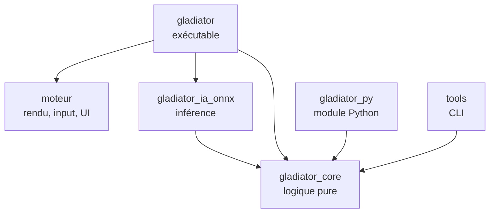

# Gladiator Manager — Feuille de route technique (Rust)

Version du 11 octobre 2026. Ce document remplace la partie technique du plan de conception du 27 septembre 2026 (architecture Godot, outils, feuille de route). Les règles du jeu (combattants, combat, économie, colisées, compétitions) restent décrites dans le plan de conception, qui demeure la référence pour le gameplay.

## Changement de cap

| Avant | Maintenant |
| --- | --- |
| Godot 4.7.2 .NET (C#) | Moteur maison en Rust, construit sur macroquad |
| Interface Godot (Control) | egui, avec un thème personnalisé |
| SubViewports | Render targets de macroquad |
| Godot RL Agents | Module Python compilé depuis Rust avec PyO3 + Stable-Baselines3 |
| ONNX dans Godot via C# | Crate `tract` (100 % Rust) |
| Steamworks.NET | Crate `steamworks` |
| Rider | VS Code + rust-analyzer |

Ce qui ne change pas : la règle d'or. La logique du jeu est séparée de l'affichage, pour pouvoir simuler sans rendu, entraîner l'IA et tester. En Rust, cette règle n'est plus une discipline : c'est le compilateur qui l'impose, puisque la crate de logique ne dépend d'aucune bibliothèque graphique.

## Pile technique

| Besoin | Choix | Remarque |
| --- | --- | --- |
| Langage | Rust stable, édition la plus récente | Installé avec `rustup` |
| Fenêtre, rendu, input, audio | macroquad | Simple, compile vite, Windows et Linux |
| Interface | egui (intégration macroquad) | Tableaux, listes, fiches, pop-ups ; thème à travailler |
| Hasard reproductible | `rand` + `rand_chacha` | Une graine par combat |
| Maths déterministes | `libm` | Mêmes résultats de `sin`, `sqrt`, etc. sur toutes les plateformes |
| Sérialisation | `serde`, `serde_json`, `ron` | JSON pour les sauvegardes, RON pour les données de design |
| Compression des sauvegardes | `flate2` | GZip, seulement si besoin |
| Historique volumineux | `rusqlite` | Seulement si le JSON devient trop lourd |
| Parallélisme des simulations | `rayon` | Simulation de masse, calibration |
| Rechargement à chaud des données | `notify` | Pratique pendant l'équilibrage |
| Inférence ML | `tract` (100 % Rust) | Derrière le trait commun d'IA ; préféré à `ort` en phase 0 : aucune bibliothèque native à livrer |
| Pont Python | `pyo3` + `maturin` | Le moteur de combat devient un module Python |
| Entraînement | Python, Gymnasium, Stable-Baselines3 (PPO) | Environnement virtuel `venv` |
| Steam | crate `steamworks` | Succès, sauvegarde cloud |
| Tests | `cargo test`, `proptest`, `insta` | Invariants, combats de référence |
| Mesures de performance | `criterion` | Vitesse de simulation |
| Qualité | `rustfmt`, `clippy` | Lancés en CI |
| Éditeur | VS Code + rust-analyzer + CodeLLDB | CodeLLDB pour le débogueur |
| Sprites | Aseprite ou LibreSprite, Kenney.nl, OpenGameArt | Export en spritesheets PNG |
| Versionnage | Git + Git LFS + GitHub | LFS pour les PNG, sons, fichiers Aseprite |

Toutes les versions de crates sont figées par le `Cargo.lock`, versionné dans le dépôt puisque le projet produit un exécutable.

## Moteur et jeu : un seul dépôt

### Décision

Un seul dépôt Git, organisé en **workspace Cargo** avec plusieurs crates. Le moteur et le jeu sont séparés en crates distinctes, pas en dépôts distincts.

### Pourquoi pas deux dépôts avec un fork

- Un fork sert à créer une copie qui diverge de l'original. Ici le jeu doit *utiliser* le moteur, pas en posséder une copie : on passerait son temps à synchroniser les deux.
- Au début, presque chaque fonctionnalité touche les deux côtés (une nouvelle animation demande du code moteur et du code jeu). Avec deux dépôts, chaque changement devient deux commits, deux pushes et une mise à jour de version.
- On ne sait pas encore ce qui est « générique » et ce qui est propre au jeu. Le découpage se clarifie en construisant le jeu.

### Ce qu'apporte le workspace

- La séparation reste stricte : `moteur` ne connaît pas `gladiator_core`, et `gladiator_core` ne connaît pas `moteur`. Toute dépendance interdite provoque une erreur de compilation.
- Un seul `cargo build`, un seul `cargo test`, un seul historique.
- Extraire le moteur plus tard reste simple.

### Si un jour le moteur doit vivre seul

Quand le moteur sera stable et réutilisé pour un autre projet :

1. Extraire son historique avec `git subtree split` ou `git filter-repo` vers un nouveau dépôt.
2. Publier des versions taguées (`v0.1.0`, `v0.2.0`…).
3. Dans le jeu, remplacer la dépendance locale par une dépendance Git :

```toml
# Aujourd'hui (workspace)
moteur = { path = "../moteur" }

# Plus tard (dépôt séparé)
moteur = { git = "https://github.com/<toi>/moteur", tag = "v0.2.0" }
```

Pas de fork, pas de sous-module Git : Cargo sait récupérer une dépendance depuis un dépôt et une version précise.

## Architecture du workspace

```
gladiator-manager/
├── Cargo.toml              # workspace, profils de compilation
├── Cargo.lock
├── crates/
│   ├── moteur/             # générique : boucle, sprites, animations, input, audio,
│   │                       # ressources, caméra, render targets, egui, pile d'écrans
│   ├── gladiator_core/     # logique pure : combat, IA scriptée, combattants, monde,
│   │                       # économie, classements, rivaux, sauvegarde
│   ├── gladiator_ia_onnx/  # inférence ONNX derrière le trait CombatAi
│   ├── gladiator/          # l'exécutable du jeu : écrans, rendu des combats, Steam
│   ├── gladiator_py/       # module Python (PyO3) pour l'entraînement
│   └── tools/              # binaires en ligne de commande
├── python/                 # environnement Gymnasium, entraînement, export ONNX
├── data/                   # classes, sorts, arènes, noms (RON)
├── assets/                 # sprites, sons, polices (Git LFS)
└── docs/                   # plan de conception, cette feuille de route
```

### Règles de dépendance



| Crate | Peut dépendre de | Ne doit jamais dépendre de |
| --- | --- | --- |
| `gladiator_core` | serde, rand, libm | macroquad, egui, tract, pyo3 |
| `moteur` | macroquad, egui | `gladiator_core` (il reste générique) |
| `gladiator_ia_onnx` | `gladiator_core`, tract | macroquad |
| `gladiator` | tout | — |
| `gladiator_py` | `gladiator_core`, pyo3 | macroquad, egui |
| `tools` | `gladiator_core`, rayon | macroquad |

### Modules de `gladiator_core`

| Module | Responsabilité |
| --- | --- |
| `state` | `GameState` : état global de la partie, point d'entrée de la sauvegarde |
| `calendar` | Semaines, saisons, grands événements, intersaison |
| `fighter` | Stats, forme, blessures, maladies, soins, progression, âge, retraite, mort |
| `combat` | Arène, déplacements, collisions, dégâts, sorts, équipement, pas de temps fixe |
| `ai` | Trait `CombatAi`, utility AI |
| `stat_model` | Résolution statistique des combats entre rivaux |
| `rivals` | Décisions hebdomadaires des clubs rivaux |
| `economy`, `market`, `staff` | Argent, achats, ventes, libérations, personnel |
| `rankings` | Elo par colisée, titres, défis, compétitions |
| `save` | JSON versionné, migrations entre versions |
| `achievements` | Succès du jeu, indépendants de Steam |
| `design_data` | Chargement des classes, sorts et arènes depuis `data/` |

### Principes Rust pour ce projet

- **Le code est en anglais.** Modules, types, fonctions, variables, constantes, tests, fichiers de code et commentaires sont en anglais. Restent en français : les textes affichés au joueur et les documents de `docs/`. Les abréviations des stats du plan de conception sont traduites (PV → `hp`, AC → `melee_attack`, AL → `ranged_attack`, VIT → `speed`, DC → `melee_defense`, DL → `ranged_defense`).
- **Des identifiants plutôt que des références.** Les combattants vivent dans des `Vec` ou des tables, et se désignent par un `FighterId(u32)`. Un combattant qui cible un adversaire stocke son identifiant, jamais une référence. C'est ce qui évite de se battre avec le borrow checker.
- **Une semaine est une fonction.** `fn next_week(state: &mut GameState, decisions: &Decisions)`. L'interface ne fait que construire les décisions et lire l'état.
- **Un combat est une fonction.** `fn tick(arena: &mut Arena, ais: &mut [Box<dyn CombatAi>])`. Le même code tourne à l'écran, en arrière-plan, dans les outils et dans Python.
- **Les données de design hors du code.** Classes, sorts et arènes en fichiers RON, rechargés à chaud pendant l'équilibrage.

### Déterminisme : les pièges à éviter

| Piège | Pourquoi | Parade |
| --- | --- | --- |
| `HashMap` / `HashSet` | Ordre de parcours aléatoire à chaque lancement | `BTreeMap`, `Vec` triés, ou un hasher fixe ; une règle clippy `disallowed_types` pour l'interdire dans `gladiator_core` |
| `f32::sin`, `sqrt`, etc. | Peuvent différer entre Windows et Linux | Passer par `libm` partout dans la logique |
| `thread_rng()` | Hasard non reproductible | Un seul `ChaCha8Rng` par combat, créé depuis la graine |
| Temps réel (`Instant::now`) | Dépend de la machine | La logique ne connaît que des ticks |
| Parallélisme | Ordre d'exécution variable | Paralléliser entre combats indépendants, jamais à l'intérieur d'un combat |

Ce point compte d'autant plus qu'une sauvegarde peut passer de Windows au Steam Deck par la sauvegarde cloud, et que les graines servent à revoir les combats.

### Boucle de jeu

La logique avance à cadence fixe (par exemple 30 ticks par seconde), l'IA décide quelques fois par seconde (par exemple 5), et l'affichage interpole entre deux ticks pour rester fluide à n'importe quelle fréquence d'écran. Les vitesses x2 et x4 exécutent simplement plus de ticks par image ; « passer au résultat » exécute tous les ticks restants sans rendu.

## Feuille de route

Le développement se fait en onze phases, chacune terminée par un jalon vérifiable. Par rapport au plan Godot, une phase est ajoutée (phase 2 : le socle du moteur). À la fin de la phase 6, le jeu est complet avec l'IA scriptée ; le machine learning arrive ensuite comme amélioration.

| Phase | Contenu | Jalon |
| --- | --- | --- |
| 0. Préparation | Outils, workspace, Git, trois prototypes techniques | Une fenêtre avec un sprite et un bouton egui ; Python importe le module Rust |
| 1. Combat de base | Moteur de combat en duel, sans affichage | La même graine redonne le même combat ; 10 000 duels simulés en ligne de commande |
| 2. Socle du moteur | Crate `moteur` : boucle, sprites, animations, UI, écrans | Le duel de la phase 1 s'affiche en sprites animés avec contrôles de vitesse |
| 3. Le combattant complet | Forme, blessures, maladies, personnalité, mort, progression | Un combattant enchaîne 10 semaines avec des effets visibles |
| 4. Management | Calendrier, économie, écrans principaux, sauvegarde | Une saison entière jouable avec un seul club |
| 5. Le monde | Colisées, Elo, rivaux, marché, personnel, modèle statistique | Plusieurs saisons où les classements vivent sans le joueur |
| 6. Formats et spectacle | Mêlée, King of the hill, équipement refusable, vue multi-combats | Regarder 4 combats du joueur en même temps |
| 7. IA apprenante | PyO3, Gymnasium, PPO en self-play, export et inférence ONNX | Le modèle appris bat nettement l'IA scriptée |
| 8. Grands événements | Championnat du monde, Inter-Coliseum, succès, tutoriel | Un cycle complet de 4 saisons avec les deux événements |
| 9. Contenu et équilibrage | Classes, sorts, arènes, simulations de masse, finitions | Taux de victoire par classe entre 45 et 55 % |
| 10. Publication Steam | Steamworks, page du magasin, builds, test Steam Deck | Le jeu est disponible gratuitement sur Steam |

### Phase 0 — Préparation

Objectif : un projet qui compile, et la preuve que les briques risquées fonctionnent ensemble avant d'écrire du gameplay.

- Installer `rustup`, VS Code, rust-analyzer, CodeLLDB, Git et Git LFS, Python 3 avec `venv`. Sous Linux, aussi les en-têtes ALSA (`libasound2-dev`), nécessaires à l'audio de macroquad ; la CI les installe.
- Si Rust est nouveau : lire les chapitres 1 à 10 du *Rust Book* (possession, emprunts, structs, enums, traits, gestion d'erreurs), puis les chapitres 13 et 15 au besoin.
- Créer le dépôt GitHub, le workspace et les crates vides.
- Configurer `.gitignore` (`target/`, `python/.venv/`, `*.onnx` de travail), `.gitattributes` (`* text=auto eol=lf` et les règles LFS pour `*.png`, `*.ogg`, `*.wav`, `*.aseprite`).
- Profil de développement rapide pour les dépendances, sinon les simulations seront lentes en debug :

```toml
[profile.dev.package."*"]
opt-level = 2
```

- Prototype 1 : une fenêtre macroquad qui affiche un sprite Kenney et un bouton egui. Vérifier tout de suite la compatibilité des versions entre macroquad et l'intégration egui. Fait : macroquad 0.4.16 avec egui-macroquad 0.17.3 (egui 0.31.1), figés par `Cargo.lock`. egui-macroquad suit egui avec retard, donc ne pas mettre egui à jour séparément.
- Prototype 2 : un module PyO3 minimal (`gladiator_py.addition(1, 2)`) compilé avec `maturin develop`, importé depuis Python. Fait : `lanista_py.addition`, compilé avec `maturin develop`.
- Prototype 3 : charger un petit modèle ONNX factice avec `ort`, puis avec `tract`, sous Windows et Linux. Fait : les deux fonctionnent ; `tract` est retenu (100 % Rust, lié statiquement, rien à livrer avec le jeu) et `ort` est retiré. Aucun des deux ne garantit des flottants identiques d'un processeur à l'autre (noyaux SIMD choisis à l'exécution) : en phase 7, enregistrer les décisions de l'IA dans les replays, ou écrire l'inférence du MLP à la main.
- CI GitHub Actions : `cargo fmt --check`, `cargo clippy`, `cargo test` sous Windows et Linux.
- Convention Git : `main` toujours fonctionnelle, commits directs sur `main` jusqu’à la publication, puis une branche par fonctionnalité, un tag par phase (`phase-0`, `phase-1`…).

**Jalon :** `cargo run -p gladiator` ouvre une fenêtre avec un sprite et un bouton ; `python -c "import gladiator_py"` fonctionne ; la CI est verte. Atteint : tag `phase-0`.

### Phase 1 — Combat de base

Objectif : le cœur du jeu, sans aucun affichage. Tout se passe dans `gladiator_core` et `tools`.

- Structures `Arena`, `Fighter` (version simple : six stats, classe, deux ressources : mana et endurance), `FighterId`. Fait : `fighter.rs` et `combat.rs` ; la classe est un `ClassId` qui renverra aux données de `data/`.
- Pas de temps fixe, déplacements, collisions cercle contre cercle, bords de l'arène. Fait : `combat::tick`, 30 ticks par seconde, décision des IA tous les 6 ticks (5 par seconde), arène rectangulaire, un seul rayon et une seule échelle de vitesse (`VIT × 0,1 m/s`) pour tous en attendant `data/` ; trait `CombatAi` minimal dans `ai` (actions : `Wait`, `Move`).
- Formule de dégâts du plan de conception (attaque × 100 / (100 + défense)). Fait : `combat::damage` (AC contre DC au corps à corps, AL contre DL à distance), en entiers arrondis vers le haut pour qu'une attaque non nulle inflige toujours au moins 1 ; `Fighter::take_damage` retire les PV sans passer sous 0. Aucune action d'attaque dans `tick` pour l'instant : portée et cadence viendront avec les classes et les sorts.
- 2 classes, 3 sorts chacune, avec temps de recharge et coût en ressource, décrits dans `data/` en RON. Fait : `data/classes.ron` (Mirmillon au corps à corps sur l'endurance, Augure à distance surtout sur le mana ; valeurs provisoires), lu par le module `design_data` (serde + ron, champs inconnus refusés). Chaque sort a une portée de dégâts (corps à corps ou distance), une allonge en mètres, une puissance en % de la formule de dégâts, un temps de recharge en ticks et un coût en mana ou en endurance. `ClassId(i)` désigne la i-ème classe du fichier. Les sorts ne sont pas encore lancés en combat.
- Trait `CombatAi` et une utility AI : chaque action reçoit un score, la meilleure est jouée. Fait : `ai::UtilityAi` vise l'ennemi vivant le plus proche ; attendre vaut 0, un sort lançable (prêt, payable, cible à portée) vaut ses dégâts, se rapprocher vaut 1 et n'est proposé que si aucun sort n'atteint la cible ; à égalité, la première action l'emporte. Pour que l'IA ait de quoi choisir, les sorts se lancent en combat : action `Cast { spell, target }`, chaque `Fighter` copie les sorts de sa classe et tient un temps de recharge par sort, `tick` décompte les recharges puis résout les sorts dans l'ordre des indices (dépense de la ressource, dégâts = formule × puissance / 100, arrondis vers le haut). L'allonge se mesure entre les bords des deux combattants. Pas encore de régénération du mana ni de l'endurance, et les combattants à distance ne gardent pas leurs distances.
- Graine par combat, `ChaCha8Rng`, règles de déterminisme appliquées dès le premier jour. Fait : `Arena::new` prend une graine `u64` et garde `seed` et `rng` (`ChaCha8Rng::seed_from_u64`), seule source de hasard du combat. Seule `rand_chacha` est ajoutée : en version 0.10 elle ne sait pas tirer une graine du système, donc aucun hasard non reproductible n'est possible. `rand` viendra quand il faudra des tirages dans un intervalle. Un test fige les premiers tirages de la graine 42 : la CI vérifie qu'ils sont les mêmes sous Windows et Linux.
- Journal d'événements du combat (qui frappe qui, dégâts, sorts) et compte rendu simple. Fait : module `log`. `Arena::log` reçoit un `Event` par sort lancé (tick, lanceur, cible, sort, PV réellement perdus) et par mort. `Report::new` en tire le compte rendu : durée, vainqueur, puis pour chaque combattant les PV restants, les dégâts infligés et reçus et le nombre de sorts lancés. `log_text` et l'affichage de `Report` donnent un texte qui ne contient que des entiers, donc identique sous Windows et Linux. `combat::run` joue le combat jusqu'à la fin ou jusqu'à une limite de ticks.
- Outil `simulate --seed 42` : affiche le déroulé et le résultat dans le terminal. Fait : crate `tools`, binaire `simulate` (graine 42 par défaut). Comme le combat ne tire encore aucun hasard, la graine choisit la mise en place : classes des deux combattants, au hasard, et points de départ, l'un dans le quart gauche, l'autre dans le quart droit d'une arène de 20 × 20 m. Tous ont les mêmes stats (`tools::STATS`) pour que seules les classes comptent. `data/classes.ron` est lu à l'exécution : rééquilibrer ne demande pas de recompiler.
- Outil `batch --fights 10000` avec `rayon` : taux de victoire par classe, durée moyenne. C'est la parade au risque d'équilibrage, en place dès maintenant. Fait : binaire `batch`, graines 0 à n − 1, combats en parallèle, résultats additionnés dans l'ordre des graines, donc identiques d'un lancement à l'autre. Un duel miroir compte pour les deux combattants. Il affiche aussi les combats sans vainqueur après une minute et ceux sans survivant. Premier résultat (10 000 combats, en release en moins d'une seconde) : Augure 75 %, Mirmillon 24 %, 6,5 s en moyenne.
- Tests : combats de référence avec `insta` (une graine donnée produit toujours le même journal), invariants avec `proptest` (les PV ne dépassent jamais le maximum, un combat se termine toujours). Fait pour `insta` : `crates/lanista_core/tests/reference_fights.rs` fige le journal et le compte rendu de deux duels entre utility AI (Mirmillon contre Augure, Mirmillon contre Mirmillon, graine 42). Les snapshots sont dans `tests/snapshots/`. Fait pour `proptest` : `crates/lanista_core/tests/invariants.rs` joue des duels entre utility AI aux classes, positions et graines tirées au hasard. Avec des stats au hasard, à chaque tick, les PV, le mana et l’endurance ne dépassent jamais leur maximum et les combattants restent dans l’arène. Avec les stats égales des outils, le combat se termine toujours avant une minute. Ce dernier point n’est pas vrai pour des stats quelconques : sans régénération, deux combattants peuvent épuiser leurs ressources sans que l’un tombe.

**Jalon :** deux combattants s'affrontent ; la même graine redonne exactement le même combat ; 10 000 duels sont simulés et les taux de victoire s'affichent. Atteint : tag `phase-1`.

### Phase 2 — Socle du moteur

Objectif : la crate `moteur`, générique, et un premier rendu du combat.

- Boucle de jeu à cadence fixe avec interpolation de l'affichage. Fait : `reesch::FixedStep`. `advance(temps de l'image)` accumule le temps réel et renvoie le nombre de ticks logiques à jouer ; `alpha()` donne la fraction de tick écoulée, dans [0, 1), pour interpoler l'affichage. La cadence est passée par le jeu (`TICKS_PER_SECOND` de `lanista_core`), puisque `reesch` ne connaît pas `lanista_core`. Une image compte au plus 0,25 s : après un blocage (fenêtre déplacée, point d'arrêt), la logique ralentit au lieu d'enchaîner des centaines de ticks. Les vitesses x2 et x4 multiplieront le nombre de ticks renvoyé.
- Gestionnaire de ressources : textures, spritesheets, sons, polices, chargés une fois et désignés par un identifiant. Fait : `reesch::Assets`. L'identifiant est le chemin du fichier sous le dossier `assets/` (`set_pc_assets_folder`), comme les données RON le désigneront. `load_texture`, `load_sound` et `load_font` chargent un fichier s'il ne l'est pas déjà ; `texture`, `sound` et `font` le retrouvent, et paniquent s'il n'a pas été chargé, puisque c'est une erreur de programmation. Les textures sont en filtrage « nearest » (pixel art), une spritesheet est une texture (le découpage viendra avec les animations), une police est gardée en octets pour egui. Tout se charge avant `reesch::run(assets, premier écran)`, qui passe `&Assets` à `update` et `draw` de chaque écran. Le dossier `assets/` est relatif au répertoire courant : à résoudre à côté de l'exécutable pour la publication Steam.
- Animations par spritesheet : découpage en frames, durée par frame, boucle ou non, événements (impact, fin d'animation). Fait : module `reesch::animation`. `SpriteSheet` découpe une texture en grille de frames égales, numérotées de gauche à droite puis de haut en bas (`frame_rect` donne le rectangle source). `Animation` décrit des frames consécutives : première frame, nombre, durée par frame en secondes, boucle ou non, et des marqueurs nommés (`impact`…) déclenchés au début d'une frame. `AnimationPlayer`, un par entité affichée, avance du temps de l'image et renvoie les événements franchis, dans l'ordre, même si une image en saute plusieurs : `Marker(nom)` et, pour une animation sans boucle, `Finished`, après quoi elle reste sur sa dernière frame. Les animations ne servent qu'à l'affichage et avancent en temps réel ; la logique ne dépend jamais d'elles. Les définitions sont en code pour l'instant ; elles passeront en RON avec les sprites des combattants.
- Input clavier, souris et manette (Steam Deck).
- Caméra 2D, mise à l'échelle selon la résolution, gestion du 16:10 du Steam Deck.
- Audio : effets sonores et musique, volumes séparés.
- Intégration egui et un premier thème (couleurs, polices, tailles adaptées au Steam Deck). Fait pour l'intégration : `reesch` dépend d'egui-macroquad et réexporte sa version d'egui (`reesch::egui`), que le jeu utilise sans dépendre d'egui lui-même. `reesch::run(premier écran)` est la boucle de jeu : une passe egui par image, où l'écran du dessus reçoit le `egui::Context` dans `update`, puis `draw` de l'écran, egui par-dessus, image suivante ; elle s'arrête quand la pile est vide. Le prototype de la phase 0 est devenu un écran de `lanista`, avec un bouton « Quitter ».
- Pile d'écrans : empiler, remplacer, revenir en arrière ; chaque écran a `update` et `draw`. Fait : module `reesch::screen`. Le trait `Screen` a `update`, qui renvoie une `Transition` (`None`, `Push`, `Replace`, `Pop`), et `draw`. L'interface egui se construit dans `update`, puisque ses clics décident de la transition ; egui est dessiné par-dessus après `draw`. `ScreenStack` ne met à jour et ne dessine que l'écran du dessus ; quand le dernier écran est retiré, la pile est vide et le jeu peut quitter. Les écrans ne partagent pas encore d'état (le `GameState` viendra en phase 4).
- Dans `gladiator` : un écran de combat qui lit l'état de l'arène et l'affiche en sprites animés, avec les contrôles x1, x2, x4 et « passer au résultat ».

**Jalon :** le duel de la phase 1 se regarde à l'écran en sprites animés, avec les contrôles de vitesse ; le résultat est identique à celui de l'outil en ligne de commande pour la même graine.

### Phase 3 — Le combattant complet

- Forme (0 à 100) et formule de risque du plan de conception.
- Blessures avec localisation et gravité, main dominante, blessures permanentes.
- Maladies sur trois niveaux.
- Soins décidés par le joueur.
- Personnalité (agressivité, prudence, goût du spectacle, détermination), seuil d'abandon, mort.
- Moral, renommée.
- Progression sans niveaux, potentiel caché, effets de l'âge, retraite décidée par le combattant.
- Tous ces éléments deviennent des entrées de l'utility AI : un combattant blessé ou peureux se bat différemment.
- Représentation de la mort à l'écran : tache de sang et petite animation.
- Outil `career --seed 7 --weeks 10` pour suivre un combattant en ligne de commande.

**Jalon :** un combattant enchaîne 10 semaines avec des effets visibles (forme, blessure, guérison, progression), à l'écran comme dans l'outil.

### Phase 4 — Management

- `GameState` et `next_week`.
- Calendrier : semaines, saison de 33 semaines, phases de la saison.
- Économie : flux d'entrée et de sortie, filet de sécurité (free agents, colisée gratuit).
- Écrans : menu général, liste des combattants, fiche combattant, résumé de combat.
- Sauvegarde : JSON avec numéro de version, fonction de migration par version, sauvegarde automatique après chaque combat regardé, sauvegarde manuelle. Emplacement par plateforme avec la crate `directories`.
- Tests de sauvegarde : une partie sauvegardée puis rechargée donne exactement le même état ; des fichiers de sauvegarde anciens sont gardés dans les tests pour vérifier les migrations.

**Jalon :** une saison entière jouable avec un seul club, sauvegarde et rechargement compris.

### Phase 5 — Le monde

- Colisées : type d'arène, prestige, classement, champion. Commencer avec 2 colisées.
- Elo par colisée, top 50 affiché, adaptation à la mêlée selon l'ordre d'élimination.
- Titres de champion et défenses obligatoires.
- Défis proposés et reçus.
- Clubs rivaux avec profils (prudent, agressif, marchand) et règles hebdomadaires.
- Marché : achat, vente, free agents, rookies, fourchettes d'observation.
- Personnel : entraîneur, médecin, recruteur, niveaux 1 à 5.
- Modèle statistique : l'outil `calibrate` lance des milliers de combats, enregistre les résultats et ajuste une régression logistique (vainqueur), puis des tables de probabilités (blessures, morts). Les coefficients sont exportés dans `data/` et lus par `stat_model`.
- Outil `compare` : vérifie que les taux de victoire, de blessure et de mort sont proches entre vrais combats et modèle statistique.
- Écrans : colisées, marché, personnel.

**Jalon :** plusieurs saisons s'enchaînent où les classements, les champions et les marchés évoluent sans intervention du joueur.

### Phase 6 — Formats et spectacle

- Mêlée de 3 à 20 et King of the hill, sans alliance entre combattants d'un même club.
- Équipement refusable, malus et bonus de renommée.
- Types d'arène : sable qui ralentit, piliers qui bloquent les tirs, arène étroite.
- Render targets dans `reesch` : dessiner une scène dans une texture (repoussé de la phase 2, dont le jalon n'en a pas besoin).
- Vue multi-combats : un combat principal en grand, les autres dans des render targets en vignettes cliquables.
- Optimisations : IA appelée quelques fois par seconde, regroupement des sprites, mesure avec `criterion` d'une mêlée à 20.

**Jalon :** regarder 4 combats du joueur en même temps, dont une mêlée à 20, sans ralentissement. **Le jeu est complet avec l'IA scriptée.**

### Phase 7 — IA apprenante

- `gladiator_py` expose une classe `Environment` : `reset(seed)`, `step(actions)`, observation, récompense, fin de combat. Compilée avec `maturin` en mode `abi3` pour ne pas dépendre d'une version précise de Python.
- Côté Python, une enveloppe Gymnasium autour de cet environnement, et plusieurs environnements en parallèle.
- Observation : stats, forme, blessures, maladie, personnalité, moral, équipement, arène, ressources et sorts, puis les 4 adversaires et 4 alliés les plus proches.
- Récompenses : dégâts infligés, victoire, légère pénalité de temps. Revoir régulièrement des combats pour détecter les comportements absurdes.
- Entraînement PPO avec Stable-Baselines3 en self-play, contre d'anciennes versions et contre l'utility AI. Ordre : duel, puis mêlée, puis équipe.
- Un modèle par classe, exporté en ONNX, versionné (un modèle peu entraîné pour les recrues, le plus abouti pour les vétérans).
- `gladiator_ia_onnx` implémente `CombatAi` : action la plus probable, pour rester déterministe.
- Le jeu fonctionne toujours avec l'utility AI si un modèle est absent.

**Jalon :** sur 10 000 duels, le modèle appris bat nettement l'IA scriptée, et un combat avec IA ONNX reste reproductible avec sa graine.

### Phase 8 — Grands événements

- Championnat du monde (saisons 4, 8, 12…) : poules puis élimination directe.
- Inter-Coliseum (saisons impaires) en 5 contre 5, convocations, choix en cas de double convocation.
- Intersaison : vieillissement, retraites, rookies, marché ouvert.
- Succès du jeu dans `gladiator_core`, sans dépendre de Steam.
- Tutoriel par déblocage progressif et manuel du jeu.

**Jalon :** un cycle complet de 4 saisons avec les deux événements, joué du début à la fin.

### Phase 9 — Contenu et équilibrage

- Nouvelles classes et sorts, nouvelles arènes, monde à sa taille définitive.
- Équilibrage par simulations de masse, avec rechargement à chaud des fichiers RON.
- Recalibrage du modèle statistique et réentraînement des modèles ML après chaque changement important.
- Finitions : sons, effets visuels, thème egui, lisibilité sur Steam Deck.

**Jalon :** taux de victoire de chaque classe entre 45 et 55 %, et écart réduit entre modèle statistique et vrais combats.

### Phase 10 — Publication Steam

- Compte Steamworks, 100 $ de Steam Direct.
- Intégration de la crate `steamworks` : succès, sauvegarde cloud. Le jeu doit aussi se lancer sans Steam.
- Build Windows.
- Build Linux compilé dans le conteneur Steam Runtime (version *sniper*), pour éviter les problèmes de version de glibc.
- Test sur Steam Deck : contrôles à la manette, taille du texte, résolution 1280×800, objectif de compatibilité « Vérifié ».
- Page du magasin, captures, branche bêta pour les tests.
- CI optionnelle : construction des builds et envoi sur la branche bêta.

**Jalon :** le jeu est disponible gratuitement sur Steam.

## Risques

| Risque | Conséquence | Parade |
| --- | --- | --- |
| Apprentissage de Rust | Phases 0 et 1 plus lentes | Phase 1 sans affichage, idéale pour apprendre ; identifiants plutôt que références |
| Portée trop large pour un développeur seul | Projet jamais terminé | Respecter l'ordre des phases, 2 classes et 2 colisées au départ ; le moteur ne contient que ce dont le jeu a besoin |
| Moteur qui grossit pour lui-même | Le jeu n'avance plus | Toute fonctionnalité du moteur doit servir une phase du jeu en cours |
| Compatibilité macroquad / egui | Blocage à la mise à jour | Vérifier en phase 0, figer les versions, solution de repli avec egui sur miniquad |
| Interface sous-estimée | Retard général | Écrans inclus explicitement dans chaque phase, thème egui commencé en phase 2 |
| Déterminisme cassé | Graines qui ne redonnent pas le même combat | `libm`, pas de `HashMap` dans la logique, tests de combats de référence en CI sous Windows et Linux |
| Pont PyO3 et versions de Python | Module qui ne se charge plus | Mode `abi3`, environnement virtuel figé dans `requirements.txt` |
| Distribution d'ONNX Runtime | Jeu qui ne se lance pas sur Linux ou Steam Deck | Tester tôt, `tract` en solution de secours |
| Entraînement ML lent ou instable | Phase 7 qui s'éternise | Jeu complet dès la phase 6 avec l'IA scriptée |
| Récompenses mal conçues | Comportements absurdes | Récompenses simples, revoir des combats régulièrement |
| Performances en mêlée à 20 avec multi-vue | Ralentissements | IA à basse fréquence, mesures `criterion`, nombre de vignettes limité |
| Écart entre modèle statistique et vrais combats | Résultats incohérents | Outil `compare`, recalibrage après chaque changement d'équilibrage |
| Temps de compilation | Itérations lentes | Workspace découpé, profil dev optimisé pour les dépendances, données en RON hors du code |

## Points encore ouverts

- [ ] Taille du monde : nombre de colisées et de clubs rivaux.
- [ ] Liste des classes et de leurs sorts.
- [ ] Calendrier des grands événements : confirmer l'Inter-Coliseum aux saisons impaires.
- [x] `ort` ou `tract` pour l'inférence : `tract`, tranché en phase 0.
- [x] Cadence de la logique et fréquence de décision de l'IA : 30 ticks par seconde, 5 décisions par seconde, retenus en phase 1 (à revoir si l'équilibrage l'exige).
- [ ] Extraction du moteur dans son propre dépôt : à reconsidérer après la publication, pas avant.
