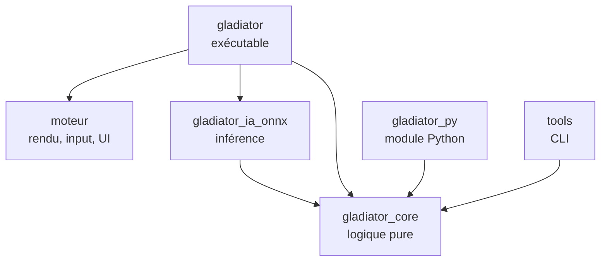

# Gladiator Manager — Feuille de route technique (Rust)

Version du 11 octobre 2026. Ce document remplace la partie technique du plan de conception du 27 septembre 2026 (architecture Godot, outils, feuille de route). Les règles du jeu (combattants, combat, économie, colisées, compétitions) restent décrites dans le plan de conception, qui demeure la référence pour le gameplay.

## Changement de cap

| Avant | Maintenant |
| --- | --- |
| Godot 4.7.2 .NET (C#) | Moteur maison en Rust, construit sur macroquad |
| Interface Godot (Control) | egui, avec un thème personnalisé |
| SubViewports | Render targets de macroquad |
| Godot RL Agents | Module Python compilé depuis Rust avec PyO3 + Stable-Baselines3 |
| ONNX dans Godot via C# | Crate `tract` (100 % Rust) |
| Steamworks.NET | Crate `steamworks` |
| Rider | VS Code + rust-analyzer |

Ce qui ne change pas : la règle d'or. La logique du jeu est séparée de l'affichage, pour pouvoir simuler sans rendu, entraîner l'IA et tester. En Rust, cette règle n'est plus une discipline : c'est le compilateur qui l'impose, puisque la crate de logique ne dépend d'aucune bibliothèque graphique.

## Pile technique

| Besoin | Choix | Remarque |
| --- | --- | --- |
| Langage | Rust stable, édition la plus récente | Installé avec `rustup` |
| Fenêtre, rendu, input, audio | macroquad | Simple, compile vite, Windows et Linux |
| Interface | egui (intégration macroquad) | Tableaux, listes, fiches, pop-ups ; thème à travailler |
| Hasard reproductible | `rand` + `rand_chacha` | Une graine par combat |
| Maths déterministes | `libm` | Mêmes résultats de `sin`, `sqrt`, etc. sur toutes les plateformes |
| Sérialisation | `serde`, `serde_json`, `ron` | JSON pour les sauvegardes, RON pour les données de design |
| Compression des sauvegardes | `flate2` | GZip, seulement si besoin |
| Historique volumineux | `rusqlite` | Seulement si le JSON devient trop lourd |
| Parallélisme des simulations | `rayon` | Simulation de masse, calibration |
| Rechargement à chaud des données | `notify` | Pratique pendant l'équilibrage |
| Inférence ML | `tract` (100 % Rust) | Derrière le trait commun d'IA ; préféré à `ort` en phase 0 : aucune bibliothèque native à livrer |
| Pont Python | `pyo3` + `maturin` | Le moteur de combat devient un module Python |
| Entraînement | Python, Gymnasium, Stable-Baselines3 (PPO) | Environnement virtuel `venv` |
| Steam | crate `steamworks` | Succès, sauvegarde cloud |
| Tests | `cargo test`, `proptest`, `insta` | Invariants, combats de référence |
| Mesures de performance | `criterion` | Vitesse de simulation |
| Qualité | `rustfmt`, `clippy` | Lancés en CI |
| Éditeur | VS Code + rust-analyzer + CodeLLDB | CodeLLDB pour le débogueur |
| Sprites | Aseprite, Kenney.nl, OpenGameArt | Export en spritesheets PNG, formats dans [Formats_graphiques.md](Formats_graphiques.md) |
| Versionnage | Git + Git LFS + GitHub | LFS pour les PNG, sons, fichiers Aseprite |

Toutes les versions de crates sont figées par le `Cargo.lock`, versionné dans le dépôt puisque le projet produit un exécutable.

## Moteur et jeu : un seul dépôt

### Décision

Un seul dépôt Git, organisé en **workspace Cargo** avec plusieurs crates. Le moteur et le jeu sont séparés en crates distinctes, pas en dépôts distincts.

### Pourquoi pas deux dépôts avec un fork

- Un fork sert à créer une copie qui diverge de l'original. Ici le jeu doit *utiliser* le moteur, pas en posséder une copie : on passerait son temps à synchroniser les deux.
- Au début, presque chaque fonctionnalité touche les deux côtés (une nouvelle animation demande du code moteur et du code jeu). Avec deux dépôts, chaque changement devient deux commits, deux pushes et une mise à jour de version.
- On ne sait pas encore ce qui est « générique » et ce qui est propre au jeu. Le découpage se clarifie en construisant le jeu.

### Ce qu'apporte le workspace

- La séparation reste stricte : `moteur` ne connaît pas `gladiator_core`, et `gladiator_core` ne connaît pas `moteur`. Toute dépendance interdite provoque une erreur de compilation.
- Un seul `cargo build`, un seul `cargo test`, un seul historique.
- Extraire le moteur plus tard reste simple.

### Si un jour le moteur doit vivre seul

Quand le moteur sera stable et réutilisé pour un autre projet :

1. Extraire son historique avec `git subtree split` ou `git filter-repo` vers un nouveau dépôt.
2. Publier des versions taguées (`v0.1.0`, `v0.2.0`…).
3. Dans le jeu, remplacer la dépendance locale par une dépendance Git :

```toml
# Aujourd'hui (workspace)
moteur = { path = "../moteur" }

# Plus tard (dépôt séparé)
moteur = { git = "https://github.com/<toi>/moteur", tag = "v0.2.0" }
```

Pas de fork, pas de sous-module Git : Cargo sait récupérer une dépendance depuis un dépôt et une version précise.

## Architecture du workspace

```
gladiator-manager/
├── Cargo.toml              # workspace, profils de compilation
├── Cargo.lock
├── crates/
│   ├── moteur/             # générique : boucle, sprites, animations, input, audio,
│   │                       # ressources, caméra, render targets, egui, pile d'écrans
│   ├── gladiator_core/     # logique pure : combat, IA scriptée, combattants, monde,
│   │                       # économie, classements, rivaux, sauvegarde
│   ├── gladiator_ia_onnx/  # inférence ONNX derrière le trait CombatAi
│   ├── gladiator/          # l'exécutable du jeu : écrans, rendu des combats, Steam
│   ├── gladiator_py/       # module Python (PyO3) pour l'entraînement
│   └── tools/              # binaires en ligne de commande
├── python/                 # environnement Gymnasium, entraînement, export ONNX
├── data/                   # classes, sorts, arènes, noms (RON)
├── assets/                 # sprites, sons, polices (Git LFS)
└── docs/                   # plan de conception, cette feuille de route
```

### Règles de dépendance



| Crate | Peut dépendre de | Ne doit jamais dépendre de |
| --- | --- | --- |
| `gladiator_core` | serde, rand, libm | macroquad, egui, tract, pyo3 |
| `moteur` | macroquad, egui | `gladiator_core` (il reste générique) |
| `gladiator_ia_onnx` | `gladiator_core`, tract | macroquad |
| `gladiator` | tout | — |
| `gladiator_py` | `gladiator_core`, pyo3 | macroquad, egui |
| `tools` | `gladiator_core`, rayon | macroquad |

### Modules de `gladiator_core`

| Module | Responsabilité |
| --- | --- |
| `state` | `GameState` : état global de la partie, point d'entrée de la sauvegarde |
| `calendar` | Semaines, saisons, grands événements, intersaison |
| `fighter` | Stats, forme, blessures, maladies, soins, progression, âge, retraite, mort |
| `combat` | Arène, déplacements, collisions, dégâts, sorts, équipement, pas de temps fixe |
| `ai` | Trait `CombatAi`, utility AI |
| `stat_model` | Résolution statistique des combats entre rivaux |
| `rivals` | Profils, effectifs et décisions hebdomadaires des clubs rivaux |
| `economy`, `market`, `staff` | Argent, achats, ventes, libérations, personnel |
| `colosseum` | Colisées, résidents, classement Elo, champion et défis de chaque colisée |
| `rankings` | Titres, défis, compétitions |
| `save` | JSON versionné, migrations entre versions |
| `achievements` | Succès du jeu, indépendants de Steam |
| `design_data` | Chargement des classes, sorts et arènes depuis `data/` |

### Principes Rust pour ce projet

- **Le code est en anglais.** Modules, types, fonctions, variables, constantes, tests, fichiers de code et commentaires sont en anglais. Restent en français : les textes affichés au joueur et les documents de `docs/`. Les abréviations des stats du plan de conception sont traduites (PV → `hp`, AC → `melee_attack`, AL → `ranged_attack`, VIT → `speed`, DC → `melee_defense`, DL → `ranged_defense`).
- **Des identifiants plutôt que des références.** Les combattants vivent dans des `Vec` ou des tables, et se désignent par un `FighterId(u32)`. Un combattant qui cible un adversaire stocke son identifiant, jamais une référence. C'est ce qui évite de se battre avec le borrow checker.
- **Une semaine est une fonction.** `fn next_week(state: &mut GameState, decisions: &Decisions)`. L'interface ne fait que construire les décisions et lire l'état.
- **Un combat est une fonction.** `fn tick(arena: &mut Arena, ais: &mut [Box<dyn CombatAi>])`. Le même code tourne à l'écran, en arrière-plan, dans les outils et dans Python.
- **Les données de design hors du code.** Classes, sorts et arènes en fichiers RON, rechargés à chaud pendant l'équilibrage.

### Déterminisme : les pièges à éviter

| Piège | Pourquoi | Parade |
| --- | --- | --- |
| `HashMap` / `HashSet` | Ordre de parcours aléatoire à chaque lancement | `BTreeMap`, `Vec` triés, ou un hasher fixe ; une règle clippy `disallowed_types` pour l'interdire dans `gladiator_core` |
| `f32::sin`, `sqrt`, etc. | Peuvent différer entre Windows et Linux | Passer par `libm` partout dans la logique |
| `thread_rng()` | Hasard non reproductible | Un seul `ChaCha8Rng` par combat, créé depuis la graine |
| Temps réel (`Instant::now`) | Dépend de la machine | La logique ne connaît que des ticks |
| Parallélisme | Ordre d'exécution variable | Paralléliser entre combats indépendants, jamais à l'intérieur d'un combat |

Ce point compte d'autant plus qu'une sauvegarde peut passer de Windows au Steam Deck par la sauvegarde cloud, et que les graines servent à revoir les combats.

### Boucle de jeu

La logique avance à cadence fixe (par exemple 30 ticks par seconde), l'IA décide quelques fois par seconde (par exemple 5), et l'affichage interpole entre deux ticks pour rester fluide à n'importe quelle fréquence d'écran. Les vitesses x0,5, x1 et x1,5 exécutent simplement moins ou plus de ticks par image ; « passer au résultat » exécute tous les ticks restants sans rendu.

## Feuille de route

Le développement se fait en onze phases (0 à 10), plus les phases 5 bis et 6 bis, chacune terminée par un jalon vérifiable. Par rapport au plan Godot, une phase est ajoutée (phase 2 : le socle du moteur). À la fin de la phase 6, le jeu est complet avec l'IA scriptée ; le machine learning arrive ensuite comme amélioration.

| Phase | Contenu | Jalon |
| --- | --- | --- |
| 0. Préparation | Outils, workspace, Git, trois prototypes techniques | Une fenêtre avec un sprite et un bouton egui ; Python importe le module Rust |
| 1. Combat de base | Moteur de combat en duel, sans affichage | La même graine redonne le même combat ; 10 000 duels simulés en ligne de commande |
| 2. Socle du moteur | Crate `moteur` : boucle, sprites, animations, UI, écrans | Le duel de la phase 1 s'affiche en sprites animés avec contrôles de vitesse |
| 3. Le combattant complet | Forme, blessures, maladies, personnalité, mort, progression | Un combattant enchaîne 10 semaines avec des effets visibles |
| 4. Management | Calendrier, économie, écrans principaux, sauvegarde | Une saison entière jouable avec un seul club |
| 5. Le monde | Colisées, Elo, rivaux, marché, personnel, modèle statistique | Plusieurs saisons où les classements vivent sans le joueur |
| 5 bis. Précision et personnel | Précision en combat, blessures à la tête sur la précision, étourdissement selon l'arme, personnel sur le marché et chez les rivaux, mortalité revue, free agents qui combattent, niveaux de richesse des clubs | Une blessure à la tête fait rater des coups ; les rivaux engagent du personnel sur le marché ; les libérations de l'intersaison arrivent |
| 6. Formats et spectacle | Mêlée (King of the hill) d'ouverture de saison, équipement refusable, types d'arène, apparence, vue multi-combats | Regarder 3 combats du joueur en même temps, dont une mêlée à 20 |
| 6 bis. Un monde vivant | Des dizaines de clubs générés aux influences du monde entier, colisées sur cinq continents, relations entre clubs, rivalités déclarées | Trois saisons où un club devient rival du joueur par ce qui s'est passé entre eux, et où un club ferme et un autre se crée |
| 7. IA apprenante | PyO3, Gymnasium, PPO en self-play, export et inférence ONNX | Le modèle appris bat nettement l'IA scriptée |
| 8. Grands événements | Championnat du monde, Inter-Coliseum, succès, tutoriel | Un cycle complet de 4 saisons avec les deux événements |
| 9. Contenu et équilibrage | Classes, sorts, arènes, simulations de masse, finitions | Taux de victoire par classe entre 45 et 55 % |
| 10. Publication Steam | Steamworks, page du magasin, builds, test Steam Deck | Le jeu est disponible gratuitement sur Steam |

### Phase 0 — Préparation

Objectif : un projet qui compile, et la preuve que les briques risquées fonctionnent ensemble avant d'écrire du gameplay.

- Installer `rustup`, VS Code, rust-analyzer, CodeLLDB, Git et Git LFS, Python 3 avec `venv`. Sous Linux, aussi les en-têtes ALSA (`libasound2-dev`), nécessaires à l'audio de macroquad ; la CI les installe.
- Si Rust est nouveau : lire les chapitres 1 à 10 du *Rust Book* (possession, emprunts, structs, enums, traits, gestion d'erreurs), puis les chapitres 13 et 15 au besoin.
- Créer le dépôt GitHub, le workspace et les crates vides.
- Configurer `.gitignore` (`target/`, `python/.venv/`, `*.onnx` de travail), `.gitattributes` (`* text=auto eol=lf` et les règles LFS pour `*.png`, `*.ogg`, `*.wav`, `*.aseprite`).
- Profil de développement rapide pour les dépendances, sinon les simulations seront lentes en debug :

```toml
[profile.dev.package."*"]
opt-level = 2
```

- Profil de publication : `lto = "thin"` et `codegen-units = 1` dans `[profile.release]`, pour `batch` et le build Steam. Version minimale de Rust déclarée dans `[workspace.package]` (`rust-version = "1.91"`, la plus haute exigée par les dépendances, `tract`), héritée par chaque crate avec `rust-version.workspace = true`.

- Prototype 1 : une fenêtre macroquad qui affiche un sprite Kenney et un bouton egui. Vérifier tout de suite la compatibilité des versions entre macroquad et l'intégration egui. Fait : macroquad 0.4.16 avec egui-macroquad 0.17.3 (egui 0.31.1), figés par `Cargo.lock`. egui-macroquad suit egui avec retard, donc ne pas mettre egui à jour séparément.
- Prototype 2 : un module PyO3 minimal (`gladiator_py.addition(1, 2)`) compilé avec `maturin develop`, importé depuis Python. Fait : `lanista_py.addition`, compilé avec `maturin develop`.
- Prototype 3 : charger un petit modèle ONNX factice avec `ort`, puis avec `tract`, sous Windows et Linux. Fait : les deux fonctionnent ; `tract` est retenu (100 % Rust, lié statiquement, rien à livrer avec le jeu) et `ort` est retiré. Aucun des deux ne garantit des flottants identiques d'un processeur à l'autre (noyaux SIMD choisis à l'exécution) : en phase 7, enregistrer les décisions de l'IA dans les replays, ou écrire l'inférence du MLP à la main.
- CI GitHub Actions : `cargo fmt --check`, `cargo clippy`, `cargo test` sous Windows et Linux.
- Convention Git : `main` toujours fonctionnelle, commits directs sur `main` jusqu’à la publication, puis une branche par fonctionnalité, un tag par phase (`phase-0`, `phase-1`…).

**Jalon :** `cargo run -p gladiator` ouvre une fenêtre avec un sprite et un bouton ; `python -c "import gladiator_py"` fonctionne ; la CI est verte. Atteint : tag `phase-0`.

### Phase 1 — Combat de base

Objectif : le cœur du jeu, sans aucun affichage. Tout se passe dans `gladiator_core` et `tools`.

- Structures `Arena`, `Fighter` (version simple : six stats, sept depuis la précision de la phase 5 bis, classe, deux ressources : mana et endurance), `FighterId`. Fait : `fighter.rs` et `combat.rs` ; la classe est un `ClassId` qui renverra aux données de `data/`.
- Pas de temps fixe, déplacements, collisions cercle contre cercle, bords de l'arène. Fait : `combat::tick`, 30 ticks par seconde, décision des IA tous les 6 ticks (5 par seconde), arène rectangulaire, un seul rayon et une seule échelle de vitesse (`VIT × 0,1 m/s`) pour tous en attendant `data/` ; trait `CombatAi` minimal dans `ai` (actions : `Wait`, `Move`).
- Formule de dégâts du plan de conception (attaque × 100 / (100 + défense)). Fait : `combat::damage` (AC contre DC au corps à corps, AL contre DL à distance), en entiers arrondis vers le haut pour qu'une attaque non nulle inflige toujours au moins 1 ; `Fighter::take_damage` retire les PV sans passer sous 0. Aucune action d'attaque dans `tick` pour l'instant : portée et cadence viendront avec les classes et les sorts.
- 2 classes, 3 sorts chacune, avec temps de recharge et coût en ressource, décrits dans `data/` en RON. Fait : `data/classes.ron` (Mirmillon au corps à corps sur l'endurance, Augure à distance surtout sur le mana ; valeurs provisoires), lu par le module `design_data` (serde + ron, champs inconnus refusés). Chaque sort a une portée de dégâts (corps à corps ou distance), une allonge en mètres, une puissance en % de la formule de dégâts, un temps de recharge en ticks et un coût en mana ou en endurance. `ClassId(i)` désigne la i-ème classe du fichier. Les sorts ne sont pas encore lancés en combat.
- Trait `CombatAi` et une utility AI : chaque action reçoit un score, la meilleure est jouée. Fait : `ai::UtilityAi` vise l'ennemi vivant le plus proche ; attendre vaut 0, un sort lançable (prêt, payable, cible à portée) vaut ses dégâts, se rapprocher vaut 1 et n'est proposé que si aucun sort n'atteint la cible ; à égalité, la première action l'emporte. Pour que l'IA ait de quoi choisir, les sorts se lancent en combat : action `Cast { spell, target }`, chaque `Fighter` copie les sorts de sa classe et tient un temps de recharge par sort, `tick` décompte les recharges puis résout les sorts dans l'ordre des indices (dépense de la ressource, dégâts = formule × puissance / 100, arrondis vers le haut). L'allonge se mesure entre les bords des deux combattants. Pas encore de régénération du mana ni de l'endurance, et les combattants à distance ne gardent pas leurs distances.
- Graine par combat, `ChaCha8Rng`, règles de déterminisme appliquées dès le premier jour. Fait : `Arena::new` prend une graine `u64` et garde `seed` et `rng` (`ChaCha8Rng::seed_from_u64`), seule source de hasard du combat. Seule `rand_chacha` est ajoutée : en version 0.10 elle ne sait pas tirer une graine du système, donc aucun hasard non reproductible n'est possible. `rand` viendra quand il faudra des tirages dans un intervalle. Un test fige les premiers tirages de la graine 42 : la CI vérifie qu'ils sont les mêmes sous Windows et Linux.
- Journal d'événements du combat (qui frappe qui, dégâts, sorts) et compte rendu simple. Fait : module `log`. `Arena::log` reçoit un `Event` par sort lancé (tick, lanceur, cible, sort, PV réellement perdus) et par mort. `Report::new` en tire le compte rendu : durée, vainqueur, puis pour chaque combattant les PV restants, les dégâts infligés et reçus et le nombre de sorts lancés. `log_text` et l'affichage de `Report` donnent un texte qui ne contient que des entiers, donc identique sous Windows et Linux. `combat::run` joue le combat jusqu'à la fin ou jusqu'à une limite de ticks.
- Outil `simulate --seed 42` : affiche le déroulé et le résultat dans le terminal. Fait : crate `tools`, binaire `simulate` (graine 42 par défaut). Comme le combat ne tire encore aucun hasard, la graine choisit la mise en place : classes des deux combattants, au hasard, et points de départ, l'un dans le quart gauche, l'autre dans le quart droit d'une arène de 20 × 20 m. Tous ont les mêmes stats (`tools::STATS`) pour que seules les classes comptent. `data/classes.ron` est lu à l'exécution : rééquilibrer ne demande pas de recompiler.
- Outil `batch --fights 10000` avec `rayon` : taux de victoire par classe, durée moyenne. C'est la parade au risque d'équilibrage, en place dès maintenant. Fait : binaire `batch`, graines 0 à n − 1, combats en parallèle, résultats additionnés dans l'ordre des graines, donc identiques d'un lancement à l'autre. Un duel miroir compte pour les deux combattants. Il affiche aussi les combats sans vainqueur après une minute et ceux sans survivant. Premier résultat (10 000 combats, en release en moins d'une seconde) : Augure 75 %, Mirmillon 24 %, 6,5 s en moyenne.
- Tests : combats de référence avec `insta` (une graine donnée produit toujours le même journal), invariants avec `proptest` (les PV ne dépassent jamais le maximum, un combat se termine toujours). Fait pour `insta` : `crates/lanista_core/tests/reference_fights.rs` fige le journal et le compte rendu de deux duels entre utility AI (Mirmillon contre Augure, Mirmillon contre Mirmillon, graine 42). Les snapshots sont dans `tests/snapshots/`. Fait pour `proptest` : `crates/lanista_core/tests/invariants.rs` joue des duels entre utility AI aux classes, positions et graines tirées au hasard. Avec des stats au hasard, à chaque tick, les PV, le mana et l’endurance ne dépassent jamais leur maximum et les combattants restent dans l’arène. Avec les stats égales des outils, le combat se termine toujours avant une minute. Ce dernier point n’est pas vrai pour des stats quelconques : sans régénération, deux combattants peuvent épuiser leurs ressources sans que l’un tombe.

**Jalon :** deux combattants s'affrontent ; la même graine redonne exactement le même combat ; 10 000 duels sont simulés et les taux de victoire s'affichent. Atteint : tag `phase-1`.

### Phase 2 — Socle du moteur

Objectif : la crate `moteur`, générique, et un premier rendu du combat.

- Boucle de jeu à cadence fixe avec interpolation de l'affichage. Fait : `reesch::FixedStep`. `advance(temps de l'image)` accumule le temps réel et renvoie le nombre de ticks logiques à jouer ; `alpha()` donne la fraction de tick écoulée, dans [0, 1), pour interpoler l'affichage. La cadence est passée par le jeu (`TICKS_PER_SECOND` de `lanista_core`), puisque `reesch` ne connaît pas `lanista_core`. Une image compte au plus 0,25 s : après un blocage (fenêtre déplacée, point d'arrêt), la logique ralentit au lieu d'enchaîner des centaines de ticks. La vitesse du combat multiplie le temps de l'image donné à `advance`.
- Gestionnaire de ressources : textures, spritesheets, sons, polices, chargés une fois et désignés par un identifiant. Fait : `reesch::Assets`. L'identifiant est le chemin du fichier sous le dossier `assets/` (`set_pc_assets_folder`), comme les données RON le désigneront. `load_texture`, `load_sound` et `load_font` chargent un fichier s'il ne l'est pas déjà ; `texture`, `sound` et `font` le retrouvent, et paniquent s'il n'a pas été chargé, puisque c'est une erreur de programmation. Les textures sont en filtrage « nearest » (pixel art), une spritesheet est une texture (le découpage viendra avec les animations), une police est gardée en octets pour egui. Tout se charge avant `reesch::run(assets, premier écran)`, qui passe `&Assets` à `update` et `draw` de chaque écran. Le dossier `assets/` est relatif au répertoire courant : à résoudre à côté de l'exécutable pour la publication Steam.
- Animations par spritesheet : découpage en frames, durée par frame, boucle ou non, événements (impact, fin d'animation). Fait : module `reesch::animation`. `SpriteSheet` découpe une texture en grille de frames égales, numérotées de gauche à droite puis de haut en bas (`frame_rect` donne le rectangle source). `Animation` décrit des frames consécutives : première frame, nombre, durée par frame en secondes, boucle ou non, et des marqueurs nommés (`impact`…) déclenchés au début d'une frame. `AnimationPlayer`, un par entité affichée, avance du temps de l'image et renvoie les événements franchis, dans l'ordre, même si une image en saute plusieurs : `Marker(nom)` et, pour une animation sans boucle, `Finished`, après quoi elle reste sur sa dernière frame. Les animations ne servent qu'à l'affichage et avancent en temps réel ; la logique ne dépend jamais d'elles. Les définitions sont en code pour l'instant ; elles passeront en RON avec les sprites des combattants.
- Input clavier, souris et manette (Steam Deck). Fait pour le clavier et la souris : module `reesch::input`. Le jeu déclare ses actions dans son propre enum ; `Bindings<A>` associe chaque action à une ou plusieurs touches ou boutons de souris (`Button::Key`, `Button::Mouse`), et `pressed` / `down` répondent pour l'image en cours. Une entrée qu'egui utilise (champ de texte actif, pointeur au-dessus d'une fenêtre) n'atteint pas le jeu. La position de la souris dans le monde se lit avec `mouse_position()` et `Camera2D::screen_to_world` de macroquad. Dans le prototype, Échap quitte. La manette est repoussée en phase 10 (Steam Input) : macroquad ne la gère pas.
- Caméra 2D, mise à l'échelle selon la résolution, gestion du 16:10 du Steam Deck. Fait : module `reesch::camera`. `fit_camera(zone)` renvoie une `Camera2D` de macroquad qui montre toute la zone du monde demandée (en unités du monde, y vers le bas), aussi grande que possible et centrée, quels que soient la taille et le format de l'écran ; on l'appelle à chaque image pour suivre les redimensionnements. L'espace en trop montre davantage du monde plutôt que des bandes noires : une arène de 20 × 20 m sur l'écran 1280 × 800 du Steam Deck occupe 40 px par mètre et l'écran montre 32 m de large. Le calcul est dans `fit_view`, testé sans fenêtre. `from_display_rect` de macroquad met y vers le haut à l'écran (textures à l'envers) : `fit_camera` inverse le zoom vertical. Le dessin en pixels d'écran se fait après `set_default_camera()`. Pas de mise à l'échelle entière pour le pixel art : à voir avec les vrais sprites.
- Audio : effets sonores et musique, volumes séparés. Fait : module `reesch::audio`. `Audio` joue des effets (`play_effect`, une fois, au volume des effets) et une musique en boucle (`play_music`, qui ne fait rien si ce morceau joue déjà et remplace sinon le précédent), chacun avec son volume de 0 à 1 ; changer le volume de la musique s'applique au morceau en cours, celui des effets aux effets suivants. `run` crée l'`Audio` et le passe à `update` de chaque écran (`draw` ne joue rien). Dans l'écran de combat, `advance` renvoie les sons à jouer : un coup au marqueur `impact` de l'animation de sort, un cri quand un combattant passe en pose de mort ; la musique tourne pendant le combat, et une fenêtre « Son », repliée en haut à droite, règle les deux volumes (musique 0,5 et effets 0,8 au départ, pas encore sauvegardés). Un test vérifie un seul cri par mort et un coup par sort dont la frame d'impact est montrée. Sons provisoires générés par un script, en WAV 16 bits mono à 22 050 Hz : `assets/placeholder/hit.wav`, `death.wav` et `music.wav` (boucle de 8 s).
- Intégration egui et un premier thème (couleurs, polices, tailles adaptées au Steam Deck). Fait pour l'intégration : `reesch` dépend d'egui-macroquad et réexporte sa version d'egui (`reesch::egui`), que le jeu utilise sans dépendre d'egui lui-même. `reesch::run(premier écran)` est la boucle de jeu : une passe egui par image, où l'écran du dessus reçoit le `egui::Context` dans `update`, puis `draw` de l'écran, egui par-dessus, image suivante ; elle s'arrête quand la pile est vide. Le prototype de la phase 0 est devenu un écran de `lanista`, avec un bouton « Quitter ». Fait pour le thème : `run` prend aussi une fonction `setup_ui`, appelée une fois pour régler egui, et met l'interface à l'échelle de la hauteur de la fenêtre : elle est dessinée pour les 800 px du Steam Deck et garde la même disposition à toute taille (facteur de zoom d'egui = hauteur / 800). Le thème est dans `lanista` (`theme.rs`) : bois sombre, texte couleur parchemin, accents bronze, rouge sang pour les erreurs ; texte courant et boutons en 18 px, titres en 26 px, petit texte en 14 px (Valve demande au moins 9 px à 1280 × 800) ; boutons hauts de 32 px pour le doigt sur l'écran tactile. La fenêtre s'ouvre en 1280 × 800. Police : celle d'egui par défaut, en attendant d'en choisir une (sous licence libre, chargée avec `Assets::load_font`).
- Pile d'écrans : empiler, remplacer, revenir en arrière ; chaque écran a `update` et `draw`. Fait : module `reesch::screen`. Le trait `Screen` a `update`, qui renvoie une `Transition` (`None`, `Push`, `Replace`, `Pop`), et `draw`. L'interface egui se construit dans `update`, puisque ses clics décident de la transition ; egui est dessiné par-dessus après `draw`. `ScreenStack` ne met à jour et ne dessine que l'écran du dessus ; quand le dernier écran est retiré, la pile est vide et le jeu peut quitter. Les écrans ne partagent pas encore d'état (le `GameState` viendra en phase 4).
- Dans `gladiator` : un écran de combat qui lit l'état de l'arène et l'affiche en sprites animés, avec les contrôles x0,5, x1, x1,5 et « passer au résultat ». Fait pour l'écran de combat : `combat_screen.rs` dans `lanista`. L'écran possède l'`Arena` et une utility AI par combattant ; à chaque image, `FixedStep` donne le nombre de ticks à jouer, et les positions d'avant le dernier tick servent à interpoler l'affichage avec `alpha()`. Chaque combattant a une pose, donc une animation : attente, déplacement (action `Move`), sort et mort. Un sort se résout en un seul tick et l'action repasse aussitôt à `Wait` : c'est un événement `Cast` du journal qui lance l'animation de sort, jouée une fois jusqu'au bout. Les morts sont dessinés en premier, les combattants se tournent vers leurs adversaires, et chacun a sa teinte pour les distinguer dans un duel miroir. Les sprites sont provisoires : une planche grise de 4 × 4 frames de 16 px générée par un script (`assets/placeholder/fighter.png` : attente, déplacement, sort, mort), à remplacer par les vrais sprites, et les animations sont décrites dans le code en attendant `data/`. Le duel est mis en place par `lanista_core::duel::random_duel`, comme dans `simulate`. Échap quitte. Le prototype de la phase 0 est retiré. Fait pour les contrôles de vitesse : une barre egui en bas de l'écran propose x0,5, x1, x1,5 et « Passer au résultat » (touches 1, 2, 3 et Entrée). La vitesse multiplie le temps de l'image donné à `FixedStep`, donc le nombre de ticks par image, et ralentit ou accélère les animations d'autant (x2 et x4 ont été remplacés par x0,5 et x1,5). « Passer au résultat » appelle `combat::run` jusqu'à la fin ou à la limite d'une minute, sans rendu ni animation de sort pour les coups non vus. Le combat fini, la barre affiche le résultat (vainqueur, aucun survivant ou temps écoulé). Pour la graine 42, l'écran donne le même vainqueur que `simulate` (combattant 0). Fait pour le choix de la graine : la mise en place du duel standard est passée de `tools` au module `lanista_core::duel` (`ARENA_SIZE`, `MAX_TICKS`, `STATS`, `random_duel`, `utility_ais`, `play`), que partagent le jeu, `simulate`, `batch` et les tests (qui n'ont plus leurs propres copies de `STATS` et de `MAX_TICKS`) ; `lanista_core` dépend donc maintenant de `rand` pour les tirages dans un intervalle. La lecture de `data/classes.ron` est devenue `DesignData::load()`, chemin des sources en attendant la publication. `tools` ne garde que la lecture des options et le formatage. Dans le jeu, le duel de la graine 42 s'affiche au lancement, et la barre de contrôles montre la graine en cours, un champ pour en choisir une autre et un bouton « Lancer » qui recommence le combat avec cette graine, en gardant la vitesse. `simulate` et `batch` donnent les mêmes résultats qu'avant le déplacement. Fait pour la vérification du jalon : le passage des ticks de l'écran est sorti de `update` dans `CombatScreen::advance(dt)`, qui n'appelle pas macroquad. Deux tests de `lanista` (`cargo test -p lanista`) jouent l'écran pour les graines 42, 0, 1 et 7 et comparent le journal (`log_text`) et le `Report` à ceux de `duel::play`, c'est-à-dire de `simulate --seed <graine>` : l'un avec des temps d'image (1/60, 1/144, 0,05 et 0,3 s) et des vitesses qui changent à chaque image, l'autre en passant au résultat après une demi-seconde. La cadence d'affichage et la vitesse changent la façon de montrer le combat, jamais son déroulé.

**Jalon :** le duel de la phase 1 se regarde à l'écran en sprites animés, avec les contrôles de vitesse ; le résultat est identique à celui de l'outil en ligne de commande pour la même graine. Atteint : tag `phase-2`, vérifié par les tests de `lanista`. Toutes les tâches de la phase sont faites (render targets repoussés en phase 6, manette en phase 10).

### Phase 3 — Le combattant complet

- Forme (0 à 100) et formule de risque du plan de conception. Fait : module `lanista_core::fighter::form`. `Form` garde une valeur de 0 à 100 ; `Form::after(FormEvent, &FormRules)` applique un combat, une défense de titre, une semaine d'entraînement (pertes) ou de repos (gain), sans sortir des bornes ; `Form::risk(base, &FormRules)` donne `base × (1 + k × (1 − forme / 100))`, plafonné à 1. Les valeurs sont des données de design dans `data/fighter.ron` (k = 2 ; provisoirement combat −20, défense de titre −30, entraînement −5, repos +15, à régler pendant l'équilibrage), lu avec `data/classes.ron` par `DesignData` (`DesignData::from_ron(classes, fighter)`, champ `fighter.form`). Tests : valeurs exactes de la formule (risque de base à forme 100, doublé à 50, triplé à 0) et `proptest` (une forme plus basse ne baisse jamais le risque, le risque reste une probabilité). La forme n'est pas encore portée par un combattant : elle le sera avec le combattant de carrière de cette phase.
- Blessures avec localisation et gravité, main dominante, blessures permanentes. Fait : module `lanista_core::fighter::injury`. Une `Injury` a une localisation (`Head`, `Body`, `Arm(Side)`, `Leg(Side)`), une gravité (`Light`, `Medium`, `Severe`, `Permanent`) et un nombre de semaines avant guérison. La main dominante est un `Side` : un bras blessé est le bras dominant s'il est du même côté. `roll_injury(rng, forme, …)` tire après un combat s'il y a blessure, avec la chance de base de `data/fighter.ron` relevée par la formule de risque de la forme, puis la localisation, la gravité et la durée selon des poids. `heal_week` avance la guérison d'une semaine et retire les blessures guéries ; une blessure permanente ne guérit jamais. `injured_stats` applique les malus en pourcentage de chaque stat, additionnés puis plafonnés (80 %). Les malus suivent le tableau du plan : tête, attaques (la précision n'existe pas encore en combat, l'étourdissement attend aussi) ; corps, PV et DC ; bras dominant, AC et AL ; bras secondaire, DC ; jambe, VIT. Un malus temporaire est donné pour une blessure moyenne, réduit de moitié si légère, doublé si grave ; les séquelles ont leurs propres malus (perte d'un bras : −50 % d'AC et d'AL, le changement de style viendra plus tard). Toutes les valeurs (chance 15 % par combat, poids, durées 1-2, 3-5 et 6-8 semaines, malus) sont provisoires, dans `data/fighter.ron`. `Stats` se lit maintenant depuis RON (stats absentes à 0) pour écrire ces malus. Tests : malus du bras dominant et du bras secondaire, effet de la gravité, cumul et plafond, guérison, blessures plus fréquentes à forme basse, poids nuls jamais tirés, et `proptest` (durée dans l'intervalle de sa gravité, une blessure ne monte jamais une stat). Les blessures ne sont pas encore portées par un combattant ni tirées après un vrai combat : ce sera avec le combattant de carrière.
- Maladies sur trois niveaux. Fait : module `lanista_core::fighter::illness`. Une `Illness` a un niveau (`Mild`, `Moderate`, `Severe` : faible, moyenne, sévère) et un nombre de semaines avant guérison ; un combattant a au plus une maladie. `roll_illness(rng, forme, …)` tire chaque semaine si un combattant sain tombe malade, avec la chance de base de `data/fighter.ron` relevée par la formule de risque de la forme, puis le niveau selon des poids et la durée. `ill_stats` retire le même pourcentage à toutes les stats (5, 15 et 30 % selon le niveau) ; `rest` réduit le gain de forme d'une semaine de repos (100, 50 et 25 % du gain normal) ; `fight_advised` est faux pour une maladie sévère (combat déconseillé, pas interdit) ; `after_fight` peut l'aggraver (une chance sur deux d'ajouter 2 à 4 semaines) ; `heal_week` avance la guérison. Durées : 1-2, 3-5 et 6-8 semaines ; chance de 5 % par semaine à forme 100 ; toutes ces valeurs sont provisoires. Le tirage pondéré et les opérations stat par stat (`Stats::map`, `Stats::zip`, `percent_of`, en entiers) sont partagés avec les blessures dans `fighter`. Tests : malus par niveau, repos ralenti, aggravation seulement si sévère, guérison, maladie plus fréquente à forme basse, et `proptest` (durée dans l'intervalle de son niveau, une maladie ne monte jamais une stat).
- Soins décidés par le joueur. Fait : module `lanista_core::fighter::care`. Soigner est un acte ponctuel, jamais automatique : `treat` sur une `Injury` ou une `Illness` garde la moitié des semaines restantes (arrondi au supérieur, au moins une) et renvoie le prix à payer ; `care_cost` donne ce prix à l'interface sans rien changer. Le prix ne dépend que de la gravité (blessure : 20, 60, 150 ; maladie : 15, 50, 120, valeurs provisoires dans `data/fighter.ron`), donc soigner tard rapporte moins pour le même prix, et attendre qu'une blessure légère guérisse seule est un vrai choix. Un soin inutile (blessure permanente, ou guérison trop proche pour gagner une semaine) n'est pas proposé (`None`) et ne change rien. Le prix est un simple nombre : l'argent et son débit arrivent avec l'économie en phase 4, comme le médecin (niveaux 1 à 5 : prix, guérison plus rapide, moins de séquelles). Tests : effet et prix d'un soin, même prix en fin de guérison, soin inutile refusé, et `proptest` (un soin raccourcit sans jamais guérir d'un coup).
- Personnalité (agressivité, prudence, goût du spectacle, détermination), seuil d'abandon, mort. Fait : module `lanista_core::fighter::personality`. `Personality` a quatre traits de 0 à 100 (`TraitValue`, plafonné à 100 comme `Form`), fixés à la naissance ; `Personality::random(rng)` les tire uniformément pour la génération des combattants. La détermination donne le seuil d'abandon, `surrender_hp(pv_max, …)` : de 50 % des PV max à détermination 0 jusqu'à 0 % à détermination 100 (valeurs provisoires dans `data/fighter.ron`) ; le joueur n'a aucune prise dessus. En combat, le `Fighter` a un `surrender_hp` (0 par défaut : combat à mort, si bien que le duel standard, `simulate`, `batch` et les snapshots ne changent pas) et un état `surrendered`. Un coup qui laisse le combattant en vie à son seuil ou en dessous le fait abandonner : il sort du combat vivant, n'agit plus, n'est plus ciblé ni touché, et le journal note un événement `Surrender` (« gives up »). Un coup qui amène les PV à 0 tue (`Death`). Un peureux abandonne donc tôt et meurt rarement ; un déterminé continue à PV critiques et un coup trop fort l'achève. Le combat se termine quand au plus un combattant combat encore (`Fighter::is_fighting`) ; c'est lui le vainqueur, dans le compte rendu (« gave up » à côté de l'abandon), dans `batch` et à l'écran (« Vainqueur : combattant 0 (abandon : combattant 1) »). Agressivité, prudence et goût du spectacle n'ont pas encore d'effet : ils deviendront des entrées de l'utility AI avec la tâche dédiée de cette phase. Les conséquences de la mort pour la carrière (retrait de l'effectif) viendront avec le combattant de carrière, la représentation à l'écran avec sa propre tâche. Tests : seuil selon la détermination, tirage reproductible, abandon au seuil (vivant, vainqueur, journal et compte rendu), coup mortel sous le seuil, et `proptest` (plus déterminé n'abandonne jamais plus tôt ; dans des duels aux seuils au hasard, un combattant qui a abandonné n'est plus jamais touché et le combat se termine).
- Moral, renommée. Fait : modules `lanista_core::fighter::morale` et `lanista_core::fighter::fame`. Le moral (`Morale`) va de 0 à 100, neutre à 50 ; `after(MoraleEvent, …)` le monte avec une victoire (+10) et la renommée gagnée (+50 % des points gagnés ; une perte de renommée ne le touche pas) et le baisse avec une défaite, abandon compris (−10), une blessure (−8) ou une maladie (−5). En combat, `combat_stats` applique un petit bonus ou malus à toutes les stats, linéaire de −5 % à moral 0 à +5 % à moral 100. Son effet sur la progression viendra avec la progression. La renommée (`Fame`) va de 0 à 100. `FightOutcome::from_arena(arène, combattant, adversaire_plus_fort, …)` lit un combat fini : résultat (`Won`, `Lost`, `GaveUp`, `Unfinished`) et coups spectaculaires (au moins 30 % des PV max de la cible). `fame_change` en tire les points : victoire +5, victoire contre plus fort +5 de plus, +1 par coup spectaculaire, abandon −8, combat sans relief (arrêté par la limite de temps, pour les deux) −3. « Plus fort » est donné par l'appelant en attendant l'Elo de la phase 4 ; les fuites, défis refusés (phase 4), King of the hill et équipement refusé (phase 5) s'ajouteront avec leurs phases, et l'effet sur les recettes avec l'économie. Toutes les valeurs sont provisoires, dans `data/fighter.ron`. Tests : effets de chaque événement et bornes, bonus et malus de combat, résultat et points d'un combat gagné, abandonné ou arrêté par le temps, coups spectaculaires, et `proptest` (un meilleur moral ne combat jamais moins bien).
- Progression sans niveaux, potentiel caché, effets de l'âge, retraite décidée par le combattant. Fait : modules `lanista_core::fighter::progression` et `lanista_core::fighter::retirement`. Le potentiel caché est un plafond par stat (un `Stats`) ; `random_potential` le tire de 20 à 80 % au-dessus de chaque stat à la génération. `progress(rng, stats, potentiel, ProgressEvent, âge, moral, …)` s'applique après chaque séance d'entraînement (`Training`) et chaque combat (`Fight`) : chaque stat a une chance de gagner ses points (2 PV ou 1 point ailleurs), sans dépasser le potentiel. La chance (30 % à l'entraînement, 20 % au combat) est multipliée par la tranche d'âge (`age_brackets` : 100 % jusqu'à 27 ans, 40 % jusqu'à 35, 10 % jusqu'à 39, rien ensuite) et par le moral (±20 % de la chance à moral 100 et 0). Le tirage se fait en entiers sur un million, une fois par stat même plafonnée, pour rester reproductible. `age_decline` applique le déclin annuel à partir de 40 ans : chaque stat perd un pourcentage arrondi au supérieur (2 %, 5 % pour la VIT). La retraite est vérifiée une fois par an (`decides_to_retire`) : `retirement_chance` vaut 0 avant 30 ans, puis 5 % par année depuis 30 ans (comprise), plus 15 % par blessure permanente, le tout modulé par la détermination (+50 % de la chance à détermination 0, −50 % à 100), plafonné à 100 %. Le joueur n'a pas de prise : libérer un combattant l'envoie au marché (phase 4). L'âge est un nombre d'années ; le vieillissement et l'appel annuel viendront avec le combattant de carrière et le calendrier. `Stats::to_array` et `Stats::from_array` permettent de parcourir les stats. Valeurs provisoires dans `data/fighter.ron`. Tests : tranches d'âge et rythme, effet du moral, plafond du potentiel, déclin à 40 ans, chances de retraite selon l'âge, les blessures et la détermination, et `proptest` (une progression reste entre les stats et le potentiel, le potentiel tiré reste dans son intervalle, la chance de retraite ne baisse jamais avec l'âge).
- Tous ces éléments deviennent des entrées de l'utility AI : un combattant blessé ou peureux se bat différemment. Fait : le `Fighter` du combat porte une `Condition` (personnalité, moral, forme, blessures, maladie), neutre par défaut ; ses `stats` en intègrent déjà les effets. L'utility AI en tire trois comportements, tous nuls à l'état neutre, si bien qu'un combattant neutre décide exactement comme avant : snapshots, `simulate` et `batch` inchangés (Augure 75,2 %, 6,5 s). La peur (`ai::fear`, de 0 à 1) monte avec la prudence, les blessures (0,15 chacune), la maladie (0,1 à 0,3), la fatigue et un moral bas, et baisse avec l'agressivité et la détermination. Blessé dans le combat, un combattant qui a peur recule face à un adversaire menaçant (à portée de son plus long sort plus 1 m) au lieu de frapper ; il prend quand même un coup mortel s'il en a un, et se bat s'il est acculé à un mur. Les sorts valent maintenant la part des PV restants de la cible qu'ils enlèvent (1 = coup mortel), ce qui garde l'ordre d'avant entre eux et rend le recul comparable. Un combattant agressif avance au contact pendant que ses sorts rechargent. Un combattant qui a le goût du spectacle attend son sort le plus fort s'il est prêt dans moins de 2 s (à goût du spectacle 100) plutôt que de placer un coup plus faible. Les poids sont des constantes de `ai.rs`, à passer dans `data/` quand l'équilibrage le demandera. Sur 2 000 duels standard aux personnalités et seuils d'abandon tirés au hasard : 236 morts, 1 681 abandons, 83 combats arrêtés par le temps (deux combattants craintifs qui se tiennent à distance : des combats sans relief). Tests : peur nulle à l'état neutre et selon chaque élément, recul d'un combattant peureux blessé ou d'un combattant blessé et malade, coup mortel pris malgré la peur, combat quand il est acculé, avancée de l'agressif, attente du sort fort par le showman, et `proptest` des bornes avec des personnalités au hasard.
- Représentation de la mort à l'écran : tache de sang et petite animation. Fait dans `combat_screen.rs` : à la mort, en plus de l'animation de mort et du cri déjà en place, une tache de sang s'étale sous le corps en 1,2 s (vite au début puis plus lentement, `blood_spread`), dessinée sous tous les combattants ; elle est faite de quatre cercles rouge sombre opaques, en miroir d'un combattant à l'autre pour que deux taches diffèrent, et décalée de 25 cm vers le bas pour tomber sous le corps couché. Une fois l'animation finie, le corps est assombri (60 % de sa teinte). Le temps de la tache suit la vitesse du combat ; un combattant qui abandonne ne saigne pas. Formes provisoires, à remplacer par un sprite avec les vrais graphismes. Tests : étalement de 0 à 1 puis arrêt, et sur la graine 42 la tache du mort démarre à sa mort et continue après le combat, le vainqueur ne saigne pas. Vérifié à l'écran.
- Outil `career --seed 7 --weeks 10` pour suivre un combattant en ligne de commande. Fait : module `lanista_core::fighter::career` et binaire `career` de `tools`. `CareerFighter` est le combattant qui dure de semaine en semaine : classe, stats entraînées, potentiel caché, main dominante, âge, personnalité, moral, renommée, forme, blessures, maladie et statut (actif, retraité, mort). `CareerFighter::random` le génère : classe au hasard, stats à ±20 % de celles du duel standard, âge de 20 à 30 ans, droitier à 85 %. `fighting_stats` applique blessures, maladie puis moral aux stats entraînées, et `combat_fighter` en fait un `Fighter` de combat avec son seuil d'abandon et sa `Condition`. `play_week(WeekPlan, rng, …)` joue une semaine : soins (tout ce qu'un soin raccourcit, si le plan le demande ; le choix blessure par blessure viendra avec la fiche en phase 4), puis repos, entraînement ou combat, puis guérison, tirage de maladie et, à chaque fin de saison (30 semaines depuis le calendrier de la phase 4, 33 avant), anniversaire, déclin et décision de retraite. Le combat oppose le combattant à un adversaire généré, en duel standard depuis une graine tirée (affichée) ; il donne la renommée (adversaire « plus fort » si la somme de ses stats de combat est plus haute, en attendant l'Elo), le moral, la perte de forme, l'aggravation d'une maladie sévère, une blessure tirée selon la forme d'avant le combat et la progression. Mort, le combattant ne joue plus de semaine. Le binaire tient le rôle du joueur avec une règle simple : soigner ce qui est moyen ou pire, se reposer si la forme est sous 50, en cas de blessure moyenne ou grave ou de maladie qui n'est pas faible, sinon combattre les semaines impaires et s'entraîner les paires. Il affiche le combattant (potentiel caché compris), puis chaque semaine : activité, soins payés, combat (adversaire, graine, résultat, durée, renommée), blessures, guérisons, maladie, forme, moral et renommée avant et après, stats quand elles changent, état restant. `tools::options` lit plusieurs options. Exemple, graine 7 sur 10 semaines : un Mirmillon de 22 ans abandonne ses deux premiers combats, se blesse légèrement à la jambe et guérit, progresse à l'entraînement, gagne deux combats, tombe malade une semaine. Sur 400 semaines, il prend une blessure permanente au corps et prend sa retraite à 32 ans (depuis la saison de 30 semaines : séquelle à la jambe gauche à 31 ans, retraite à 35 ans). Tests : génération reproductible et dans les règles, repos et entraînement, combat (forme, renommée), guérison signalée, stats de combat, anniversaire, plus de semaine après la retraite ou la mort, même graine même carrière ; et `options` dans `tools`.

**Jalon :** un combattant enchaîne 10 semaines avec des effets visibles (forme, blessure, guérison, progression), à l'écran comme dans l'outil. Atteint. Dans l'outil : `career --seed 7 --weeks 10`. À l'écran : le jeu s'ouvre maintenant sur un écran de carrière (`career_screen.rs` dans `lanista`), celle de la graine 7. À gauche, la fiche du combattant : classe, âge, main dominante, jauges de forme, moral et renommée, stats entraînées et stats de combat (blessures, maladie et moral compris), personnalité, blessures et maladie ; le potentiel reste caché. À droite, les décisions de la semaine : repos, entraînement ou combat (le choix de `suggested_plan`, la règle de l'outil désormais dans `lanista_core::fighter::career`, est présélectionné et le joueur peut le changer), « Soigner » avec son coût quand un soin sert, l'avertissement « Combat déconseillé » pour une maladie sévère, et « Semaine suivante » (Espace). Dessous, le journal des semaines, la plus récente en haut, en français (combat et résultat, blessure, guérison, maladie, anniversaire, forme, moral et renommée avec leur variation, stats gagnées ou perdues, retraite) ; « Duel standard » ouvre l'ancien écran de duel à graine. Une semaine de combat ouvre l'écran de combat sur ce combat-là : `FightSummary::start` garde l'arène avant son premier tick, et `CombatScreen::watch` la rejoue (sans choix de graine ; le résultat nomme « votre combattant » et « l'adversaire » ; « Continuer » ou Échap revient à la carrière, déjà mise à jour). Échap sur la carrière quitte le jeu (en phase 4, l'écran de carrière devient l'écran du club). Tests de `lanista` : dix semaines à l'écran donnent le même combattant que l'outil pour les graines 7, 0, 1 et 42, une semaine de combat donne le combat à regarder et regarder ce combat image par image redonne exactement celui de la carrière, le journal, un plan changé par le joueur, plus de semaine après la fin de carrière, les textes des blessures. Vérifié à l'écran sur la carrière 7 : semaine 1, combat regardé (abandon face à un Augure), retour, semaine 2 d'entraînement. La police du thème n'a ni flèche ni signe moins : les variations s'écrivent « Forme 80 (-20) ».

### Phase 4 — Management

- `GameState` et `next_week`. Fait : module `lanista_core::state`. `GameState` tient la semaine à jouer (à partir de 1), le club du joueur (`fighters`, des `CareerFighter` désignés par leur place dans le `Vec`) et l'unique `ChaCha8Rng` de la partie : même graine et mêmes décisions, même partie. `GameState::new(graine, données)` crée un club d'un seul combattant, celui que tire `CareerFighter::random` en premier avec cette graine (l'effectif viendra avec la liste des combattants et le marché). `Decisions` porte un `WeekPlan` par combattant, dans l'ordre du club ; un combattant sans plan suit `suggested_plan`, et `suggested_decisions` les donne tous. `next_week(&mut GameState, &Decisions, &DesignData)` joue la semaine de chaque combattant dans l'ordre du club, puis passe à la semaine suivante, même sans combattant actif ; elle renvoie le `WeekReport` de chacun (`None` pour un retraité ou un mort). Les données de design restent hors de l'état : elles ne font pas partie de la sauvegarde. L'écran de carrière et l'outil `career` passent maintenant par `GameState` et `next_week` (même sortie qu'avant pour `career --seed 7 --weeks 10`). Tests : nouvelle partie, décisions suivies et semaine suivante, plan absent égal au plan suggéré, la semaine avance sans combattant actif, même graine même partie.
- Calendrier : semaines, saison de 30 semaines, phases de la saison. Fait : module `lanista_core::calendar`. La saison passe de 33 à 30 semaines : 22 de compétition (25 avant), 4 de grand événement, 4 d'intersaison, comme dans le plan de conception mis à jour. Ces durées sont des données de design dans le nouveau fichier `data/calendar.ron` (`CalendarRules`, champ `calendar` de `DesignData`, que `from_ron` lit en troisième texte ; une saison sans semaine est refusée au chargement). La partie ne compte que les semaines depuis le début (`GameState::week`) ; `Date::of(semaine, …)` en tire la saison et la semaine de la saison (à partir de 1), et `Date::phase` la phase (`Competition`, `GreatEvent`, `OffSeason`). `GameState::date` donne la date de la semaine à jouer, et l'écran de carrière l'affiche en titre (« Saison 1, semaine 3 : compétition »). L'année d'un combattant est maintenant une saison : `weeks_per_year` disparaît de `data/fighter.ron`, et l'anniversaire (déclin, décision de retraite) tombe à la fin de chaque saison de 30 semaines, en phase avec le calendrier pour les combattants présents dès la semaine 1 ; le vieillissement de tous à l'intersaison viendra quand le marché amènera des combattants en cours de saison. Le contenu des phases (Classique, championnat du monde ou Inter-Coliseum selon la saison, rookies) arrivera avec les phases 5 et 8. `career --seed 7 --weeks 10` ne change pas. Tests : saison de 30 semaines dans les données livrées, dates et changements de saison, enchaînement des phases, saison vide refusée, date d'une nouvelle partie.
- Économie : flux d'entrée et de sortie, filet de sécurité (free agents, colisée gratuit). Fait : module `lanista_core::economy` et argent du club dans `GameState` (`money`, un `i64`). Les prix sont des données de design dans le nouveau fichier `data/economy.ron` (`EconomyRules`, champ `economy` de `DesignData`, quatrième texte de `from_ron`), provisoires : 500 au départ, entretien de 10 par semaine et par combattant actif, 5 par séance d'entraînement, soins aux prix de `data/fighter.ron`. En attendant les colisées de la phase 5, tous les combats ont lieu dans un seul colisée de bas niveau à entrée gratuite (`colosseum` : inscription 0, prime de victoire 50, recettes de 20 plus 1 par point de renommée des deux combattants, versées gagnant ou perdant). `next_week` paie chaque combattant à son tour, dans l'ordre du club : un choix que le club ne peut pas payer à ce moment est abandonné (pas de soin, repos au lieu de l'entraînement ou d'un combat payant) ; l'entretien est toujours prélevé, quitte à s'endetter. Elle renvoie maintenant un `WeekSummary` : les rapports des combattants et le livre de comptes (`ledger`, des `Transaction` : combattant, poste `Flow` et montant signé), seule voie par laquelle l'argent bouge. Filet de sécurité : le colisée gratuit, et `Decisions::hire_free_agent` qui fait signer gratuitement un combattant généré avant la semaine, même endetté ou sans combattant actif ; le choix parmi des free agents viendra avec le marché de la phase 5, la vente et le bonus de champion avec leurs phases, les salaires avec le personnel. `CareerFighter::care_cost` donne le prix des soins (repris de l'écran). L'écran de carrière affiche l'argent, grise « Soigner » quand le club ne peut pas payer et ajoute au journal une ligne « Argent 510 (+10) : recettes +20, entretien -10 » ; l'outil `career` affiche l'argent de départ et chaque semaine les mouvements (le combattant de la graine 7 fait exactement la même carrière). Tests : argent de départ, entretien et entraînement payés, club fauché qui se repose sans soin et s'endette, soins payés, recettes et prime de victoire seulement en cas de victoire, combat possible sans argent, free agent recruté gratuitement qui joue la semaine, l'argent ne bouge que par le livre de comptes, et la ligne d'argent du journal.
- Écrans : menu général, liste des combattants, fiche combattant, résumé de combat. Fait : l'écran de carrière devient l'écran du club (`club_screen.rs` dans `lanista`), qui possède le `GameState` et les `Decisions` de la semaine ; les textes français sont regroupés dans `texts.rs`. Les quatre écrans du plan sont des vues de ce seul écran (`View`), choisies dans une barre du haut qui montre aussi la date, l'argent et « Duel standard » : ainsi elles partagent l'état sans `Rc<RefCell>`, et la pile d'écrans ne sert qu'au combat. Menu général : alertes (dettes, blessure moyenne ou grave, maladie qui n'est pas faible, forme sous 50, plus aucun combattant actif), nombre de combattants en activité, case « Recruter un free agent (gratuit) en début de semaine », « Semaine suivante » (Espace) et le bilan de la semaine passée (ligne d'argent, puis une ligne par combattant). Liste des combattants : nom, âge, forme, moral, renommée, état, et la semaine de chacun en un clic (repos, entraînement ou combat, soins avec leur prix, grisés si le club ne peut pas payer) ; le rang attend l'Elo de la phase 5. En attendant les noms générés du marché, un combattant s'appelle par sa classe et son numéro dans le club (« Mirmillon n° 1 »). Fiche combattant : la fiche de la phase 3, les décisions de sa semaine et son historique semaine par semaine ; le bouton « libérer » viendra avec le marché. Résumé de combat : pour chaque combat de la semaine, adversaire, résultat, durée, graine, puis pour les deux combattants dégâts infligés et reçus, sorts lancés et PV restants (`FightSummary` garde maintenant le `log::Report` du combat), et pour celui du club l'argent du combat (inscription, recettes, prime), la renommée, la forme et la blessure reçue ; « Revoir le combat » le rejoue. Une semaine avec des combats les fait regarder l'un après l'autre dans l'écran de combat, puis ouvre le résumé. Échap revient au menu, et quitte depuis le menu. Tests de `lanista` : dix semaines à l'écran égales à l'outil `career` pour quatre graines, combat à regarder et résumé fidèle au combat regardé, bilan du menu et historique de la fiche, plan changé par le joueur, free agent recruté après le dernier combattant. Le menu général a été vérifié à l'écran ; les autres vues seulement par les tests.
- Sauvegarde : JSON avec numéro de version, fonction de migration par version, sauvegarde automatique après chaque combat regardé, sauvegarde manuelle. Emplacement par plateforme avec la crate `directories`. Fait : module `lanista_core::save` et `saves.rs` dans `lanista`. Une sauvegarde est le `GameState` entier en JSON (`serde_json`) dans une enveloppe `{ "version": 1, "state": … }`, générateur aléatoire compris (feature `serde` de `rand_chacha`) : une partie rechargée continue exactement comme l'originale. `to_json` écrit la version courante (`VERSION`) ; `from_json` lit la version, applique dans l'ordre les migrations depuis celle-ci (`MIGRATIONS[i]` passe de la version i + 1 à i + 2, en travaillant sur le JSON pour ne pas garder les anciens types ; une assertion à la compilation exige une migration par version), puis lit l'état. Une sauvegarde sans version, d'une version inconnue (jeu plus récent), illisible ou avec un combattant d'une classe absente des données est refusée (`SaveError`) ; forme, moral, renommée et traits de personnalité relus passent par leur `new`, donc une valeur modifiée à la main reste dans ses bornes. Dans le jeu, les fichiers sont dans le dossier de données de la plateforme donné par `directories` (`%APPDATA%\Lanista\data` sous Windows, `~/.local/share/lanista` sous Linux et sur le Steam Deck) : `autosave.json` et `save.json`, écrits dans un fichier temporaire puis renommés, pour qu'un arrêt pendant l'écriture laisse la sauvegarde précédente intacte. La sauvegarde automatique est écrite après chaque semaine jouée, donc aussi après chaque semaine de combat, et avant de regarder ses combats : quitter pendant un combat ne permet pas de le rejouer autrement. Au lancement, le jeu reprend la sauvegarde automatique s'il y en a une (« Partie reprise »), sinon commence la partie de la graine 7 ; une sauvegarde illisible est signalée et une nouvelle partie commence. Le menu général propose « Sauvegarder » (`save.json`), « Charger » et « Nouvelle partie » (graine tirée de l'horloge, permise hors de `lanista_core`), et ces deux derniers réécrivent aussitôt la sauvegarde automatique, pour que le lancement suivant reprenne la partie chargée ou nouvelle et pas celle qu'elle a remplacée ; le résultat s'affiche dans la barre du haut. Le journal des semaines et les résumés de combat ne sont pas sauvegardés : ils repartent vides après un chargement, en attendant que l'historique entre dans `GameState`. `directories` dépend d'`option-ext`, sous MPL-2.0 : exception ajoutée dans `deny.toml` (copyleft par fichier, sans effet sur le jeu tant que ce crate n'est pas modifié). Tests : une partie sauvegardée puis relue est identique et joue ensuite les mêmes semaines, versions inconnues et JSON invalide refusés, classe inconnue refusée et forme modifiée bornée, fichier écrit puis relu, et à l'écran semaines sauvegardées, partie reprise au lancement et sauvegarde manuelle rechargée.
- Tests de sauvegarde : une partie sauvegardée puis rechargée donne exactement le même état ; des fichiers de sauvegarde anciens sont gardés dans les tests pour vérifier les migrations. Suspendu en phase 5 bis, après la version 14 : jusqu'à la sortie sur Steam, les sauvegardes ne sont plus versionnées. `VERSION` repart à 1, les 13 migrations et les sauvegardes gardées `v1.json` à `v14.json` sont retirées (elles restent dans l'historique git), et seul reste le `proptest` de relecture. Une sauvegarde d'une autre version, ou que les types sauvegardés ne savent plus lire, est refusée, et le jeu commence une nouvelle partie en le signalant. Personne n'a encore de sauvegarde à garder, et chaque changement des types sauvegardés demandait une version, une migration et un fichier gardé. Le versionnage revient à la sortie (phase 10). Avant la suspension, c'était fait ainsi : tests d'intégration `crates/lanista_core/tests/saves.rs`. Un `proptest` sauvegarde puis relit la partie d'une graine quelconque après 0 à 39 semaines et retrouve exactement le même état (le test du module `save` vérifie en plus que la partie relue joue ensuite les mêmes semaines). Le dossier `crates/lanista_core/tests/saves/` garde une sauvegarde par version (`v1.json` : graine 7, un free agent recruté en semaine 3, jouée jusqu'à la semaine 196 où un combattant est à la fois blessé et malade, pour que chaque champ ait une valeur). Les tests vérifient qu'il y a un fichier pour chaque version jusqu'à `VERSION`, que chacun se charge (donc passe par ses migrations), se réécrit et se relit à l'identique et joue encore 10 semaines, et que le fichier de la version courante est réécrit octet pour octet : un changement des types sauvegardés sans nouvelle version fait échouer ce test. Quand `VERSION` augmente : écrire la migration, garder les fichiers existants et créer celui de la nouvelle version avec `cargo test -p lanista_core --test saves -- --ignored` (le test ignoré refuse d'écraser un fichier gardé).

Ajouté après la vérification du jalon, sur les retours du jeu : un club compte au plus 3 combattants en activité (règle ajoutée au plan de conception ; `max_fighters` dans `data/economy.ron`, refusé à 0 au chargement). `GameState::active_fighters` compte les combattants ni morts ni retraités, `GameState::can_hire` dit s'il reste une place, et `next_week` ignore `hire_free_agent` quand le club est complet ; un mort ou un retraité libère sa place. Une partie sauvegardée avec plus de combattants les garde, mais ne peut plus recruter. Le menu général affiche « 2 / 3 combattants en activité » et grise le recrutement quand l'effectif est complet. Ses alertes disent maintenant où est la blessure (« Augure n° 3 : blessure, Bras droit (dominant) : moyenne, 3 semaines ») et le niveau de la maladie. Tests : un club complet ne recrute plus et une place libérée se reprend, alerte avec l'endroit de la blessure.

**Jalon :** une saison entière jouable avec un seul club, sauvegarde et rechargement compris. Atteint. Vérifié par le test `a_whole_season_is_played_saved_and_reloaded` de `lanista` : l'écran du club joue les 30 semaines de la saison 1 de la graine 7 ; à mi-saison, une seconde partie est ouverte depuis la sauvegarde automatique, comme au lancement du jeu, et les deux jouent les 15 semaines restantes avec les mêmes combats et finissent dans le même état, en saison 2, semaine 1, le combattant ayant pris un an. Dans l'outil, `career --seed 7 --weeks 31` montre la même saison (anniversaire en semaine 30). Vérification d'ensemble de la phase : formatage, clippy, 154 tests avec `CI=true`, `cargo machete`, `cargo deny` et build release sans erreur. À l'écran, seul le menu général a été vu ; liste, fiche, résumé de combat et boutons de sauvegarde ne sont vérifiés que par les tests.

### Phase 5 — Le monde

- Colisées : type d'arène, prestige, classement, champion. Commencer avec 2 colisées. Fait : module `lanista_core::colosseum` et nouveau fichier `data/world.ron` (`WorldRules`, champ `world` de `DesignData`, cinquième texte de `from_ron`). Chaque colisée y a un nom, un type d'arène (`ArenaKind` : `Sand`, `Pillars`, `Narrow`, sans effet sur le combat avant la phase 6), un prestige de 1 à 5, un nombre de résidents et ses bourses (`Purses` : inscription, prime de victoire, recettes), qui remplacent le colisée unique de `data/economy.ron`. Deux colisées pour commencer, aux valeurs provisoires : Capoue (sable, prestige 1, entrée gratuite, prime 50) et Rome (piliers, prestige 3, inscription 20, prime 150, recettes plus fortes). Le chargement refuse des colisées sans aucun gratuit (le filet de sécurité) ou un colisée sans résident. En attendant les clubs rivaux, chaque colisée a ses résidents (15), des combattants générés au début de la partie, plus forts avec le prestige (+10 % de stats par niveau au-dessus de 1, `prestige_stats_percent`) : ce sont les adversaires des combats du club, tirés au hasard (un adversaire choisi passe par un défi), et ils deviendront les combattants des clubs rivaux. Un résident ne garde d'un combat que la renommée et la mort ; il ne vieillit ni ne se fatigue encore, et un mort est remplacé en fin de semaine par un nouveau résident, qui repart de l'Elo de départ. `GameState::colosseums` garde, dans l'ordre de `data/world.ron`, les résidents, le classement (`ranking`, Elo du meilleur au moins bon, les égalités gardant leur ordre) et le champion (`Contender::Club(i)` ou `Contender::Resident(i)`) de chaque colisée. Le classement utilise déjà l'Elo en duel (départ 1000, K = 32, dans `data/world.ron`, calcul avec `libm`) : victoire 1, nul (combat arrêté par le temps) 0,5, défaite ou abandon 0, et ce que l'un gagne, l'autre le perd. Un combattant du club entre au classement d'un colisée à son premier combat là-bas. Le titre est distinct du rang 1 : au départ, le résident le plus fort est champion, et battre le champion prend le titre (seulement dans un combat pour le titre depuis la puce des titres) ; un titre dont le détenteur meurt, prend sa retraite ou est remplacé va au premier du classement encore en activité. Le plan de la semaine choisit le colisée : `Activity::Fight(ColosseumId)` ; `suggested_plan` combat à Capoue, et `next_week` ramène au repos un combat dont le club ne peut pas payer l'inscription ou dans un colisée absent des données. `CareerFighter::play_week` reçoit l'adversaire (un nouveau combattant au hasard sans adversaire, pour les tests). Sauvegarde en version 2 : la migration ajoute une liste de colisées vide, et `from_json` ouvre les colisées des données que la partie n'a pas encore (`GameState::open_colosseums`, aussi pour un colisée ajouté plus tard) ; un résident d'une classe inconnue est refusé comme un combattant du club. Écran : vue « Colisées » de l'écran du club, les colisées côte à côte avec type d'arène, prestige, inscription et prime, champion, et le classement (rang, nom, Elo ; les 50 premiers, les combattants du club marqués « votre club », ceux qui ne combattent plus retirés) ; dans la liste et la fiche, un bouton de combat par colisée, avec l'inscription, grisé quand le club ne peut pas payer ; le résumé de combat et le journal nomment le colisée (« Combat à Capoue »). L'outil `career` aussi (`fight in Capoue`) ; comme l'adversaire est maintenant un résident, ses combats changent : le combattant de la graine 7 gagne son premier combat et prend sa retraite à 36 ans. Tests : Elo (gain égal, nul, surprise), ouverture d'un colisée (résidents, champion le plus fort, prestige), titre pris en battant le champion et perdu en abandonnant, remplacement des morts et titre vacant, adversaire donné rencontré et mortel, combat à Rome qui fait payer l'inscription et bouge les deux Elo, club qui ne peut pas payer Rome, données sans colisée gratuit refusées, résident d'une classe inconnue refusé, sauvegarde v2 gardée.
- Elo par colisée, top 50 affiché, adaptation à la mêlée selon l'ordre d'élimination. Fait : l'Elo par colisée et l'affichage des 50 premiers (`RANKS_SHOWN` de l'écran du club ; les autres, non classés, gardent leur Elo caché) sont venus avec les colisées. Pour la mêlée, `log::places(arène)` donne la place de chaque combattant d'après l'ordre d'élimination (mort ou abandon) du journal : 1 pour ceux encore en lice à la fin, puis plus un combattant sort tard, meilleure est sa place ; sortis au même tick ou encore en lice ensemble quand le temps s'écoule, ils partagent une place. `Colosseum::record_places` compare chaque participant à tous les autres : place meilleure 1, égale 0,5, moins bonne 0, moins le score attendu d'après les deux Elo d'avant le combat. Chaque comparaison pèse K / (n − 1), donc le vainqueur d'une mêlée à 20 au même Elo que les autres gagne autant qu'en duel (+16) et le premier éliminé perd autant (−16). Le duel en est le cas à deux : `record` passe maintenant par `record_places` et donne les mêmes points qu'avant. Une mêlée ne touche pas au titre, défendu en duel. Les mêlées elles-mêmes arrivent en phase 6 ; elles n'auront qu'à passer leurs places à `record_places`. Tests : places selon l'ordre d'élimination, égalités et temps écoulé, Elo d'une mêlée à 20 (vainqueur, premier éliminé, milieu, ordre), égalité entre deux sortis ensemble, titre intact après une mêlée, et les tests de duel réécrits avec les places.
- Titres de champion et défenses obligatoires. Fait, dans `lanista_core::colosseum` et `state`. Le titre ne change plus de mains que dans un combat pour le titre que le champion perd (défaite ou abandon ; un nul le lui laisse), et tout combat pour le titre compte comme une défense : `Colosseum::title_since` garde la semaine où le titre a été pris ou défendu, et `defense_deadline` la dernière semaine pour le défendre (`title_defense_weeks`, 4, dans `data/world.ron`). Le plan de la semaine a une nouvelle activité, `Activity::TitleFight(ColosseumId)`, gratuite et qui coûte la forme d'une défense (`FormEvent::TitleDefense`, 30 au lieu de 20), au champion comme au challenger. Un combattant du club y a droit comme champion, contre le meilleur résident du classement, ou s'il est parmi les 5 premiers du classement (`challengers`) quand le champion est un résident, contre ce champion (`Colosseum::title_opponent`, `GameState::title_opponent`) ; sinon sa semaine devient du repos. Les ayants droit sont fixés avant que la semaine se joue, d'après les classements du moment. Une défense réussie (titre gardé) du champion du club rapporte le bonus champion du colisée (`champion_bonus` des bourses : 30 à Capoue, 100 à Rome ; poste `Flow::ChampionBonus`), en plus des recettes et de la prime de victoire. En fin de semaine (`Colosseum::end_week`), après le remplacement des résidents morts et l'attribution d'un titre vacant : un champion résident arrivé à son échéance défend contre le meilleur autre résident du classement, un vrai combat dont les deux ne gardent que la renommée et la mort (`CareerFighter::duel`, `take_fame_and_death` et `stronger_than`, sortis du combat de carrière) ; un champion du club qui a laissé passer son échéance perd le titre, qui va au premier du classement encore en activité. `WeekSummary::titles` rapporte ce qui est arrivé aux titres (`TitleNews` : combat pour le titre, titre retiré faute de défense, titre vacant). Le plan suggéré (`GameState::suggested_plan`, utilisé aussi pour les combattants sans plan) fait défendre le titre au lieu de combattre ou de s'entraîner pendant les deux dernières semaines avant l'échéance ; s'il doit se reposer, le titre est perdu. Il ne demande jamais de combat pour le titre comme challenger. En attendant les défis, un champion résident ne rencontre que des résidents dans ses défenses obligatoires : c'est au joueur de demander le combat pour le titre de ses combattants. Sauvegarde en version 3 : la migration date chaque titre de la semaine de la sauvegarde. Écran : dans la liste et la fiche, un bouton « Combat pour le titre à … » par titre auquel le combattant a droit ; le menu alerte sur l'échéance de chaque titre du club et raconte les nouvelles des titres de la semaine (« Titre de Capoue : Résident n° 4 (Augure) le garde face à Résident n° 9 (Mirmillon) ») ; la vue Colisées montre le bonus champion et les semaines de la dernière défense et de l'échéance ; le livre de comptes nomme le « bonus champion ». L'outil `career` écrit `title fight in …` ; comme les défenses des résidents tirent aussi dans le générateur, la carrière de la graine 7 change encore : retraite à 34 ans. Tests : seul un combat pour le titre le fait changer, nul gardé, échéance ; adversaire d'un combat pour le titre selon qu'on est champion, dans les 5 premiers ou non, ou retraité ; défense d'un champion résident à son échéance et pas avant ; titre retiré au champion du club en retard ; titre vacant ; combat pour le titre du club (gratuit, forme d'une défense, titre pris en gagnant), bonus champion, repos sans droit au titre ; défense suggérée avant l'échéance ; défenses des résidents toutes les 4 semaines sans le joueur ; alerte et nouvelles dans le menu ; sauvegarde v3 gardée.
- Défis proposés et reçus. Fait, dans `lanista_core::colosseum` et `state`. En attendant les clubs rivaux, les défis se font entre les combattants du club et les résidents. Le plan de la semaine a une nouvelle activité, `Activity::Challenge(ColosseumId, résident)` : un combat contre ce résident, payé comme un combat ordinaire (inscription, recettes, prime) et qui bouge les deux Elo. Défi proposé : un résident accepte si l'Elo lui donne au moins 30 % de chances de gagner (`Colosseum::accepts_challenge`, `accept_percent`), donc refuse un combattant trop au-dessus de lui ; un combattant pas encore classé dans le colisée part de l'Elo de départ. Défi reçu : en fin de semaine, pour la semaine suivante, chaque combattant du club en état de combattre (celui que `suggested_plan` ne ferait pas reposer) reçoit, dans chaque colisée où il est classé, avec 25 % de chances (`received_percent`), le défi du résident le plus proche de lui en Elo (`Colosseum::challenger`). Les défis reçus sont gardés dans `GameState::challenges` le temps d'une semaine ; un défi reçu peut toujours être accepté, même si le résident aurait refusé de le proposer. `GameState::may_challenge` dit si un défi est permis ; sinon la semaine devient du repos. Le refus n'est pas sanctionné en soi : un combattant qui refuse un défi reçu et combat ailleurs cette semaine ne perd rien, mais s'il se repose ou s'entraîne, il perd 2 de renommée et 8 d'Elo dans le colisée du défi (`refusal_fame`, `refusal_elo`, `Colosseum::lose_elo`) ; `WeekSummary::refusals` liste ces refus payés. Si le résident défié meurt plus tôt dans la semaine, le combattant rencontre un autre résident au hasard. Valeurs dans la section `challenges` de `data/world.ron`. Le plan suggéré accepte un défi reçu au lieu de combattre ou de s'entraîner, si le club peut payer l'inscription ; la défense d'un titre passe avant. Sauvegarde en version 4 : la migration ajoute une liste de défis vide ; la sauvegarde gardée `v4.json` recrute un free agent chaque semaine pour avoir un défi en attente. Écran : le menu alerte sur chaque défi reçu (« Mirmillon n° 1 : défi de Résident n° 1 (Augure) à Capoue (refus sans combattre : renommée -2, Elo -8) ») et raconte les refus payés ; dans la liste et la fiche, un bouton « Défi de … » par défi reçu ; la fiche a une liste par colisée pour proposer un défi, les résidents du mieux classé au moins bien classé avec leur Elo, ceux qui refuseraient grisés. L'outil `career` écrit `challenge to resident N in …` ; la graine 7 accepte maintenant des défis et prend sa retraite à 33 ans. Tests : résident le plus proche, acceptation selon l'Elo, perte d'Elo ; défi proposé contre le résident choisi, refusé par un résident trop faible ; défi reçu accepté par la suggestion, refusé gratuitement en combattant ailleurs, payé en s'entraînant ; défis reçus seulement dans un colisée où le combattant est classé et en état de combattre ; alerte et combat du défi à l'écran ; sauvegarde v4 gardée.
- Clubs rivaux avec profils (prudent, agressif, marchand) et règles hebdomadaires. Fait, dans le nouveau module `lanista_core::rivals` et dans `state`. `data/world.ron` décrit trois clubs rivaux aux valeurs provisoires (`rivals` : Ludus Magnus, prudent ; Ludus Gallicus, agressif ; Ludus Dacicus, marchand ; au moins un, refusé à vide au chargement) et les seuils de chaque profil (`profiles`, `ProfileRules`) : forme sous laquelle un combattant se repose (`rest_form` : 70, 35, 50), argent gardé en réserve après des soins (`care_reserve` : 0, 100, 300), chance Elo minimale pour s'inscrire (`fight_percent` : 45, 20, 35), chance Elo minimale pour accepter un défi du joueur (`accept_percent` : 50, 20, 35) et chance de défier chaque semaine un combattant du joueur (`challenge_percent` : 10, 40, 20). Ces deux dernières remplacent les 30 % et 25 % communs de l'étape des défis. Les résidents deviennent les combattants des clubs rivaux : ils leur sont répartis à tour de rôle d'après leur place (`rivals::owner`, `WorldRules::owner`), 10 par club, et un résident remplacé rejoint le même club. `GameState::rivals` garde l'argent de chaque club (`Rival`), qui part de l'argent de départ du joueur. Chaque semaine, avant les combats du club, `GameState::rival_plans` applique les règles du club à chacun de ses combattants (`rivals::plan`) : repos sous la forme du profil ou en cas de blessure moyenne ou grave ou de maladie (`career::badly_hurt_or_ill`, partagé avec la suggestion du joueur), avec soins si le club garde sa réserve après les avoir payés ; sinon inscription dans son colisée si l'Elo lui donne la chance du profil contre la moyenne des autres résidents (`Colosseum::chance`) et si le club peut payer l'inscription ; sinon entraînement s'il peut le payer, sinon repos. L'argent de la semaine est réservé dans l'ordre des colisées puis des résidents. Un combattant du joueur rencontre maintenant un résident tiré au hasard parmi ceux inscrits cette semaine et pas encore combattus (n'importe lequel s'il n'y en a aucun) ; un défi ou un combat pour le titre fait combattre le résident visé, quel que soit son plan. Après les combats du club (`rival_weeks`), dans chaque colisée, les résidents inscrits qui n'ont pas rencontré le club sont appariés dans l'ordre du classement, donc d'Elo proche, et chaque paire joue un vrai duel qui bouge les deux Elo ; celui qui reste seul s'entraîne. Les autres se reposent ou s'entraînent selon leur plan. Les résidents vivent maintenant de vraies semaines : forme, blessures, maladies, moral, progression, âge et retraite ; un résident retraité est remplacé comme un mort. Un combat fait désormais subir à l'adversaire les mêmes suites qu'au combattant (moral, blessure, forme, maladie, progression ; `CareerFighter::after_fight`), et un résident qui a combattu un combattant du joueur finit sa semaine avec `end_fought_week`. Chaque club paie l'entretien de ses combattants, les soins, l'entraînement et les inscriptions, et touche les recettes et les primes, y compris dans les combats contre le joueur. Les défenses de titre entre résidents restent des duels qui ne donnent que la renommée et la mort. Simplifications : un combattant rival combat seulement dans son colisée tant que le marché ne déplace pas les combattants ; le profil marchand ne se distingue que par ses seuils jusqu'au marché ; les combats entre rivaux sont de vrais duels en attendant le modèle statistique ; les clubs rivaux s'enrichissent vite (environ 200 par semaine), à équilibrer avec le marché. L'écran « Colisées » liste les clubs rivaux (« Ludus Magnus, prudent : 10 combattants, argent 500 ») et ajoute une colonne « Club » au classement. Sauvegarde en version 5 : la migration ajoute une liste de clubs vide, que `from_json` remplit avec l'argent de départ (`GameState::open_world`, qui ouvre aussi les colisées manquants). Les parties changent : la graine 7 meurt maintenant en semaine 11, et le test `career` de l'outil suit la graine 1, retraitée à 34 ans. Le test du jalon de la phase 4 vérifie maintenant que les résidents présents toute la saison ont pris un an. Tests : seuils de chaque profil (repos, combat, entraînement, argent), soins seulement au-dessus de la réserve, répartition des résidents, chance Elo contre la moyenne, acceptation selon le seuil du club, plans des résidents et adversaire inscrit, 60 semaines sans joueur où les classements s'écartent, les résidents se fatiguent et sont remplacés et l'argent des clubs bouge, liste des clubs à l'écran, sauvegarde v5 gardée.
- Marché : achat, vente, free agents, rookies, fourchettes d'observation. Fait, dans le module `lanista_core::market` et dans `state`, puis repris sur les retours du jeu (vrais effectifs, négociation, liste des transferts, stats révélées peu à peu). **Effectifs des clubs rivaux** : chaque club a maintenant sa propre liste de combattants (`Rival::fighters`) et les colisées ne gardent plus que leur classement et leur champion. Un combattant rival est désigné par son club et sa place dans l'effectif (`RivalId`, `Contender::Rival`) ; comme au club du joueur, un combattant qui part y garde sa place avec son statut. À l'ouverture, les résidents de chaque colisée (aussi forts que son prestige) sont répartis à tour de rôle entre les clubs et classés dans ce colisée. Chaque semaine, un combattant rival en forme s'inscrit dans le colisée où son Elo lui donne les meilleures chances (seuil `fight_percent` du profil) parmi ceux dont son club peut payer l'inscription ; les combattants du joueur rencontrent des inscrits, puis les rivaux inscrits sont appariés par Elo dans chaque colisée. Les défenses de titre se jouent contre le meilleur autre rival classé, et ceux qui ne combattent plus sortent des classements. Un club sous `roster.wanted` (10) combattants en activité recrute jusqu'à les avoir (`rival_signings`) : le free agent le plus cher s'il vaut au moins son combattant le moins cher ; sinon, une fois par semaine, il essaie d'abord d'acheter à un autre club le combattant le plus cher qui vaut au moins autant, au prix demandé par le vendeur, s'il garde sa réserve de soins après avoir payé et si le combattant accepte (même règle de refus, contre la renommée du plus connu de l'acheteur) ; à défaut, il prend quand même le free agent. Le vendeur se complète à son tour. Un club à `roster.max` (12) n'achète personne (`data/world.ron`). **Prix** : la valeur d'un combattant (`market::value`) vient de ses stats (2 par point), de sa renommée (5 par point) et de son bilan (+15 par victoire, +5 par nul, −10 par défaite, abandons compris), sans descendre sous un dixième de la part des stats. Le bilan (`CareerFighter::record`) compte tous les combats, défenses de titre comprises. Les clubs rivaux demandent `sell_percent` de la valeur et offrent `buy_percent` (prudent 150 et 60, agressif 130 et 80, marchand 100 et 90). **Free agents et rookies** : `GameState::free_agents`, recrutés gratuitement (le filet de sécurité) : au moins 6, complétés en fin de semaine par des combattants aussi forts qu'un colisée tiré au hasard, au plus 20. Ils se reposent chaque semaine et quittent le marché s'ils meurent ou prennent leur retraite. Au début de chaque intersaison arrivent 8 rookies de 20 ans, et chaque club rival libère ses combattants de 30 ans et plus (33 jusqu'à la mortalité revue de la phase 5 bis) qui valent moins que la moyenne de son effectif : un ancien toujours performant reste. **Décisions** : `Decisions::moves` porte les opérations de la semaine (`Move`), chacune faite si `GameState::may_move` l'autorise à son tour : observer (une par semaine), recruter un free agent, libérer, mettre en vente ou retirer de la vente, accepter une offre, faire une offre pour un combattant rival (une par semaine). **Achat par négociation** : l'offre est jugée en fin de semaine. Au prix demandé ou plus, le club accepte et le combattant décide : il refuse avec 20 % de chances, plus la moitié de sa renommée au-dessus de celle du combattant le plus connu du club du joueur (moins en dessous), plus un cinquième de sa prudence au-dessus de 50, entre 0 et 90 % (`market::refuses_to_join`). S'il accepte et que le club a une place et l'argent, il rejoint le club (`Flow::Purchase`). Entre 75 % du prix demandé et ce prix, le club fait une contre-offre à son prix, valable la semaine suivante (`GameState::counter_offer`) ; en dessous, il refuse. Le prix demandé reste caché ; l'écran montre une valeur estimée. **Vente par la liste des transferts** : un combattant mis en vente (`GameState::transfer_list`) reste au club et continue de combattre ; chaque fin de semaine, chaque club rival qui a une place et garde sa réserve de soins après avoir payé fait une offre (`SaleOffer`, `GameState::sale_offers`), que le joueur peut accepter la semaine suivante (`Flow::Sale`). **Statuts** : un combattant qui quitte un club est vendu (`Status::Sold`), libéré (`Status::Released`, il devient free agent) ou retraité (`Status::Retired`), en plus de mort. **Observation** : hors du club, 2 stats entraînées sont visibles en fourchette (40 % de la stat) et les autres cachées ; chaque semaine d'observation en révèle 2 de plus, puis une semaine de plus resserre les fourchettes à 20 % (`market::stat_ranges`, `CareerFighter::observed_weeks`). L'ordre des stats révélées et la place de la stat dans sa fourchette viennent du potentiel caché. `WeekSummary::market` raconte ce qui s'est passé (`MarketNews`). Simplifications : l'ordre de révélation et la place dans la fourchette sont tirés du potentiel au lieu d'être tirés au hasard et sauvegardés ; la valeur estimée affichée est la valeur arrondie, en attendant le recruteur ; un combattant qui change de club repart de l'Elo de départ. Écran « Marché » : opérations de la semaine (annulables), contre-offre à accepter, offre en cours de rédaction, free agents puis combattants rivaux (âge, renommée, bilan, stats vues, valeur estimée ; « Observer », « Recruter » ou « Négocier »), puis les combattants du club (« Mettre en vente », offres reçues à accepter, « Libérer »). L'écran « Colisées » nomme les combattants rivaux « Augure n° 3 (Ludus Magnus) ». Sauvegarde en version 7 : la migration donne aux clubs les résidents de chaque colisée, à tour de rôle comme avant, renomme classements, champions et défis, remplace « observé » par une semaine d'observation et le statut « parti » par « libéré ». Les parties changent encore : les tests de l'écran suivent les nouvelles semaines de la graine 7, et le test `career` de l'outil suit la graine 2, retraitée à 31 ans. Tests : valeur selon stats, renommée et bilan, stats révélées puis resserrées, refus selon la renommée et la prudence, ouverture des effectifs, achat par négociation (refus, contre-offre, accord), liste des transferts et offres (pas d'offre d'un club plein), libération, observation, libérations à l'intersaison (l'ancien performant reste), recrutement de free agents par les clubs rivaux, achat entre clubs rivaux quand aucun free agent ne convient (et free agent pris quand même faute d'argent), titres des rivaux, choix du colisée par un rival, nouvelles du marché à l'écran, sauvegardes v5 et v6 migrées, v7 gardée.
- Personnel : entraîneur, médecin, recruteur, niveaux 1 à 5. Fait, dans le nouveau module `lanista_core::staff` et dans `state`, d'abord l'entraîneur, puis le médecin et le recruteur. **Entraîneur.** Les cinq niveaux sont des données de design dans `data/economy.ron` (`staff.trainers`, `StaffRules`, champ `staff` d'`EconomyRules`), aux valeurs provisoires : salaire hebdomadaire (10, 20, 35, 55, 80), prix d'une séance d'entraînement à la place de `training_cost` (5, 6, 7, 8, 10, comme le veut le plan de conception : l'entraînement coûte selon le niveau de l'entraîneur), et `Coaching` : chance de progression ajoutée à l'entraînement en pourcentage de la chance (+10, +20, +35, +50, +75 %, `ProgressEvent::Training { coaching_percent }`, sans tirage de plus : une partie sans entraîneur joue exactement comme avant) et forme épargnée par séance (1, 1, 2, 3, 4 sur les 5 de `data/fighter.ron`). Sans entraîneur, l'entraînement est celui d'avant. `GameState::staff` (`Staff`) garde le niveau de l'entraîneur du club (`trainer`, `None` sans entraîneur) ; `GameState::trainer`, `coaching` et `training_cost` en donnent les effets, et `CareerFighter::play_week` reçoit les `StaffEffects` de la semaine (`Coaching` de l'entraîneur et `Medicine` du médecin). **Médecin.** Cinq niveaux dans `staff.doctors` (`DoctorRules`), aux valeurs provisoires : salaire (10, 20, 35, 55, 80) et `Medicine` : points de pourcentage retirés aux semaines restantes que garde un soin (5, 10, 15, 20, 30 sur les 50 de `data/fighter.ron` : un soin laisse alors 45 à 20 % des semaines), prix des soins en pourcentage du prix habituel (100, 110, 120, 130, 150 : les soins coûtent selon la gravité et le niveau du médecin, comme le veut le plan de conception) et chance qu'une blessure qui laisserait une séquelle ne soit que grave (15, 30, 45, 60, 75 %, `injury::spare_after_effect`, qui tire alors ses semaines de guérison parmi celles d'une blessure grave). Un médecin ne guérit pas une blessure permanente déjà là. `Medicine::care_rules` donne les `CareRules` du médecin, que suivent les soins de `play_week`, `CareerFighter::care_cost` (qui reçoit maintenant des `CareRules`), `GameState::care_rules` et le choix de ce que le club peut payer. `WeekReport::after_effect_spared` signale une séquelle évitée (« Séquelle évitée par le médecin » dans l'historique). Sans médecin, aucun tirage de plus. **Recruteur.** Cinq niveaux dans `staff.recruiters` (`RecruiterRules`) : salaire (10, 20, 30, 45, 65) et `Scouting` : stats révélées en plus par semaine d'observation (0, 1, 1, 2, 2), largeur des fourchettes en pourcentage de la largeur habituelle (90, 80, 70, 60, 50), largeur de l'estimation du potentiel en pourcentage de celui-ci, dès une semaine d'observation (aucune aux niveaux 1 et 2, puis 40, 30, 20 %) et personnalité vue d'un combattant observé (niveaux 4 et 5). `market::stat_ranges` reçoit le `Scouting` du club (`GameState::scouting`), `market::potential_range` estime le total du potentiel caché (fourchette placée d'après les stats, pour que le milieu ne le donne pas) et `market::personality_seen` dit si la personnalité se voit. Le marché affiche deux colonnes de plus : « Potentiel » (« 380-460 » ou « ? ») et « Personnalité » (« Agr 60, Pru 40, Spe 50, Dét 70 » ou « ? »). **Embauche.** Le joueur décide par `Decisions::staff`, une liste de `StaffMove` : `Hire(Role, niveau)`, qui remplace celui qui tient le poste (`Role` : `Trainer`, `Doctor`, `Recruiter`), ou `Dismiss(Role)` ; seul le premier changement de chaque poste compte. `GameState::may_staff` le permet pour un niveau des données que le club n'a pas déjà à ce poste, avec l'argent d'un premier salaire. Les changements se font avant la semaine, juste après le marché, puis les salaires sont payés poste par poste, toujours, même à crédit, comme l'entretien (poste `Flow::Salary`) ; `Transaction::fighter` devient une `Option`, `None` pour les dépenses du club lui-même. `WeekSummary::staff` rapporte les changements faits. Les clubs rivaux n'ont pas encore de personnel. Sauvegarde en version 8 pour l'entraîneur (la migration ajoute un personnel vide), puis 9 pour le médecin et le recruteur (la migration ajoute les deux postes vides ; `v9.json` a les trois postes au niveau 1). **Écran.** Vue « Personnel » de l'écran du club : pour chaque poste, qui le tient et chaque niveau (ce qu'il coûte et apporte) à engager ou renvoyer, grisé quand le club ne peut pas payer le premier salaire ; le menu montre les changements choisis et, après la semaine, « Médecin de niveau 1 engagé » et les salaires dans la ligne d'argent. Tests : niveaux comptés à partir de 1, entraîneur qui augmente les gains d'entraînement et épargne la forme, salaire payé chaque semaine et prix de la séance, embauche refusée sans argent ou à un niveau absent, salaire payé à crédit, renvoi, un changement par poste et salaires payés tour à tour, soins du médecin plus efficaces et à son prix, séquelles seules évitées par le médecin, recruteur qui révèle plus, resserre les fourchettes, estime le potentiel et voit la personnalité, et à l'écran l'embauche des trois postes racontée dans le menu et ce que le recruteur montre d'un combattant observé.
- Modèle statistique : l'outil `calibrate` lance des milliers de combats, enregistre les résultats et ajuste une régression logistique (vainqueur), puis des tables de probabilités (blessures, morts). Les coefficients sont exportés dans `data/` et lus par `stat_model`. Fait, dans le nouveau module `lanista_core::stat_model` et le nouvel outil `calibrate` (`cargo run --release -p tools --bin calibrate -- --fights 20000`, logique dans `tools::calibration`). Pour chaque graine de 0 à n − 1, en parallèle, `calibrate` génère deux combattants variés (`CareerFighter::random`, forme et moral tirés de 0 à 100, blessures de deux combats et maladie d'une semaine tirées à cette forme) et joue leur vrai duel. Il ajuste ensuite, par la méthode de Newton et avec un léger rappel des poids vers 0 (ridge de 1), une régression logistique sans constante sur les combats qui ont un vainqueur : la chance que A batte B vaut σ(Σ poids × (caractéristique de A − caractéristique de B)), donc P(A bat B) + P(B bat A) = 1 et deux combattants identiques sont à 50 %. Les caractéristiques sont les six stats de combat (blessures, maladie et moral compris) en part des stats du duel standard, la peur (`ai::fear`), le seuil d'abandon en part des PV, l'agressivité, le goût du spectacle et la classe. Les tables donnent la chance d'atteindre la limite de temps par paire de classes (comptée dans les deux sens), la chance que le perdant meure plutôt qu'il abandonne par dixième de détermination, et les chances de 0 à 4 coups spectaculaires ou plus pour le vainqueur, pour le perdant et dans un combat sans fin. Il n'y a pas de table de blessures : dans ce moteur, une blessure est tirée après le combat selon la forme (`after_fight`), pas pendant, et ce tirage est le même dans les deux modes. Les coefficients sont écrits dans `data/stat_model.ron` (`StatModel::to_ron`), lu avec les autres données (`DesignData::stat_model`). Une classe absente du modèle pèse 0, si bien que `calibrate` tourne encore après l'ajout d'une classe. Le chargement refuse une chance hors de 0 à 1, un poids qui n'est pas un nombre ou une table vide. Premier résultat (20 000 duels, moins d'une seconde en release) : 88,2 % des combats ont un vainqueur, 11,7 % s'arrêtent sur la limite de temps (34 % entre deux Augures), 14,7 % finissent par une mort. La régression désigne le bon vainqueur dans 83,5 % des combats qui en ont un. Les poids sont forts sur les PV (5,9), les attaques (3,2) et le seuil d'abandon (−6,8), faibles sur la vitesse et les défenses. La mort du perdant passe de 0,3 % à faible détermination à 87 % à forte détermination. `StatModel::resolve` tire la fin du combat dans cet ordre : limite de temps, vainqueur, mort ou abandon du perdant, coups spectaculaires de chacun. Dans le jeu, les combats entre combattants rivaux (`rival_weeks`) et les défenses de titre entre rivaux sont maintenant résolus par le modèle (`CareerFighter::modelled_fight`, `CareerFighter::modelled_fame_and_death`) : renommée, bilan et mort viennent de la fin tirée, et les autres suites du combat sont celles d'un vrai duel. Les combats d'un combattant du joueur restent de vrais duels. Les parties changent : dans le test des recettes, la graine 7 ne gagne plus en 20 semaines et le test suit la graine 1 ; le test `career` de l'outil suit la graine 1, retraitée à 34 ans. Tests : résolution d'un système linéaire, régression qui retrouve des poids connus, modèle ajusté sur 400 duels valide et favorable aux PV et aux attaques, modèle livré calibré, le plus fort qui gagne plus souvent et le miroir à 50 %, mort selon la détermination, modèle neutre, tirage dans une table, et `proptest` (un seul vainqueur, qui ne meurt jamais, ou une limite de temps pour les deux ; même graine, même fin).
- Outil `compare` : vérifie que les taux de victoire, de blessure et de mort sont proches entre vrais combats et modèle statistique. Fait : `compare --fights 20000 --tolerance 2` (`tools::comparison`) joue chaque combat entre deux combattants variés (le même tirage que `calibrate`, mais à partir de la graine 1 000 000 pour rester hors de l'échantillon d'ajustement) deux fois, en vrai duel (`CareerFighter::dueled_fight`) et par le modèle (`modelled_fight`), chacun avec ses suites (blessures comprises), puis compare les taux : combats à la limite de temps, victoires du plus fort, victoires par classe, combattants tués, combattants blessés. L'outil échoue si un écart dépasse la tolérance, en points ; il faut alors relancer `calibrate`. Premier passage sur 20 000 combats : tous les écarts sont sous 0,6 point (limite de temps 11,7 % contre 11,5 %, plus fort vainqueur 65,1 % contre 64,5 %, morts 7,1 % contre 7,5 %, blessés 28,1 % contre 27,9 %). Il a révélé un biais du moteur de duel : `cast_spells` résout les combattants dans l'ordre des identifiants, donc quand les deux frappent au même tick, `FighterId(0)` frappe d'abord, et s'il tue ou fait abandonner, l'autre ne frappe pas. Le premier combattant gagne 49,6 % des combats contre 38,7 % au second. Le modèle, symétrique, ignore qui commence. Le taux « premier combattant vainqueur » est donc affiché sans être vérifié. Comme le combattant du club est toujours `FighterId(0)` dans `CareerFighter::duel`, le joueur profitait de ce biais. Corrigé en phase 5 bis : le plus rapide frappe le premier (voir la précision).
- Écrans : colisées, marché, personnel. Fait : les trois vues de l'écran du club, venues avec leurs tâches, ont maintenant chacune leur module (`club_screen/colosseums.rs`, `market.rs`, `staff.rs`), et le monde hors du club se parcourt d'un clic. **Fiche d'un combattant hors du club** (`View::Outside`, pour un free agent ou un combattant rival) : âge, état, renommée, bilan, semaines d'observation (« Observé 2 semaines », « Jamais observé »), stats vues (fourchettes ou « ? »), potentiel et personnalité selon le recruteur ; pour un combattant rival, son club et sa place dans chaque colisée (« champion, 1er, Elo 1032 », ou « non classé » au-delà des 50 premiers, l'Elo restant caché), et les actions du marché : « Observer », « Recruter » pour un free agent, « Négocier » pour un rival, qui ouvre l'offre au marché à la valeur estimée. **Page d'un club rival** (`View::Rival`) : profil, argent (remplacé par le niveau de richesse en phase 5 bis), combattants en activité sur le maximum, titres tenus (« Champion de Capoue : Augure n° 3 (Ludus Magnus) »), anciens combattants comptés, puis chaque combattant en activité avec âge, renommée, bilan, état et sa place dans chaque colisée. On y arrive par les noms : les clubs rivaux, le champion et le classement de la vue Colisées (un combattant du club ouvre sa fiche), les free agents et combattants rivaux du marché ; « Retour » ramène à la vue de la barre du haut d'où l'on est parti. La fiche d'un free agent se ferme à la semaine suivante, la liste changeant. Tests : place et titres d'un combattant rival, retour et fermeture de la fiche d'un free agent. Les vues n'ont pas encore de tri ni de filtre : à ajouter quand le monde aura plus de colisées et de clubs.

**Jalon :** plusieurs saisons s'enchaînent où les classements, les champions et les marchés évoluent sans intervention du joueur. Atteint. Vérifié par le test `three_seasons_live_without_the_player` de `lanista_core::state` : la partie de la graine 7, le combattant du joueur retiré, joue trois saisons (90 semaines) sans décision. Chaque titre change de mains au moins une fois, le premier du classement de la saison 3 n'est pas celui de la saison 1, chaque club rival remplace ses morts et ses retraités (jamais plus d'un combattant sous `roster.wanted`, le temps d'une semaine) et achète à un autre, des rookies rejoignent les clubs, et l'argent des clubs ne passe jamais sous zéro. Vérification d'ensemble : formatage, clippy, 225 tests avec `CI=true`, `cargo machete`, `cargo deny` et build release sans erreur. Deux réserves relevées en mesurant les graines 3, 7, 11 et 42 sur trois saisons, à reprendre à l'équilibrage (phase 9) ou avant : **la mort fauche les rivaux** (environ 35 morts pour 30 combattants en activité, presque aucun n'atteint `release_age`, 33 ans, donc les libérations de l'intersaison n'arrivent jamais en pratique) ; **l'argent des clubs rivaux enfle** (de 500 à 10 000-30 000 en trois saisons : 10 d'entretien par semaine, pas de personnel, des recettes à chaque combat), sans rien pour le dépenser au-delà des achats. Repris en phase 5 bis : personnel des clubs rivaux et mortalité revue.

### Phase 5 bis — Précision et personnel

- Précision en combat : une attaque peut rater selon la précision de l'attaquant (formule et valeurs dans `data/`, à caler avec `batch`). Fait. **Nouvelle stat** : la précision (PRÉ, `Stats::accuracy`, septième stat, placée après AL ; `STAT_COUNT`), 30 dans le duel standard comme la vitesse. Elle progresse (gain 1) et décline après 40 ans (3 % par an, entre les attaques et la vitesse) avec les autres, compte dans la valeur marchande et se révèle à l'observation comme les autres stats (il faut une semaine de plus pour tout voir). **Formule** : `combat::hit_percent`, chance de toucher = `even_percent` × 2 × PRÉ / (PRÉ + VIT de la cible), bornée par `min_percent` et `max_percent` ; la vitesse sert donc aussi d'esquive. Valeurs dans le nouveau fichier `data/combat.ron` (`CombatRules`, `DesignData::combat`) : 85 % à égalité, entre 25 et 95 %. Le tirage se fait sur le générateur de l'arène, seulement si la chance est sous 100 %. L'arène porte ses règles (`Arena::accuracy`) : `Arena::new` touche toujours (`AccuracyRules::ALWAYS`, pour les tests unitaires), les vrais combats passent par `Arena::with_accuracy` (duel standard, combats de carrière, combats de référence). Un coup raté dépense le sort et lance son temps de recharge, sans dégâts ; le journal le note (`EventKind::Cast { missed }`, « missed » dans `log_text`, `FighterReport::misses`), le résumé de combat de l'écran ajoute une ligne « Coups ratés », et l'écran de combat joue l'animation sans le bruit d'impact. L'IA utilitaire estime un sort à ses dégâts multipliés par la chance de toucher. **Calage avec `batch`** (20 000 duels standard) : sans raté, 6,5 s en moyenne, Augure 75 % contre Mirmillon 25 %, aucun combat sans fin ; à 90 %, 8,2 s, 60/37, 3 % sans fin ; à 85 % (retenu), 9,8 s, 54/39, 6 % sans fin ; à 80 %, 11,5 s, 50/40, 10 % sans fin. Les ratés rééquilibrent les classes mais allongent les combats, et deux combattants à court de ressources peuvent maintenant se quitter sans vainqueur même à stats égales, rien ne se régénérant encore : l'invariant « un combat entre égaux finit toujours » ne vaut plus que sans raté. **Modèle** : poids `accuracy` ajouté au vainqueur (`BASE_FEATURES` passe à 11), `calibrate` relancé : 12,5 % de combats sans fin, la régression désigne le bon vainqueur dans 78,2 % des cas, poids PV 4,0, AC 2,1, AL 2,3, PRÉ 1,8 et VIT 1,9 (0,06 avant : l'esquive lui donne enfin un rôle) ; `compare` dans sa tolérance (morts 1,7 % des deux côtés). **Sauvegardes** : version 10, la migration `accuracy_from_speed` donne à chaque combattant (club, free agents, rivaux) une précision et un potentiel de précision égaux à sa vitesse. **Effets de bord** : les parties changent (un tirage de plus par combattant généré) ; la graine 7 de l'écran et la graine 1 de l'outil `career`, maintenant retraitée à 31 ans, sont suivies dans leurs tests, et la sauvegarde gardée de la version 10 donne 5 000 d'argent au club pour qu'il ne s'endette pas avant d'avoir tout vécu. Le nouveau tirage a montré un défaut des rivaux : un club qui venait de vendre son meilleur combattant le rachetait aussitôt plus cher pour combler sa place ; un club qui vient de vendre se complète maintenant parmi les free agents (`rival_signings`).
- Frappes d'un même tick : le plus rapide frappe le premier. Fait. Relevé par l'outil `compare` en phase 5 : `cast_spells` résolvait les sorts d'un tick dans l'ordre des identifiants, donc quand les deux combattants frappaient au même tick (fréquent, les IA décidant aux mêmes ticks), `FighterId(0)`, toujours le combattant du club, frappait d'abord et, s'il tuait ou faisait abandonner, l'autre ne frappait pas : il gagnait 49,6 % des combats contre 38,7 %. `combat::cast_order` range maintenant les combattants qui lancent un sort dans le tick par vitesse décroissante (blessures et maladie comprises) : la vitesse donne l'initiative en plus de l'esquive. À vitesse égale, un tirage sur le générateur de l'arène les départage (Fisher-Yates sur des tirages `u32`, les mêmes sur toutes les plateformes), fait seulement pour une telle égalité. Les coups ne sont pas simultanés : il n'y a toujours pas de double mort. `calibrate` relancé : le poids de la vitesse passe de 1,9 à 3,1, la régression désigne le bon vainqueur dans 79,1 % des cas ; `compare` vérifie maintenant aussi le taux « premier combattant vainqueur » (44,4 % en duel comme par le modèle, la moitié des combats qui ont un vainqueur) et tous les écarts restent sous 0,7 point. Les instantanés de combat changent : dans le miroir Mirmillon contre Mirmillon, les deux coups fatals du tick 114 se départagent maintenant par le tirage et le second combattant gagne. Le test `career` de l'outil suit la graine 1, retraitée à 33 ans ; dans le test de l'écran, le combattant de la graine 7 attend son premier défi plus de 30 semaines. Tests : le plus rapide frappe le premier dans un même tick, un tirage reproductible départage deux vitesses égales.
- Blessures à la tête : leur malus (temporaire et séquelle) porte sur la précision et non plus sur AC et AL, comme le veut le plan de conception. Fait : dans `data/fighter.ron`, une blessure à la tête retire 10 % de précision (moyenne, donc 5 % légère et 20 % grave) et sa séquelle 20 %, au lieu de 5 % et 10 % d'AC et d'AL ; elle fait rater des coups au lieu de baisser les dégâts. Les instantanés de combat sont inchangés (leurs combattants sont indemnes). Modèle recalibré (poids de la précision 1,8, vainqueur prévu dans 79,0 % des combats) ; `compare` reste sous 0,8 point d'écart. La carrière de la graine 1 (outil `career`) prend sa retraite à 30 ans au lieu de 33. Test : `a_head_wound_lowers_accuracy_not_attacks`.
- Étourdissement : un coup peut étourdir, plus ou moins selon l'arme. Fait. **Type de dégâts** : chaque sort a un `damage_kind` dans `data/classes.ron` (`combat::DamageKind`) : contondant (`Blunt` : Charge au bouclier, Coup de bâton), tranchant (`Cutting` : Coup de glaive, Frappe brutale) ou neutre (`Neutral` : Trait de feu et Éclair, sans élément pour l'instant). **Risque** : un coup qui touche sans tuer ni faire abandonner étourdit sa cible avec la chance `combat::stun_chance` : `blunt_percent` (5 %) ou `cutting_percent` (1 %) par dixième des PV max de la cible que le coup retire, jamais pour un coup neutre, relevée de `head_injury_percent` (50 %) par blessure à la tête de la cible, séquelle comprise. Dans le duel standard, la Charge au bouclier (29 PV sur 100) étourdit 14 fois sur 100, le Coup de glaive (19 PV) 2 fois. Les règles sont dans `data/combat.ron` (`StunRules`) ; le tirage, sur le générateur de l'arène, n'a lieu que si la chance dépasse 0. Comme pour la précision, `Arena::new` n'étourdit jamais (`StunRules::NEVER`) et les vrais combats passent par `Arena::with_rules`. **À terre** : l'étourdi reste à terre `ticks` (60, soit 2 s) : il ne décide plus, ne bouge plus et ne frappe plus, et personne ne le frappe, l'IA laissant seul un combattant à terre (`Fighter::is_standing`). À la fin, il se relève avec une chance qui vient de sa détermination (`combat::rise_percent` : 30 % à 0, 90 % à 100, moins 20 points par étourdissement précédent dans le même combat). Il peut se relever plusieurs fois, et l'adversaire attaque de nouveau dès qu'il est debout. S'il ne se relève pas, il est mis K.-O. (`Fighter::knocked_out`) : le combat s'arrête, c'est une défaite (`FightResult::Lost`, sans la perte de renommée d'un abandon) et il vit. Le journal note `Stun`, `Rise` et `KnockedOut` (« is stunned », « gets up », « is knocked out ») ; le rapport compte les étourdissements (`FighterReport::stuns`) et note le K.-O. ; l'écran de combat couche le combattant à terre sans sang (pose provisoire : la rangée de la mort) et le résultat dit « K.-O. : … » ; le résumé du combat ajoute une ligne « Étourdi » et dit « défaite, étourdi sans se relever ». **Après le combat** : un combattant étourdi, relevé ou non, garde une blessure grave à la tête avec la chance `injury.stun_wound_chance` (30 %, `data/fighter.ron`, `injury::stun_wound`), à la place du tirage habituel ; la blessure d'un coup fatal passe avant. **Modèle** : `Ending` porte `stunned` et `knocked_out`, et deux tables s'ajoutent : la chance que le perdant soit mis K.-O., selon la classe du vainqueur, et la chance d'être étourdi sans être mis K.-O., selon la classe de l'adversaire. La table des morts ne compte plus que les perdants qui n'ont pas été mis K.-O. `calibrate` relancé : 6,1 % des duels ont un étourdissement, 2,3 % un K.-O. (5,9 % des victoires du Mirmillon, 0,6 % de celles de l'Augure, qui frappe surtout à distance) ; le vainqueur est prévu dans 78,5 % des combats. `compare` vérifie aussi les blessures à la tête (4,0 % des deux côtés) et tous les écarts restent sous 1,2 point. **Effets de bord** : les parties changent (un tirage de plus par coup contondant ou tranchant qui touche). L'instantané Mirmillon contre Mirmillon change (un coup du tick 66 est maintenant raté, sans étourdissement) ; le nouvel instantané `a_standard_duel_with_a_knock_out` (duel standard de la graine 15) montre deux étourdissements et un K.-O. La carrière de la graine 1 de l'outil `career` prend sa retraite à 32 ans, et le combattant de la graine 7 de l'écran touche 31 de recettes à la semaine 3 au lieu de 43. Les sauvegardes ne changent pas : l'état du combat n'est pas sauvegardé. Tests : chance selon l'arme, les dégâts et les blessures à la tête, chance de se relever, combattant à terre ni frappé ni actif puis relevé, K.-O., aucun étourdissement sans règles, IA qui laisse seul un combattant à terre, blessure à la tête après un étourdissement, pose à terre à l'écran, et `proptest` (un combattant à terre n'est jamais frappé et n'agit pas ; un combattant mis K.-O. est vivant).
- Armes tranchantes : un coup tranchant (`DamageKind::Cutting`) étourdit trois fois moins qu'un coup contondant, mais il peut trancher un membre ou la tête. Fait. **Étourdissement** : les chances de `StunRules` passent en centièmes de pourcent par dixième des PV max retirés (`blunt_hundredths` 500, soit 5 % comme avant ; `cutting_hundredths` 167, un tiers, au lieu de 1 %). Le Coup de glaive (19 PV sur 100) étourdit maintenant 3 fois sur 100. **Coupe** : nouvelle section `cut` de `data/combat.ron` (`CutRules`, `CombatRules::cut`). Un coup tranchant qui touche passe par `combat::severed_part`. S'il amène la cible à 0 PV, il lui coupe la tête avec `fatal_head_percent` (30 %) ; sinon, avec `head_hundredths` (0,05 %) par dixième des PV max retirés. La tête coupée tue sans tirage de survie au coup fatal. Sinon, si la cible combat encore (pas d'abandon), il tranche un membre avec `limb_hundredths` (0,3 %) par dixième : un bras ou une jambe selon `arm_weight` et `leg_weight` (1 et 1), le côté à pile ou face (`combat::severed_limb`). Le combattant qui perd un membre sort du combat vivant : c'est une défaite, sans la perte de renommée d'un abandon. Il n'est pas étourdi par ce coup et personne ne le frappe plus. `Fighter::severed` garde la partie tranchée (`Fighter::is_fighting` est faux), le journal note `EventKind::Sever` (« loses its left leg », « is beheaded », suivi de `Death` pour la tête) et le rapport note `FighterReport::severed`. Comme pour l'étourdissement, `Arena::new` ne tranche jamais (`CutRules::NEVER`) et les vrais combats passent par `Arena::with_rules`. **Après le combat** (`CareerFighter::take_side`) : un décapité meurt ; un membre tranché devient une blessure permanente à cet endroit (`injury::severed_limb_wound` : la séquelle du bras, bras perdu, ou de la jambe), à la place du tirage habituel, et aucun médecin ne l'évite. **Modèle** : `Ending::severed` ; deux tables s'ajoutent, la chance que le perdant perde un membre et celle qu'il soit décapité, selon la classe du vainqueur. Un seul tirage départage K.-O., membre perdu, décapitation ou rien, et le membre est tiré par `severed_limb` (`StatModel::resolve` reçoit les `CutRules`). La table des morts ne compte plus que les perdants ni mis K.-O. ni tranchés. `calibrate` relancé sur 20 000 duels : 7,7 % des duels ont un étourdissement, 2,9 % un K.-O., 0,9 % un membre perdu et 0,3 % une décapitation. Les deux derniers ne viennent que des victoires du Mirmillon, seul à trancher : 2,6 % et 1,1 % de ses victoires. Dans le duel standard, où l'on se bat jusqu'à la mort, 9,7 % des duels finissent par une tête coupée. `compare` vérifie aussi les nouvelles séquelles (1,2 % en duel, 1,3 % par le modèle) ; tous les écarts restent sous 0,7 point et les morts restent à 1,9 % des combattants des deux côtés. **Correction** : `separate` repoussait aussi un combattant à terre quand l'autre marchait sur lui ; maintenant seul celui qui est debout est repoussé (relevé par le test `proptest` des combattants à terre). **Effets de bord** : les parties changent (un ou deux tirages de plus par coup tranchant qui touche). L'instantané Mirmillon contre Mirmillon change : le premier combattant gagne. Dans celui du K.-O., le premier combattant est étourdi deux fois. Deux nouveaux instantanés : `a_standard_duel_with_a_lost_limb` (graine 62, jambe tranchée) et `a_standard_duel_with_a_beheading` (graine 13). La carrière de la graine 1 de l'outil `career` prend sa retraite à 35 ans. Les sauvegardes ne changent pas. Écran : le résumé du combat dit « décapité » ou « défaite, jambe gauche tranchée », et le résultat de l'écran de combat « décapité : … » ou « membre tranché : … » ; le combattant qui perd un membre se couche comme un K.-O. (pose provisoire, sans sang). Un membre tranché est perdu pour de bon (`Severity::Lost`, distinct d'une séquelle) : il a ses propres malus (`InjuryRules::lost` dans `data/fighter.ron` : bras dominant −60 % d'AC et d'AL et −10 % de PRÉ, bras secondaire −50 % de DC et −30 % de DL, jambe −50 % de VIT et −15 % de DC), plus lourds que ceux d'une séquelle (bras estropié ramené à −30 % d'AC et d'AL, bouclier à −25 % de DC, boiterie inchangée), aucun médecin ne le rend, et il compte comme une blessure permanente dans la décision du combattant de prendre sa retraite. Un bras et une jambe perdus sont le plus qu'un combattant supporte : un deuxième bras ou une deuxième jambe perdus, et il prend sa retraite sur-le-champ, à la fin du combat (`retirement::too_maimed`, `max_lost_arms` et `max_lost_legs` dans `data/fighter.ron`) ; la semaine dit « Prend sa retraite : trop mutilé pour combattre ». Un coup sur un membre déjà perdu ne coupe rien (`Fighter::has_lost`, le tirage restant le même) ; les malus de plusieurs membres perdus s'additionnent, plafonnés à 80 % par stat. À l'écran, le membre n'est plus dessiné, dès le coup et dans tous les combats suivants, du côté où le combattant se tourne (`fighter_sprite::Missing`) ; le décapité perd sa tête et ses cheveux. La fiche dit « Bras droit : perdu », « Jambe gauche : perdue ». Le combat à mains nues (contondant) viendra avec le refus de l'arme, en phase 6. Tests : chance de tête et de membre selon le coup, membres selon leurs poids, membre tranché hors du combat et plus jamais frappé, décapitation même d'un coup léger, seuls les coups tranchants tranchent, combattant à terre jamais poussé, décapité mort et membre perdu à vie, et `proptest` (un décapité est mort, un combattant qui a perdu un membre est vivant hors du combat et ne gagne pas ; modèle cohérent).

- Personnel sur le marché : on engage le personnel au marché comme un combattant. Des candidats (entraîneurs, médecins, recruteurs), chacun avec son niveau, ses stats et son salaire, arrivent et partent comme les free agents ; les stats d'un candidat se voient sans observation, pour gagner du temps. Le choix d'un niveau dans la vue « Personnel » laisse la place à ces candidats ; la vue garde le personnel en poste et son renvoi. Fait. **Candidats** : un `Candidate` (module `staff`) est une `Person` pour un poste et le nombre de semaines qu'il lui reste sur le marché. Une `Person` est `Trainer`, `Doctor` ou `Recruiter`, chacune un `Member` : un niveau et ses propres règles, `TrainerRules`, `DoctorRules` ou `RecruiterRules`, salaire compris. `staff::candidate` tire le niveau selon `level_weights` (30, 25, 20, 15, 10, du niveau 1 au niveau 5). Il tire ensuite chaque stat et le salaire autour de ceux du niveau, chacun à part, à 20 % près, arrondis au plus proche (`spread_percent`). Un candidat peut ainsi être bon marché pour son niveau, ou bon dans une stat et faible dans une autre. Un recruteur voit la personnalité si son niveau la voit. Un candidat reste de 2 à 6 semaines (`min_weeks`, `max_weeks`). Ces règles sont dans `staff.market` de `data/economy.ron` (`StaffMarketRules`). **Marché** : `GameState::staff_market`, commun au joueur et aux clubs rivaux. `GameState::open_world` le complète à 3 candidats par poste (`candidates`) au début d'une partie, au chargement et à la fin de chaque semaine. Après l'embauche des rivaux, chaque candidat perd une semaine, et ceux qui n'en ont plus partent (`staff::age_market`). Un candidat engagé quitte le marché. Ses stats se voient sans observation. **Personnel** : pour chaque poste, `Staff` garde maintenant le `Member` engagé, et non plus un niveau. Ses effets, son prix de séance et ses salaires viennent de ses propres règles : `Staff::effects`, `training_cost` et `salaries` ne reçoivent plus les règles du jeu. `Staff::of_levels` donne un personnel exactement aux niveaux des données, pour les tests et la migration. **Embauche** : `StaffMove::Hire(indice)` engage le candidat à cette place du marché, à la place de celui qui tient son poste ; `Dismiss(Role)` ne change pas. `staff::may_make` permet d'engager un candidat encore sur le marché si le club a l'argent d'un premier salaire. `staff::make_moves` fait les changements, le premier de chaque poste seulement, pour le joueur comme pour les rivaux. `WeekSummary::staff` rapporte des `StaffNews` : `Hired(Role, niveau)` ou `Dismissed(Role)`. Le joueur engage avant la semaine, puis les clubs rivaux dans l'ordre, chacun parmi les candidats que les précédents ont laissés. **Clubs rivaux** : `rivals::staff_moves` remplace `hired_staff` et applique la même règle aux candidats. Pour chaque poste, le club prend le candidat du meilleur niveau, puis le moins cher, dont il pourrait payer le salaire, avec ceux des postes d'avant, pendant `staff_weeks` semaines. Celui qui est en poste reste tant que le club pourrait le payer moitié moins longtemps, sauf si ce candidat est d'un meilleur niveau. **Écran** : pour chaque poste, la vue « Personnel » montre celui qui le tient, avec « Renvoyer ». Viennent ensuite les candidats du marché pour ce poste : niveau, salaire et stats, semaines restantes (« encore 3 semaines », « dernière semaine ») et « Engager ». **Sauvegardes** : version 13. La migration `staff_members` donne au personnel du club et des rivaux les stats et le salaire de son niveau dans les données ; un niveau absent laisse le poste vide. Le marché est vide après la migration, et `from_json` le remplit. Nouvelle sauvegarde gardée `v13.json`, où le club engage le premier candidat de chaque poste. **Mesures** sur trois saisons sans le joueur (graines 7, 3 et 11) : chaque club a toujours un entraîneur de niveau 4 ou 5 dès les quinze premières semaines. Au bout des trois saisons, les clubs ont les deux postes au niveau 5, sauf un club de la graine 11, sans médecin à ce moment-là. L'argent des clubs finit entre 3 800 et 23 300, contre 2 000 à 17 700 avec l'embauche par niveaux. Deux raisons : un club prend le moins cher des meilleurs, et surtout les parties ne sont plus les mêmes. Le test du jalon fixe maintenant la limite à 25 000 au lieu de 20 000. Les clubs riches ont toujours besoin d'un autre poste de dépense (voir « Personnel des clubs rivaux »). **Effets de bord** : le tirage des candidats utilise le générateur de la partie, donc les parties changent. La carrière de la graine 1 de l'outil `career` prend sa retraite à 30 ans. Le test de l'écran qui joue trois semaines a de nouveaux résultats. Tests : dans `staff`, les stats et le salaire d'un candidat sont tirés autour de son niveau, les candidats partent et d'autres arrivent, chaque poste ne change qu'une fois et le candidat engagé quitte le marché. Dans `rivals`, un club rival prend le meilleur candidat que son argent peut garder, le moins cher à niveau égal ; il garde le sien sauf face à un meilleur niveau, et renvoie un recruteur. Dans `state`, une embauche est refusée sans l'argent d'un premier salaire, des candidats arrivent la semaine suivante, et un club rival riche engage les meilleurs candidats. À l'écran, l'embauche choisie s'affiche, puis le menu de la semaine la raconte.
- Free agents qui combattent : les free agents s'inscrivent eux aussi dans les colisées pour montrer leur valeur. Leurs combats leur donnent un Elo, un bilan et de la renommée que le marché montre, ce qui aide à choisir qui recruter, et le marché vit sans attendre l'intersaison. Fait. **Classements** : nouveau `Contender::FreeAgent(indice)`, l'indice dans `GameState::free_agents`. Pour que cet indice reste stable, la liste garde maintenant, comme les effectifs des clubs, chaque combattant passé par le marché avec son statut : `Sold` une fois signé (par le joueur ou un club rival), `Retired` s'il renonce à attendre un club (au-delà de `max_free_agents`, les moins chers), `Dead` s'il meurt au combat. Les free agents sont ceux encore actifs (`GameState::available_free_agents`). Rivaux et free agents sont les « outsiders » (`Contender::is_club` faux) : `Colosseum::best_outsider` remplace `best_rival`, et `Colosseum::chance` compare un combattant à la moyenne des autres outsiders. **Qui inscrit un free agent** : lui-même, selon les seuils d'un profil de manager (`free_agents: Aggressive` dans `data/world.ron`, `WorldRules::free_agents`), en manager sans argent (`GameState::free_agent_plans`, par `rivals::plan` avec 0 d'argent). Il combat donc seulement dans un colisée sans droit d'entrée (Capoue), et n'est jamais entraîné ni soigné. Il se repose s'il est blessé, malade ou trop fatigué. **Ce qu'il gagne** : de l'Elo, un bilan et de la renommée, mais pas d'argent (ni recettes ni prime). **Ses combats** : la semaine des rivaux devient celle des outsiders (`outsider_weeks`). Dans chaque colisée, rivaux et free agents inscrits sont appariés par Elo, et le modèle statistique résout le combat : il peut mourir, tuer, être blessé, tomber malade, perdre un membre, comme tout combattant. Un free agent resté seul se repose (il ne peut pas payer l'entraînement). Les combattants du club peuvent aussi tomber sur un free agent inscrit (vrai duel, `opponent` choisit parmi les outsiders), et le club touche alors recettes et prime comme d'habitude. Un free agent peut prendre un titre (titre vacant, ou défense perdue contre lui) et le défend alors comme un champion rival, contre le meilleur autre outsider (`outsider_duel`). Le combattant du club peut le défier pour le titre (`title_opponent` rend un `Contender`). Il ne lance ni ne reçoit de défi (`Activity::Challenge` reste réservé aux combattants rivaux). **L'Elo suit le combattant** : `Colosseum::transfer` donne l'Elo et le titre de l'ancien `Contender` au nouveau à chaque changement de club. C'est le cas d'un free agent signé, d'un combattant libéré, vendu ou acheté par le joueur ou entre rivaux. Avant, l'Elo restait à l'ancienne entrée et le combattant repartait de zéro. **Écran** : la vue « Marché » montre le classement de chaque free agent dans chaque colisée, ainsi que sa fiche. Dans le classement d'un colisée, un free agent est « sans club » et son nom ouvre sa fiche. **Sauvegardes** : version 11, sans changement des anciennes (`free_agents_unranked`), nouvelle sauvegarde gardée `v11.json`. Mesures sur trois saisons sans le joueur, graines 7, 3 et 11 : de 333 à 385 combats de free agents, de 18 à 26 free agents signés par les clubs, de 5 à 10 morts. L'argent des rivaux reste dans ses bornes. **Effets de bord** : les parties changent, car les rivaux de Capoue affrontent aussi des free agents. Les recettes de la troisième semaine de la graine 7 passent de +31 à +33, et la carrière de la graine 1 de l'outil `career` prend sa retraite à 33 ans. Tests : un free agent est un outsider et l'Elo suit le combattant (`colosseum`) ; les free agents ne s'inscrivent qu'à Capoue, sans soins, combattent, puis gardent leur Elo une fois signés et le reprennent une fois libérés ; le club rencontre un free agent inscrit ; sur trois saisons, des free agents combattent, sont classés, sont signés avec leur bilan et meurent.
- Personnel des clubs rivaux : chaque club rival engage et renvoie du personnel selon son profil et paie les salaires. Ses effets valent pour ses combattants comme pour ceux du joueur. Cela fait aussi dépenser l'argent des rivaux, qui enflait sans rien à acheter. Fait, d'abord par niveaux, puis parmi les candidats du « Personnel sur le marché » : un club rival engage parmi les mêmes candidats que le joueur, et un candidat engagé par un rival n'est plus disponible. **Personnel** : `Rival::staff` (un `Staff`, comme celui du joueur). **Embauche** : chaque semaine, avant les plans, `rivals::hired_staff` pourvoit les postes de `rivals::STAFF_POSTS` dans l'ordre, l'entraîneur puis le médecin. Pour chacun, le club prend le meilleur niveau dont il pourrait payer le salaire, avec ceux des postes d'avant, pendant `staff_weeks` semaines avec son argent : 20 pour le prudent, 10 pour l'agressif, 40 pour le marchand (`ProfileRules::staff_weeks`, `data/world.ron`). Celui qui est déjà en poste reste, s'il est meilleur, tant que le club pourrait le payer moitié moins longtemps : un club qui s'appauvrit ne change pas de personnel chaque semaine, puis perd d'abord son médecin. Pas de recruteur : un club rival connaît déjà la valeur de chaque combattant, il paierait pour rien. Les salaires se paient ensuite chaque semaine, même à crédit (`rival_staff`). **Effets** : comme pour le joueur (`Staff::effects`, `Staff::training_cost`, `Staff::salaries`, que le club du joueur utilise aussi maintenant). L'entraîneur fixe le prix de la séance et fait mieux progresser, le médecin fixe le prix des soins (`rivals::plan` reçoit le personnel du club), raccourcit les guérisons et épargne des séquelles. Le médecin de chaque camp compte aussi après un combat résolu par le modèle (`CareerFighter::modelled_fight` reçoit les deux `Medicine`) et pour l'adversaire rival d'un vrai duel du club (`play_week` reçoit l'adversaire avec la `Medicine` de son club). Un free agent n'a personne. **Écran** : la page d'un club rival dit « Personnel : entraîneur de niveau 5, médecin de niveau 4 » ou « Personnel : aucun ». **Sauvegardes** : version 12, la migration `no_rival_staff` donne aux clubs rivaux un personnel vide ; nouvelle sauvegarde gardée `v12.json`. Le test qui l'écrit signe maintenant le premier free agent encore sur le marché : le combattant n° 0 est signé une fois pour toutes depuis la version 11, et sans cela le club, ses deux combattants morts, ne retrouvait personne. **Mesures** sur trois saisons sans le joueur (graines 7, 3 et 11) : chaque club a un entraîneur de niveau 4 ou 5 dès les quinze premières semaines, puis le médecin monte avec l'argent : au bout des trois saisons, les deux postes sont au niveau 5 partout, sauf le médecin du club marchand de la graine 3 (niveau 4). L'argent des clubs finit entre 2 000 et 17 700, contre 13 000 à 26 000 sans personnel. Une fois les deux postes au niveau 5 (160 de salaires par semaine), un club riche n'avait plus rien à payer de plus et son argent grossissait de nouveau : repris par les niveaux de richesse (voir plus bas), avec des salaires qui grandissent avec l'effectif. **Effets de bord** : les parties changent (prix des séances et des soins, progression et guérisons des rivaux). La carrière de la graine 1 de l'outil `career` prend sa retraite à 31 ans. Tests : le personnel donne salaires, effets et prix de séance (`staff`) ; un club rival engage le personnel que son argent peut garder, d'abord l'entraîneur, et le garde tant qu'il peut le payer moitié moins longtemps ; l'entraîneur fixe le prix de la séance et le médecin celui des soins (`rivals`) ; un club riche engage les meilleurs, un club pauvre personne, et un club ruiné renvoie son personnel (`state`) ; sur trois saisons, chaque club a un entraîneur et un médecin, et son argent reste sous 20 000.
- Mortalité revue. Fait. Mesurée sur 20 parties de trois saisons sans le joueur, elle fauchait les rivaux : 12,8 morts par saison pour 30 combattants en activité, 2,8 % de mort par combat, l'âge médian à la mort à 25 ans, 28 % des combattants du départ encore en activité au bout de trois saisons. Deux leviers sont appliqués. **Abandon des plus déterminés** : `surrender_percent_most_determined` passe de 0 à 10 dans `data/fighter.ron`, le plus déterminé abandonne donc à 10 % de ses PV au lieu de se battre jusqu'à la mort (en duel, 3,5 % des combattants meurent au lieu de 7,1 %). **Survie au coup fatal** : un combattant tombé à 0 PV survit une fois sur deux (`injury.fatal_blow_survival`, 0,5), avec une blessure grave (`injury::fatal_blow_wound`, lieu tiré comme d'habitude, 6 à 8 semaines) qui remplace le tirage de blessure d'après-combat et que la semaine raconte ; le résumé dit « laissé pour mort, survit grièvement blessé ». La survie se tire après le combat, en vrai duel comme par le modèle statistique (`CareerFighter::take_side`), donc la table des morts du modèle reste celle des chutes à 0 PV : `calibrate` relancé, `compare` dans sa tolérance (morts 1,7 % en duel contre 1,9 % par le modèle). Résultat sur trois saisons : 5,5 morts par saison pour 30, 1,3 % de mort par combat (environ un combattant sur cinq meurt dans l'année), 52 % des combattants du départ encore en activité ; sur six saisons, 4,5 morts, 1,3 retraite et 0,5 libération par saison. Les parties changent : la graine 7 de l'écran et la graine 1 de l'outil `career`, retraitée à 32 ans au lieu de 34, sont suivies dans leurs tests. **Libérations** : elles restaient rares pour une autre raison que la mort : les combattants arrivent entre 20 et 30 ans (`career.start_age`) et n'étaient libérés qu'à partir de 33 ans. `release_age` passe à 30 dans `data/economy.ron`, l'âge où un combattant peut décider de sa retraite. Mesures sans le joueur (graines 3, 7, 11 et 42, six saisons) : de 8 à 15 libérations par partie au lieu de 1 ou 2, soit environ 2 par saison. Les libérés de 30 ans valent souvent la peine d'être signés, donc un club rival trouve plus souvent un free agent qui lui convient et achète moins souvent à un autre : sur trois saisons et huit graines, de 0 à 5 ventes entre rivaux, aucune pour la graine 7. Le test du jalon vérifie donc une libération au lieu d'une vente ; l'achat entre rivaux garde son propre test, et les clubs riches (voir « Personnel des clubs rivaux ») le relanceront. Le test `career` de l'outil suit maintenant la graine 4, retraitée à 30 ans : la graine 1 n'est plus retraitée au bout de 500 semaines. **À l'écran**, un combattant qui survivait au coup fatal tombait et saignait comme un mort, l'arène le tuant et la survie ne se tirant qu'après le combat. `FightSummary::survived_fatal_blow` dit maintenant, pour chaque camp, s'il est tombé à 0 PV dans l'arène et a survécu, et `CombatScreen::watch` reçoit ces survivants (avec le combat, pour le regarder comme pour le revoir depuis le résumé). Un survivant tombe et reste allongé vivant, comme un combattant à terre : sans cri de mort, sans tache de sang et sans corps assombri ; le résultat dit « laissé pour mort, survit : votre combattant ». Placeholder : la ligne de la mort de la planche, en attendant une vraie chute dans les sprites. Tests : un combat dit qui a survécu au coup fatal, avec une survie à 0 ou à 100 % (`career`) ; à l'écran, le perdant de la graine 42 regardé en survivant reste allongé, vivant, sans cri ni sang, et le résultat le dit.
- Niveaux de richesse : chaque club est pauvre, modeste ou riche, et le joueur ne voit plus l'argent des clubs rivaux. Fait. **Niveaux** : `economy::Wealth` (`Poor`, `Modest`, `Rich`), `GameState::wealth` pour le club du joueur et `Rival::wealth` pour chaque club rival, qui part de celui de `data/world.ron` (Ludus Magnus riche, Ludus Gallicus pauvre, Ludus Dacicus modeste). Chaque niveau a son argent de départ, le don de son mécène chaque semaine et l'argent à partir duquel un club y monte (`wealth` dans `data/economy.ron`, `WealthRules` : pauvre 300, 20 par semaine ; modeste 800, 50, dès 3 000 ; riche 10 000, 120, dès 10 000). L'argent de départ remplace `starting_money`. **Mécène** : le joueur le reçoit après les salaires (`Flow::Patron`, « mécène » dans la semaine), un club rival après les siens. **Changement de niveau** : au début de l'intersaison (`wealth_changes`), chaque club monte d'un niveau s'il a l'argent du suivant, et descend d'un niveau s'il a moins de la moitié de celui du sien (`Wealth::next`), jamais plus d'un niveau par saison ; `WeekSummary::wealth` dit le nouveau niveau du joueur (« Le club devient riche : Club riche, mécène 120 par semaine »). **Salaires selon l'effectif** : chaque salaire se paie une fois par tranche de 3 combattants en activité, au moins une fois (`fighters_per_salary` dans `staff` de `data/economy.ron`, `StaffRules::salary_shares`) : quatre fois pour un club rival de 10 à 12 combattants, une fois pour le joueur, qui n'en a jamais plus de 3. Un club engage avec l'argent d'une part de salaire (`GameState::may_staff` et `rival_staff` divisent l'argent par le nombre de parts). Sans cela, presque tous les clubs finissaient riches en trois saisons : les combats rapportent aux rivaux de 5 000 à 10 000 par saison de plus qu'ils ne dépensent. **Club riche** : chaque semaine, il essaie d'acheter un combattant valant au moins `rich_upgrade_percent` (125 %) de son plus faible (`rich_purchases`), et libère son plus faible s'il dépasse alors `roster.max` ; au début de l'intersaison, il libère à tout âge ceux qui valent moins de `rich_release_percent` (75 %) de sa moyenne (`MarketRules`, `data/economy.ron`), en plus des anciens comme tout club. **Club pauvre** : il engage d'abord un recruteur, puis l'entraîneur et le médecin (`rivals::staff_posts`) ; il signe le free agent du meilleur potentiel que voit son recruteur (`market::estimated_potential`, le milieu de la fourchette, sans observation ; le plus jeune à égalité ; le plus fort sans recruteur capable de l'estimer : `wanted_agent`), et n'achète à personne. **Club modeste** : comme avant, le free agent le plus fort, ou l'achat à un autre club quand aucun ne convient. **Achats** : un club n'achète qu'à un club pas plus riche que lui, et seulement s'il garde son `care_reserve` et la moitié de l'argent de son niveau, pour ne pas en tomber en achetant (`buy_from_rival`). **Écran** : la liste des clubs et la page d'un club rival disent « prudent et riche » au lieu de son argent ; le menu général dit « Club modeste, mécène 50 par semaine » ; « Nouvelle partie » propose un club pauvre, modeste ou riche (`GameState::with_wealth` ; `GameState::new` donne un club modeste). **Sauvegardes** : version 14, la migration `no_wealth` donne au club du joueur un niveau modeste et à chaque club rival celui de `data/world.ron`, quel que soit son argent ; nouvelle sauvegarde gardée `v14.json`. **Mesures** sur huit graines (1, 2, 3, 5, 7, 11, 13, 42) et quatre saisons sans le joueur : à la fin de chaque saison, les trois niveaux coexistent le plus souvent ; le club riche le reste la première saison dans cinq graines sur huit, et l'est de nouveau au bout des quatre saisons dans six ; le club pauvre (Ludus Gallicus) finit entre 1 600 et 4 000, monte au niveau modeste dans trois graines, garde 4 à 9 jeunes et, tant qu'il est pauvre, un recruteur ; le club modeste devient riche en deux ou trois saisons dans six graines. L'argent des clubs finit entre 1 600 et 26 500. Le club le plus riche place 4 à 6 combattants dans les dix premiers de chaque colisée. **Effets de bord** : les parties changent (mécène, salaires, achats). Le test de l'écran qui joue trois semaines a de nouveaux résultats ; le test `career` de l'outil vérifie maintenant une retraite à n'importe quel âge (graine 4, retraitée à 34 ans) ; le test des libérations met ses deux anciens au repos, pour qu'ils ne meurent pas la semaine de l'intersaison ; les tests qui suivent l'argent flux par flux se jouent sans mécène. Le test du jalon vérifie qu'un club pauvre a un recruteur et qu'au bout des trois saisons il existe un club de chaque niveau. Tests : `Wealth::next` monte et descend d'un niveau (`economy`), les parts de salaire (`staff`), un club pauvre engage d'abord son recruteur (`rivals`), le potentiel estimé sans observation (`market`) ; dans `state`, le niveau suit l'argent à l'intersaison et fixe le mécène, un club pauvre signe le free agent du meilleur potentiel que voit son recruteur, un club riche achète à un plus pauvre et libère son plus faible, un club modeste n'achète pas à un riche, et un club riche libère à l'intersaison un jeune qui ne performe plus quand un club pauvre garde le sien.
- Progrès de fin de saison selon le bilan annuel. Fait. `CareerFighter::season_record` compte les victoires, défaites et nuls depuis le dernier anniversaire (la fin de la saison pour un combattant présent depuis la semaine 1), comme le bilan de carrière (`take_side`). À l'anniversaire, avant le déclin de l'âge, `progression::season_gains` en tire des progrès : 2 points par victoire, 1 par nul, moins 1 par défaite (jamais sous 0), un progrès tous les 3 points, au plus 6 (`progression.season` de `data/fighter.ron`) ; `progression::season_progress` donne à chaque progrès le gain habituel (`progression.gain`) à une stat tirée parmi celles sous le potentiel, sans le dépasser. Le bilan de l'année repart alors de zéro ; `WeekReport::season_gains` le dit, à l'écran (« Bilan de la saison ») comme dans l'outil `career`. Valeurs provisoires, à caler à l'équilibrage.
- Plus de mécène. Fait. L'argent ne vient plus que des combattants : primes, recettes, bonus de champion et ventes. Le don hebdomadaire du mécène disparaît pour le club du joueur comme pour les clubs rivaux (`patron` retiré de `wealth` dans `data/economy.ron`, `Flow::Patron` retiré) ; le niveau de richesse ne fixe plus que l'argent de départ et les seuils de montée et de descente. Le menu général dit « Club modeste », et le changement de niveau « Le club devient riche ». Tests : le niveau suit l'argent à l'intersaison sans aucune entrée sans combattant ; le jalon de la phase 5 (`three_seasons_live_without_the_player`) passe à la graine 1, la graine 4 gardant le même premier dans chaque colisée sur trois saisons ; les clubs rivaux ne tombent jamais dans le rouge.

**Jalon :** une blessure à la tête fait rater des coups au lieu de baisser les dégâts ; les instantanés de combat sont revus ; sur trois saisons sans le joueur, les clubs rivaux engagent du personnel au marché, leur argent reste dans des bornes raisonnables, des clubs riches, modestes et pauvres vivent côte à côte, la mortalité reste proche de 1 % par combat, des combattants sont libérés à l'intersaison et des free agents combattent dans les colisées.

### Phase 6 — Formats et spectacle

- Mêlée de 3 à 20 et King of the hill, sans alliance entre combattants d'un même club. Décidé : mêlée et King of the hill ne font qu'un format, joué une fois par saison dans chaque colisée, la première semaine de compétition, pour le classement de début de saison ; jusqu'à 20 combattants à la fois, chacun pour soi, qui peuvent faire des pactes spontanés (les coéquipiers de club n'ont aucun lien d'office) ; l'Elo bouge selon l'ordre de survie, seul le dernier debout compte une victoire. Fait (combat) : module `melee` ; `data/combat.ron` (`melee`) donne la taille maximale (20), la surface par combattant (le sol du colisée grandit avec eux, piliers compris, `melee_layout`), la durée maximale (3 minutes) et les `PactRules` ; `melee_arena` place les combattants en cercle (`start_positions`) et construit l'arène `with_pacts` ; à chaque décision, avant les IA, `update_pacts` (tirages sur le générateur de l'arène, aucun sans pactes : les duels ne changent pas) défait le pacte d'un combattant sorti, fait trahir avec une chance tirée de l'agressivité du plus agressif, rompt tout quand il ne reste que `break_fighting` combattants (3) ou moins, puis fait s'allier deux combattants debout et libres à moins de 3 m avec une chance tirée de la prudence du moins prudent ; un combattant a un allié au plus (`Arena::pacts`, `Arena::allied`), l'IA ne vise pas son allié (`nearest_enemy`) et un sort ne le touche pas ; `EventKind::Pact` et `PactBroken` dans le journal. Sans plus, une mêlée à 20 sur deux finissait à la limite de temps, les derniers survivants, blessés et prudents, s'attendant chacun de son côté (l'IA ne revient pas au contact quand la peur l'emporte). Des murs qui avançaient après une minute en finissaient 97 sur 100, mais les combattants restaient jusqu'à 46 s sans un coup, ce qui se voyait en jeu ; un quota fixe de dégâts toutes les 15 s ne suffisait pas non plus (encore des combattants qui attendaient). Ils sont remplacés par des éliminations par palier, propres à la mêlée (`EliminationRules`, `Arena::with_elimination`) : à la fin de chaque tranche de 15 s, `melee::eliminate` met hors combat, vivants et battus, ceux qui ont infligé le moins de dégâts depuis le palier précédent, 3, 3, 4, 2, 2, 2 puis 2 (`out`), à dégâts égaux celui à qui il reste la plus petite part de PV, les égaux à la limite tirés au sort, sans jamais descendre sous 2 combattants (`final_fighters`), qui jouent le duel final (`melee::in_final`) ; `Fighter::eliminated`, `Fighter::round_damage`, `EventKind::Eliminated`. Ceux qui sortent autrement (abandon, mort) ne changent pas le nombre d'éliminés d'un palier, seulement le moment où l'on arrive à la finale. `melee::next_cut` dit le prochain palier (temps restant, nombre de sortants, dégâts qu'il faut dépasser), `melee::in_danger` qui il sortirait ; un combattant menacé, ou en finale, ne recule plus et n'attend plus son grand sort : il va chercher le coup. Sur 100 mêlées à 20 : 98 finissaient sur un dernier debout, en 17 s en moyenne (72 s avec les murs), le plus long moment sans un coup passant à 3 s, et les blessés peureux n'attendant plus que 7 % du temps au lieu de 24 % ; les 2 autres étaient des finales entre deux combattants sans mana ni endurance, qui ne revenaient pas, faute de ressource. Le mana et l'endurance remontent donc maintenant à chaque seconde, dans tous les combats (`mana_per_second` et `endurance_per_second` de chaque classe dans `data/classes.ron`, `Gauge::recover` ; Mirmillon 3 d'endurance, Augure 4 de mana et 2 d'endurance par seconde ; rien pour qui est hors combat). Sur 100 mêlées à 20 réparties sur les trois sols, 3 finales se figeaient encore ainsi ; avec la régénération, les 100 finissent sur un dernier debout, en 11 s en moyenne au lieu de 18. Les duels de référence ne changent pas (un duel finit avant que la régénération compte), seules les deux mêlées de référence changent ; le modèle statistique est réajusté par `calibrate` et `compare` reste sous 2 points d'écart sur chaque sol. Les abandons restent la première sortie (plus de 4 sur 5), si bien que la plupart des mêlées finissent avant le deuxième palier. L'écran de combat montre au-dessus de chaque combattant une jauge des dégâts du palier, rouge s'il serait éliminé, et en haut le prochain palier, les dégâts qu'il faut dépasser et où en sont les combattants du club (`FightView::elimination_lines`), puis « Duel final » ; il grise ceux qui sont hors combat debout (abandon, élimination) et compte les sorties d'une mêlée au lieu de les nommer. Fait (carrière) : `fighter::melee::play_melee` joue la mêlée de combattants de carrière (chacun avec son équipement refusé et le médecin de son club, `Entrant`) puis leur applique ce qu'elle laisse, comme un duel : renommée, bilan et mort (`take_side`), puis moral, forme (`FormEvent::Melee`, 30 points), maladie, blessure et progression (`after_fight`) ; seul le dernier debout gagne, les autres perdent (`FightOutcome::from_arena` : un combattant sorti a perdu même si la mêlée atteint la limite de temps), la renommée est la part de sa place seule (`FameRules::melee_survival`, 10 au dernier debout, rien au premier sorti, `place_fame`), plus le bonus de l'équipement refusé, quoi que le combat ait montré (`take_fame_and_side`) ; « contre plus fort » compare aux autres en moyenne. `MeleeFight` garde la mêlée et les places pour l'Elo, et donne à chacun son `FightSummary` (`summary`), désormais à N combattants (`me`, `opponents`, `place`, `survived_fatal_blow` en `Vec`, `opponent()`, `is_melee()`, `mine()`) : plusieurs combattants du club peuvent partager une même mêlée. Le compte rendu dit « Mêlée à 20, 3e… ». Fait (monde) : `Activity::Melee`, permise la semaine qui ouvre la saison seulement (`Date::opens_season`, `GameState::opens_season`), sinon du repos ; la suggestion y inscrit le combattant là où il aurait combattu, et les rivaux et free agents qui auraient fait un duel s'y inscrivent (`outsider_plans`). Avant les autres combats de la semaine, `next_week` joue une mêlée par colisée, même sans le club (`melees`) : `melee_lineup` réunit les combattants du club inscrits, tant que le club paie soins et inscription, les outsiders inscrits, puis, s'il reste de la place, ceux du classement qui ne feraient que s'entraîner, 20 au plus (le club d'abord, puis les outsiders par Elo), jamais un rival que le club affronte cette semaine en titre ou en défi (`reserved`), dans un ordre tiré au hasard, et l'annule à moins de 3 ; `melee_entries` la joue (`CareerFighter::begin_melee_week` puis `end_melee_week` pour les combattants du club) ; `settle_melee` bouge l'Elo par place (`record_places`), fait payer l'inscription et toucher la part de sa place de la prime de mêlée (`melee_prize` au dernier debout, partagée par place, seules les `paid_places` (12, dans `data/combat.ron`) premières places touchant quelque chose : un douzième de moins par place, la 12e un douzième, de quoi payer l'inscription de chaque colisée, voyage à part, ce que le chargement vérifie ; une petite mêlée paie toutes ses places sauf le premier sorti ; la renommée suit les mêmes parts, `Purses::melee_receipts`, `fighter::melee::place_share` ; la même pour tous, quels que soient la renommée du combattant ou les relations de son club), à chaque club ; les outsiders finissent leur semaine avec les autres. Chaque `Arena` a sa limite de temps (`Arena::max_ticks`, 3 minutes en mêlée), suivie par `duel::play` et l'écran de combat. Le club propose la mêlée de chaque colisée la semaine d'ouverture ; une mêlée partagée par plusieurs de ses combattants se regarde une fois. Constaté sur trois mondes et trois saisons : la mêlée de Capoue réunit 9 à 19 outsiders, celle de Rome 2 à 6, ou s'annule, les rivaux en forme allant là où l'Elo leur donne le plus de chances, à équilibrer.
- Équipement refusable, malus et bonus de renommée. Fait : `fighter::equipment::Refused` (armure, arme), choisi par le joueur dans le plan de semaine d'un combattant qui combat (`WeekPlan::refused`, deux cases « Sans armure » et « Sans arme », gardées d'une semaine à l'autre) et rappelé dans le compte rendu (`FightSummary::refused`) ; `CareerFighter::combat_fighter` applique les malus de `data/fighter.ron` (`equipment` : défenses à 30 % sans armure, attaques à 40 % sans arme, dont les coups tranchants deviennent contondants, à mains nues) ; la renommée gagne, quel que soit le résultat, `refused_armour`, `refused_weapon` ou `refused_all` (`FameRules`, 3, 6 et 12). Les combattants rivaux et les free agents gardent tout leur équipement : le modèle statistique n'a pas cette entrée.
- Types d'arène : sable qui ralentit, piliers qui bloquent les tirs, arène étroite. Fait : `combat::ArenaKind` (déplacé de `colosseum`), le sol de chaque type dans `data/combat.ron` (`arenas` : taille, `speed_percent`, piliers ronds `Pillar`, validés à une largeur de combattant des murs), posé par `Arena::with_layout` (une `Arena::new` reste nue : le duel standard et les tests ne changent pas) ; le sable (20 × 20 m, 70 % de la vitesse) ralentit les déplacements, les piliers (20 × 20 m, trois piliers au milieu) repoussent les combattants (`keep_inside`) et arrêtent les sorts à distance dont la ligne les coupe (`combat::shot_blocked`), l'arène étroite (8 × 6 m) met le corps à corps à portée tout de suite ; l'IA contourne le pilier sur son chemin (`combat::path_direction`, deux combattants face à face passant du même côté pour se rencontrer) et ne compte pas un tir bloqué comme lançable ; un duel de carrière se joue sur le sol du colisée (`WorldRules::arena`, départs à 15 % et 85 % de la largeur) ; le modèle statistique a un jeu de coefficients par type d'arène (`StatModels`), que `calibrate` ajuste et que `compare` vérifie arène par arène. Effet mesuré sur le poids de classe de l'Augure (0,75 dans l'ancienne arène nue) : 1,09 sur le sable, 0,64 avec les piliers, 0,49 dans l'arène étroite. Le joueur lit l'effet de l'arène au survol, dans la vue « Colisées ».
- Apparence aléatoire des combattants, pour les distinguer dans une mêlée à 20. Le personnage est composé de calques superposés (jambe arrière, bras arrière, corps, jambe avant, tête, cheveux, bras avant ; le jeu fait du côté avant le droit ou le gauche selon où le combattant regarde), tous sur la même grille que la spritesheet du combattant ; un seul `AnimationPlayer` donne l'index d'image à tous les calques. Une variante par forme seulement (chauve, cheveux courts, longs…) : les couleurs (cheveux, peau, tunique) sont des teintes appliquées au dessin, à partir de sprites dessinés en gris clair. La tête peut n'être qu'une image par variante, avec un décalage par image d'animation pour suivre le corps. `lanista_core` tire une `Appearance` (indices de forme et de teinte) avec la graine du combattant et la garde dans la sauvegarde ; `lanista` dessine les calques. Les blessures et l'équipement refusé pourront s'ajouter comme calques par membre. Les personnages uniques sont une spritesheet dessinée en entier, sur la même grille : leur `Appearance` désigne cette feuille au lieu des calques. Commencer avec 2 formes de cheveux et 3 teintes. Formats et export Aseprite : [Formats_graphiques.md](Formats_graphiques.md). Fait : `fighter::appearance::Appearance` (`Layered` : forme de cheveux, teintes de peau, de cheveux et de tunique, en indices ; ou `Unique`), tirée par `CareerFighter::random` après la personnalité et gardée dans la sauvegarde, copiée sur le `Fighter` de combat ; le duel standard en tire une pour chacun après sa mise en place, donc ses combats ne changent pas. `appearance` dans `data/fighter.ron` donne la carrure (`build`), les formes de cheveux (2), les teintes (3 de peau, de cheveux et de tunique, en RGB) et le mouvement de la tête image par image (`head_pivot`, `head_frames`). Une teinte par fichier : tête et cheveux sont deux calques (`docs/Formats_graphiques.md` mis à jour) ; la tête et les cheveux suivent le cou en se décalant et en tournant, ce qui couche la tête avec le corps. `lanista::fighter_sprite::draw_fighter` dessine les calques (`assets/fighters/<calque>/<variante>.png` et leurs `_detail` facultatifs, `Assets::try_texture` dans `reesch`) au même indice d'image, chacun multiplié par sa teinte et assombri une fois mort ; un personnage unique absent des ressources est dessiné avec l'apparence par défaut. Les calques provisoires, des formes grises au format du document (cases de 32 × 32 px), sont générés par un script ; l'ancienne planche `assets/placeholder/fighter.png` et les deux teintes fixes de l'écran de combat sont retirées. Restent : le portrait de la fiche, les blessures et l'équipement refusé en calques, et le regroupement des sprites (une texture par calque pour l'instant).
- Render targets dans `reesch` : dessiner une scène dans une texture (repoussé de la phase 2, dont le jalon n'en a pas besoin). Fait : `reesch::SceneTarget` (une texture où dessiner une scène avec une caméra qui y fait tenir une zone du monde, `target_camera`, puis la montrer n'importe où à l'écran, retournée comme macroquad le demande pour une cible) ; seule la caméra se teste sans GPU. Le combat en grand est agrandi d'un facteur entier (`reesch::pixel_view` et `pixel_camera`, à partir des 20 px par mètre des dessins, `fighter_sprite::PIXELS_PER_METRE`) : le plus grand qui montre toute l'arène et sa marge, ×1 sur un écran de 800 px de haut (Steam Deck), ×2 en 1080p, ×3 en 1440p, les gradins remplissant le reste ; chaque pixel d'un dessin couvre ainsi autant de pixels d'écran. Un écran trop petit pour montrer l'arène à ×1 la réduit comme avant (`fit_view`), comme les vignettes.
- Vue multi-combats : un combat principal en grand, les autres dans des render targets en vignettes cliquables. Fait : `lanista::fight_view::FightView` porte un combat à l'écran (arène, IA, pas de temps, animations, dessin) et son dessin sert à la vue en grand comme aux vignettes ; `CombatScreen::watch` prend les combats de la semaine (`Watched` : l'arène et `Cast`, les noms, les combattants du club et les survivants du coup fatal), le premier en grand, les autres en vignettes rendues dans des `SceneTarget`, le long du bord gauche, cliquables pour passer en grand, grisées une fois finies ; vitesse et « Passer au résultat » valent pour tous, chacun avance à son rythme et s'arrête seul, seuls les sons du combat en grand s'entendent, et « Continuer » vient quand tous sont finis. À l'écran, le nom du combattant sous le pointeur s'affiche, les combattants du club sont cerclés d'or, deux alliés sont reliés par un trait bleu, et chacun se tourne vers son adversaire debout le plus proche ; le sol suit le type d'arène (sable profond, piliers, arène étroite). « Semaine suivante » ouvre une seule vue avec tous les combats du joueur (`club_screen::to_watch` : une mêlée partagée une fois, les combattants du club nommés, les autres par leur classe), et « Revoir le combat » rouvre ce combat seul.
- Optimisations : IA appelée quelques fois par seconde, regroupement des sprites, mesure avec `criterion` d'une mêlée à 20. Fait : `cargo bench -p lanista_core` (`benches/melee.rs`, `criterion` en dépendance de développement) mesure une mêlée à 20 de bout en bout sur chaque type d'arène, un tick au plus fort d'une mêlée à 20 (environ 2,4 µs, l'IA décidant déjà 5 fois par seconde) et une mêlée à 20 jouée avec deux duels, un tick chacun à son tour, comme l'écran les joue. Mesuré ensuite dans le jeu (build release, Windows) : une mêlée à 20 en grand et deux duels en vignettes tournent à environ 165 images par seconde, le dessin prenant 0,3 à 0,7 ms par image. Rien n'a donc été optimisé : ni `separate` ni la recherche de cible, et pas de regroupement des sprites (une texture par calque), à reprendre si les vrais dessins ou une machine plus modeste le demandent. Instantanés `insta` ajoutés : un duel par type d'arène et deux mêlées de référence (pactes, trahisons, places).

**Jalon :** regarder 4 combats du joueur en même temps, dont une mêlée à 20, sans ralentissement. **Le jeu est complet avec l'IA scriptée.** Ramené à 3 combats, le maximum avec 3 combattants en activité (une mêlée où le club en inscrit plusieurs ne compte que pour un combat). Vérifié par `three_fights_are_watched_together_one_of_them_a_melee_of_twenty` dans `club_screen.rs` : la semaine d'ouverture, les trois combattants du club font une mêlée à 20 à Capoue et des duels à Capoue et à Rome ; les trois combats, regardés ensemble à des cadences d'image irrégulières, sont ceux que la semaine a joués, et la saison se poursuit à l'identique de `next_week` sans écran. Mesure de fluidité ci-dessus.

### Phase 6 bis — Un monde vivant

Trois clubs écrits à la main et appelés « rivaux » d'office ne suffisent pas à animer le monde. Cette phase le peuple de clubs générés, venus de toutes les cultures, et remplace l'hostilité de principe par des relations qui se construisent semaine après semaine. Dans le code, les « rivaux » (`rivals`, `Rival`, `RivalId`) deviennent des « clubs » ; un rival n'est plus qu'un statut.

**Étape 1 — Des clubs générés, cosmopolites.**
- `data/world.ron` ne liste plus les clubs un par un : il donne leur nombre (40 pour commencer, valeur provisoire), la répartition des profils et des richesses (beaucoup de pauvres, peu de riches) et des **cultures**. Les clubs sont tirés à l'ouverture du monde sur le générateur de la partie.
- Chaque culture a ses listes de noms et ses gabarits de nom de club, dans un nouveau fichier `data/names.ron` : Rome et Europe, Asie de l'Est, Asie de l'Ouest, monde arabe, tribus amérindiennes, tribus d'Afrique, tribus d'Océanie, tribus d'Amérique du Sud, etc. Le nom d'un club suit sa culture : on ne dit pas « Ludus » partout.
- Nouveaux profils à côté de prudent, agressif et marchand, par exemple formateur (fait signer des jeunes et les revend), vétéran (garde ses anciens) et spectacle (vise la renommée), chacun avec ses seuils dans `data/world.ron`. Fait : `Profile::Mentor` (formateur), `Veteran` (vétéran) et `Showman` (spectacle), tirés au même poids que les trois autres. Chaque profil juge les combattants qu'il signe, achète et laisse partir par son regard, `ProfileRules::recruits` (`rivals::Eye`, par la valeur si absent) : le formateur compte la valeur d'un combattant à 150 % jusqu'à 25 ans, pendant qu'il progresse vite ; le vétéran à 150 % dès 28 ans, ses stats acquises ; le spectacle ne regarde que la renommée (renommée × `price_per_fame`), sans les stats. Ce regard sert au choix de l'agent libre, à la comparaison avec le plus faible du club, aux achats entre clubs et aux départs de l'intersaison. Un club pauvre garde son recruteur et choisit par le potentiel qu'il voit. Le prix reste celui de la valeur. Leurs seuils sont dans `data/world.ron` (valeurs provisoires) ; l'écran affiche « formateur », « vétéran » et « spectacle ». Test : `each_eye_rates_a_fighter_its_way`.
- Chaque club a une culture et un continent d'attache, qui fixent les colisées où il combat surtout.
- Le modèle statistique résout déjà les combats entre clubs de l'ordinateur : 40 clubs restent légers. Mesurer quand même une saison entière et la taille de la sauvegarde.
- Fait (clubs générés et cosmopolites ; le continent d'attache est fait à l'étape 2 ; les nouveaux profils sont faits plus haut). **Données** : `clubs` dans `data/world.ron` (`ClubRules`) remplace la liste des trois clubs : leur nombre (`count`, 40), puis des poids (poids, valeur) pour le profil (prudent, agressif, marchand à parts égales), la richesse (5 pauvres pour 3 modestes et 1 riche) et la culture (Rome 6, chacune des autres 2, tant que tous les colisées sont en Europe). `data/names.ron` (module `names`, `DesignData::cultures`) donne 14 cultures : Rome, Grèce, Celtes, Germains, Steppe, Asie de l'Est, Inde, Asie de l'Ouest, monde arabe, tribus d'Afrique, tribus amérindiennes, Mésoamérique, tribus d'Amérique du Sud, tribus d'Océanie. Chacune a sa clé, son nom affiché, ses noms et ses gabarits de nom de club avec `{name}` : « Ludus {name} », « Palestre de {name} », « Ordu de {name} », « Dar {name} », « Kraal de {name} », « Whare {name} »… « de » devient « d' » devant une voyelle (« Halle d'Arioviste »). Le chargement refuse une culture inconnue, une culture sans nom ni gabarit, un gabarit sans `{name}`, et un monde sans club ou sans poids. **Tirage** : `GameState::open_world` tire les clubs jusqu'à `count` sur le générateur de la partie (`rivals::random_club` : profil, richesse et culture selon les poids, nom par `names::club_name`, jamais celui d'un autre club : un nouveau tirage, puis un numéro, « Ludus Magnus II »). `Rival` garde son nom, sa culture (la clé) et son profil, qui ne viennent plus des données ; `Rival::rules` donne ses seuils (`WorldRules::profile` disparaît). Après le partage des résidents des colisées, chaque nouveau club reçoit des combattants générés jusqu'à `roster.wanted` (10), sans classement : les 30 résidents ne suffisent plus à 40 clubs. **Marché** : avec 40 clubs, 6 free agents ne remplaçaient plus les pertes de la semaine ; `min_free_agents` passe à 20 et `max_free_agents` à 60 dans `data/economy.ron`. **Écran** : la liste des clubs dit « Halle d'Arioviste (Germains), prudent et modeste : 10 combattants », la page d'un club ajoute sa culture ; `texts::club_name` lit le nom dans la partie. **Mesures** (build release, graines 1, 7 et 11, une saison sans le joueur) : 45 à 50 ms la saison contre 3 ms avec 3 clubs, sauvegarde de 1,2 à 1,4 Mo contre 150 Ko (750 à 870 combattants gardés, départs compris). Sur trois saisons (graine 1) : aucun club dans le rouge, chacun garde son effectif, presque tous ont un entraîneur et un médecin ; à la fin, 4 clubs pauvres, 31 modestes et 5 riches : les clubs pauvres montent vite au niveau modeste, à équilibrer avec l'étape 2. **Tests** : les tests de `state` jouent dans un monde de trois clubs aux réglages d'avant (`data()` avec `count` à 3, `game` et `game_of` donnant aux clubs, dans l'ordre, prudent et riche, agressif et pauvre, marchand et modeste) ; le jalon de la phase 5 se joue dans le vrai monde de 40 clubs, où un club pauvre n'a plus toujours de recruteur (trois candidats par poste pour 40 clubs) : il vérifie que des clubs pauvres en ont un et que les trois niveaux coexistent. Nouveaux tests : les noms suivent la culture, avec l'élision, et ne se répètent pas (`names`) ; le monde s'ouvre sur 40 clubs de noms différents, de plusieurs cultures, plus de pauvres que de riches, chacun avec son effectif et l'argent de sa richesse, et la même graine tire le même monde (`state`) ; le chargement refuse une culture inconnue, un gabarit sans `{name}` et un monde sans club (`design_data`). Les parties changent : le test du défi reçu donne au club du challenger le profil agressif, celui de la mêlée partagée passe à la graine 1.

**Étape 2 — Des colisées sur cinq continents.**
- Cinq colisées majeurs, un par continent, au prestige le plus haut : **Rome** (Europe), **Karakorum** (Asie), **Tenochtitlan** (Amériques), **Musumba** (Afrique), **Ngāpuhi** (Océanie).
- Autour de chacun, des colisées mineurs (un ou deux par continent pour commencer, valeur provisoire), aux noms de lieux de ce continent ; Capoue reste le colisée mineur gratuit de l'Europe, où l'on débute.
- Un club combat surtout dans les colisées de son continent et de son niveau ; s'inscrire sur un autre continent est possible, à un prix plus élevé (voyage). Le joueur choisit son continent de départ en commençant la partie.
- Recaler les Elo, les bourses et le marché pour ce monde plus grand (`calibrate`, `compare`, l'outil `career` et des saisons simulées).
- Fait. **Données** : `Continent` (`Europe`, `Asia`, `Americas`, `Africa`, `Oceania`, dans `colosseum`) ; chaque colisée de `data/world.ron` a son `continent`, chaque culture de `data/names.ron` aussi. 13 colisées, Capoue toujours le premier : en Europe Capoue (gratuit, prestige 1), Pompéi (étroite, prestige 2, inscription 10) et Rome (prestige 3) ; en Asie Samarcande (gratuit), Chang'an (prestige 2) et Karakorum ; dans les Amériques Cahokia (gratuit), Cuzco (prestige 2) et Tenochtitlan ; en Afrique Mbanza Kongo (gratuit) et Musumba ; en Océanie Nan Madol (gratuit) et Ngāpuhi. Les majeurs sont sur piliers au prestige 3, les gratuits sur sable, ceux de prestige 2 en arène étroite ; résidents : 10 par majeur, 8 par mineur. `travel_fee` (40) s'ajoute à l'inscription d'un colisée d'un autre continent (`WorldRules::entry_fee`). `clubs.continents` donne le poids de chaque continent (égaux) et `clubs.cultures` le poids d'une culture parmi celles de son continent. Le chargement refuse un continent de clubs sans colisée gratuit ou sans culture, et un monde sans poids de continent. **Tirage** : un nouveau club va au continent le plus en dessous de sa part (`rivals::home`, sans tirage : 8 clubs par continent sur 40), puis tire une culture de ce continent ; `Rival::continent`. Les résidents d'un colisée vont aux clubs de son continent, à tour de rôle. **Joueur** : `GameState::continent`, choisi au début (`GameState::start(seed, (wealth, continent))`, qui remplace `with_wealth` ; `new` reste un club modeste en Europe) ; `GameState::entry_fee` et `affordable`, `settle_week`, la mêlée et les défis reçus font payer le voyage ; la suggestion combat dans le premier colisée gratuit du continent (`WorldRules::first_colosseum`). **Clubs rivaux** : `rivals::plan` reçoit des `Venue` (chance, prix voyage compris, chez soi ou non) et choisit le meilleur colisée de chez lui qui passe son seuil, à l'étranger seulement si aucun ne convient chez lui ; les free agents n'ont pas de continent, ne paient pas de voyage et sont chez eux partout. Un club qui ne peut plus payer l'entraînement inscrit ses combattants au colisée gratuit de chez lui, quelle que soit leur chance (les recettes sont son seul revenu ; un free agent, qui n'en touche pas, se repose) ; `rival_plans` met de côté l'entretien de la semaine avant de planifier. Sans ces deux règles, un club pauvre et prudent d'Afrique s'entraînait jusqu'à la ruine sans jamais combattre. Les achats des clubs riches passent avant les recrutements de la semaine, pour qu'un club qui leur vend comble sa place aussitôt. **Recalage** (saisons simulées sans le joueur, graines 1, 7 et 11) : avec les seuils d'avant, l'argent montait saison après saison (un club des Amériques à 65 000 au bout de six saisons) et il ne restait que 8 clubs pauvres sur 40. Les recettes des colisées majeurs passent à 1 par point de renommée (2 avant), un club devient modeste dès 5 000 (3 000 avant) et riche dès 12 000 (10 000 avant) dans `data/economy.ron` : sur six saisons, 16 à 25 clubs pauvres, 12 à 22 modestes et 0 à 5 riches. Les recrues passent de 8 à 16 par intersaison ; les free agents restent au plancher de 20 chaque semaine, signés au fur et à mesure (environ 150 par saison). Les Elo s'étalent de 870 à 1 350 en trois saisons, sans recalage ; le modèle statistique ne change pas (mêmes types d'arène), donc ni `calibrate` ni `compare` n'ont été relancés. De 96 à 99 % des inscriptions des clubs rivaux sont chez eux. **Mesures** (build release, une saison sans le joueur) : 85 à 95 ms la saison contre 45 à 50 avec deux colisées, sauvegarde de 1,2 à 1,5 Mo. **Écran** : la nouvelle partie choisit le continent avant la richesse ; le menu dit « Club modeste, en Europe » ; la vue « Colisées » montre un continent à la fois (le sien d'abord, « chez vous »), ses clubs et ses colisées, avec l'inscription voyage compris ; la semaine d'un combattant propose les colisées de chez lui en boutons et ceux de l'étranger dans une liste « À l'étranger (voyage 40) » ; les mêlées proposées sont celles de chez soi, les défis ceux de chez soi et des colisées où le combattant est classé ; la page d'un club rival dit son continent et le classement de ses combattants dans les colisées de son continent ; le marché montre le classement des free agents chez soi, et la fiche d'un combattant hors du club ses classements chez soi et là où il est classé. **Tests** : les tests de `state` gardent l'ancien monde (Europe seule, Capoue et Rome à 15 résidents) ; nouveaux tests : le monde s'ouvre avec 8 clubs par continent, chacun d'une culture de son continent et propriétaire des résidents de ses colisées ; un club d'Asie se voit suggérer Samarcande, paie le voyage pour Capoue et Rome, et les clubs rivaux s'inscrivent chez eux ; `rivals::plan` préfère chez soi, part à l'étranger quand rien ne convient et ne paie pas un voyage qu'il ne peut pas payer ; un club sans argent combat pour les recettes, un free agent non ; le chargement refuse un continent sans culture ou sans colisée gratuit. Le test de la libération à l'intersaison par un club riche fatigue son combattant faible, pour qu'il ne meure pas en combattant cette semaine-là.

**Étape 3 — La vie et la mort des clubs.**
- Un club ruiné longtemps ferme : ses combattants vont au marché, son entrée reste dans l'historique. À l'intersaison, de nouveaux clubs se créent pour garder le monde à sa taille.
- La richesse monte et descend déjà (`Wealth::next`).
- Un fil de nouvelles du monde, lisible depuis le menu général : achats de champions, fermetures, créations, titres.
- Fait. **Ruine** : aucun club ne passait dans le rouge (une semaine de dette en tout sur six saisons et trois graines : chacun garde sa réserve de soins), une règle « N semaines de dette » n'aurait jamais fermé personne. Un club est donc ruiné pour la saison s'il est pauvre avec moins de `clubs.ruined_below` (1 500) au début de l'intersaison, après le changement de richesse ; ruiné `ruined_seasons` (2) intersaisons de suite (`Rival::ruined_seasons`), il ferme (`state::club_lives`, `close_club`) : ses combattants actifs vont au marché avec leur Elo et leurs titres (comme une libération), son personnel part, `Rival::closed` garde la semaine et son entrée reste dans `GameState::rivals` (les `RivalId` ne bougent pas). Un club fermé ne joue plus : ni personnel ni salaires, ni changement de richesse, ni recrutement, ni achat, ni offre pour les combattants du joueur (`Rival::is_open`, `rival_has_place`). **Créations** : à la même intersaison, autant de clubs se créent qu'il en a fermé, au moins `clubs.founded` (1), jamais plus de `clubs.max` (100) ouverts (`rivals::random_club`, avec des combattants générés jusqu'à `roster.wanted`) ; le continent d'un nouveau club est celui qui est le plus en dessous de sa part des clubs ouverts (`rivals::home`). Le chargement refuse `max` sous `count` et `ruined_seasons` à 0. **Fil** : `GameState::news` (`News` : semaine et `WorldNews`) garde `news_weeks` (30) semaines de titres qui changent de mains (`Title`, pas les défenses gagnées), d'achats de champions par un club rival (`ChampionBought`, dans `buy_from_rival`), de fermetures (`Closed`) et de créations (`Founded`) ; le menu général les montre, la plus récente d'abord (« Saison 2, semaine 1 : Fondation de Familia Crassus (Rome), en Europe »), sous le résumé de la semaine. La vue « Colisées » ne liste plus les clubs fermés ; la page d'un club fermé dit « Fermé, ruiné : Saison 2, semaine 27 ». **Mesures** (build release, sans le joueur, graines 1, 7 et 11) : sur six saisons, de 3 à 12 fermetures, la première à la saison 2, et le monde passe de 40 à 42–46 clubs ouverts ; 0,8 s les six saisons, sauvegarde de 3,9 à 4,3 Mo. Le plafond de 100 vient d'une mesure de la semaine : 3,7 ms à 40 clubs, 9 ms à 80, 24 ms à 160, 69 ms à 320, 212 ms à 640 (le coût croît plus vite que le nombre de clubs), la sauvegarde grossissant à peu près comme le nombre de clubs. **Reventes** : le fil a montré qu'un même champion passait de club riche en club riche plusieurs fois par semaine (197 ventes du même combattant en six saisons, graine 11), `rich_purchases` laissant chaque club riche racheter le meilleur combattant d'un club aussi riche. Un combattant qui rejoint un club, par une signature ou une vente, y reste désormais au moins une demi-saison avant d'être revendu (`CareerFighter::joined`, `GameState::sellable_from` et `may_be_sold`) : `asking_price` ne donne plus de prix avant, ce qui ferme l'achat entre clubs rivaux et l'offre du joueur, et le joueur ne peut pas mettre en vente un combattant arrivé depuis moins longtemps (l'écran dit « Arrivé récemment : vendable à partir de la saison 1, semaine 16 ») ; une libération reste possible. Sur six saisons : de 53 à 129 achats de champions, plus aucun combattant revendu dans la semaine. **Tests** : les tests de `state` gardent leur monde de trois clubs qui ne ferment ni ne s'agrandissent (`founded` à 0, `ruined_seasons` au maximum) ; nouveaux tests : un club pauvre ruiné deux intersaisons ferme, ses combattants libérés, son personnel parti, un club riche sans argent ne ferme pas, un club se crée avec son effectif, les nouvelles le disent puis s'effacent après `news_weeks`, un club fermé n'embauche ni ne recrute et n'a pas de place (`state`) ; un titre gagné est une nouvelle, l'achat d'un champion aussi ; le jalon de la phase 5 vérifie qu'en trois saisons des clubs ferment, vidés de leurs combattants, et que d'autres se créent ; le menu montre le fil, la plus récente d'abord (`club_screen`) ; le chargement refuse un plafond trop bas et une ruine sans saison (`design_data`).

**Étape 4 — Les relations.**
- Chaque club a une relation avec celui du joueur, de −100 à +100, partant de 0 (une table par identifiant de club, `BTreeMap`). Les relations entre clubs de l'ordinateur viendront plus tard.
- Elle bouge avec les événements, aux valeurs dans `data/world.ron` : un combattant tué (forte baisse), des victoires répétées ou un titre pris (baisse), un défi refusé (baisse), une vente ou un achat conclu à un prix correct (hausse), un pacte tenu en mêlée (hausse), une trahison en mêlée (forte baisse). Elle revient lentement vers 0 avec le temps. Le profil du club pèse : un club agressif s'irrite vite, un marchand pardonne si le prix y est.
- Chaque changement garde sa raison, pour l'afficher (« −15 : vous avez tué Marcus »).
- Statuts selon la note : Allié, Ami, Neutre, Tendu, **Rival**.
- Premiers effets : les prix au marché (meilleurs avec un ami ; un club hostile refuse de traiter) et la fréquence des défis (un club hostile en envoie plus et accepte plus volontiers ceux du joueur).
- Fait. **Note** : `GameState::relations` (`BTreeMap` par indice de club, un club absent valant 0) garde pour chaque club une `relations::Relation` : sa note, bornée à ±100, et ses `history` (20) derniers changements (`Change` : semaine, points, `Reason`). `GameState::relation` et `standing` la lisent. **Événements** (`relations` dans `data/world.ron`) : un combattant du club rival tué par celui du joueur (`Killed`, −30, à la place de la victoire), battu (`Beaten`, −5, toute victoire du joueur sur lui, en duel, défi ou titre), son titre pris (`TitleTaken`, −10, en plus), son défi refusé sans combattre (`ChallengeRefused`, −5, dans `refusals`), une vente ou un achat conclu avec le joueur (`Sold`, `Bought`, +5 ; tout marché conclu l'est au prix demandé ou offert par le club, donc « correct »), un pacte de mêlée entre un combattant du joueur et un des siens tenu jusqu'au bout (`PactKept`, +5) ou trahi par celui du joueur (`Betrayed`, −25 ; trahi par le sien, rien). Pour savoir qui trahit, `EventKind::PactBroken` porte désormais le traître (`betrayer`, le plus agressif des deux, `None` quand les pactes tombent faute de combattants), et `MeleeFight::pacts` (`fighter::melee::pacts`) relit le journal ; `state::pact_reason` en tire le club et la raison. Les morts en mêlée ne sont attribuées à personne. Chaque semaine, la note revient de `decay` (1) point vers 0 (`Relation::fade`), donc un mort s'oublie en une saison environ. **Profil** : `ProfileRules::anger_percent` pèse sur toutes les baisses (agressif 150 %), `deal_percent` sur les ventes et achats (marchand 300 % : il pardonne si le prix y est). **Statuts** (`relations::Standing`, `standings` dans `data/world.ron`, le premier dont le seuil `from` est atteint, de l'allié vers le bas) : Allié dès 60, Ami dès 20, Neutre dès −19, Tendu dès −59, Rival en dessous ; le chargement refuse des seuils non décroissants ou un prix nul. **Effets** : le club demande au joueur `price_percent` de son prix (`GameState::price_to_player` : 85 % allié, 95 % ami, 115 % tendu ; `asking_price` reste le prix entre clubs de l'ordinateur) et lui offre son prix divisé par ce pourcentage ; un rival (`deals: false`) ne fait aucune offre et refuse toute offre du joueur ; `challenge_points` (10 tendu, 25 rival) s'ajoutent à la chance qu'il défie les combattants du joueur et s'ôtent de celle dont son combattant a besoin pour accepter leurs défis. **Écran** : la liste des clubs de la vue « Colisées » donne la relation de chacun (« relation -25, tendu »), la page d'un club la donne aussi, avec « Ce qui s'est passé entre vous », le plus récent d'abord (« -30 : Augure n° 1 a tué Guerrier n° 3 (saison 2, semaine 4) », `texts::relation_change_text`), et l'offre pour un combattant d'un club rival dit qu'il refuse de traiter. **Tests** : poids du profil, bornes, historique et oubli (`relations`) ; un titre pris, une victoire ou un mort, un défi refusé, une vente et un achat changent la relation du bon club, les prix et les offres suivent le statut, un rival ne traite pas, un club hostile accepte plus volontiers les défis, un pacte tenu ou trahi touche le club du combattant rival (`state`) ; le traître relu du journal (`fighter::melee`) ; la page d'un club raconte sa relation (`club_screen`). **Mesure** : avec un seul combattant et 40 clubs, le joueur rencontre rarement deux fois le même club (8 à 12 victoires en trois saisons, aucune relation hors du neutre) ; les relations comptent quand le club grandit, ou avec un mort ou une trahison.

**Étape 5 — Les rivalités déclarées.**
- En dessous d'un seuil, un club se déclare rival du joueur, avec une alerte. Un combat entre rivaux attire plus de public : plus de recettes et de renommée (règles dans `data/world.ron`).
- Fait. Un club dont la note tombe dans le statut Rival (sous −59) se déclare rival à la fin de la semaine (`Relation::declare`, `Relation::rival_since`) et le reste jusqu'à ce que sa note remonte à `rivalry.ends_from` (−19), pour qu'une rivalité ne s'éteigne pas au premier point d'oubli ; tant qu'elle dure, son statut est Rival quelle que soit sa note (`GameState::is_rival`, `standing`). La déclaration et la fin sont des nouvelles du monde (`WorldNews::Rivalry`), et le menu général rappelle chaque rivalité en cours dans ses alertes. Un duel du joueur (combat, défi ou titre) contre un combattant d'un club rival rapporte `rivalry.receipts_percent` (150 %) des recettes aux deux clubs et `rivalry.fame` (3) de renommée aux deux combattants, quel que soit le résultat (`settle_week`, ajoutée au `fame_change` du résumé). Le chargement refuse une fin de rivalité parmi les notes de rival. La mêlée n'en profite pas : décidé, elle paie de façon fixe, l'argent comme la renommée ne dépendant que de la place.
- Fait, pour le ciblage. En mêlée, un combattant d'un club rival déclaré va d'abord vers les combattants du joueur encore debout et hors de son pacte, même plus loin qu'un autre adversaire, puis vers le plus proche une fois qu'il n'en reste plus (`Arena::hunts`, des paires chasseur et proie, lues par `ai::nearest_enemy` ; `Entrant::of_club` et `hunts_club`, posés par `state::melee_entries`, et `play_melee` en tire les paires, rejouées à l'écran depuis `MeleeFight::start`). Un duel n'a pas de chasse.
- Fait, pour les pactes. Le statut d'un club ajoute `pact_points` (dans `standings` de `data/world.ron` : allié +10, ami +5, neutre et tendu 0, rival −100, donc jamais) à la chance, en pourcentage à chaque décision, qu'un de ses combattants fasse un pacte avec un combattant du joueur (`Arena::pact_points`, lu par `update_pacts` ; `Entrant::pact_points`, posé par `state::melee_entries`). Entre deux combattants de clubs de l'ordinateur, ou sans club, seule la prudence compte, comme avant (les relations entre clubs de l'ordinateur viendront plus tard).
- En mêlée, les combattants d'un club rival visent en priorité ceux du joueur, ceux d'un club ami s'allient plus volontiers avec eux (poids dans les pactes de `melee`).

**Étape 6 — Les accords.**
- Abandonné. Il était prévu qu'au-dessus d'un seuil de relation, des accords se débloquent (prêt d'un combattant pour quelques semaines, échange d'un combattant contre un autre, combat d'exhibition sans mort), proposés aussi par les clubs. Décidé : ni prêt ni échange, et pas d'exhibition, qui laisserait le joueur tester ses adversaires à l'avance. Les relations jouent sur le marché, les défis, les rivalités et les pactes de mêlée.
- Plus tard, peut-être : relations entre clubs de l'ordinateur, alliances de clubs, coups bas (débauchage du personnel).

**Écran.** La vue « Colisées » montre déjà un continent à la fois, ses clubs avec la richesse et la relation de chacun, puis ses colisées ; la page d'un club montre l'historique entre lui et le joueur ; les alertes du menu général annoncent les rivalités. Fait : un filtre par niveau des colisées, Tous, Majeurs (prestige 3), T1 (prestige 2, moyen) et T2 (prestige 1, faible, gratuit), qui ne garde que les colonnes des colisées de ce niveau, la liste des clubs restant entière (`ClubScreen::shown_prestige` ; l'Afrique et l'Océanie n'ont pas encore de colisée T1, ajoutés plus tard) ; un bouton « Négocier » pour chaque combattant sur la page de son club, avec sa valeur estimée, qui ouvre l'offre au marché ; une alerte du menu général pour chaque offre reçue (« Ludus Magnus veut acheter Marcus pour 850 »). **Offres spontanées** : chaque semaine, un combattant du joueur ni en vente ni invendable reçoit une offre avec `unsolicited_percent` (2) % de chances, plus un point par `unsolicited_value` (200) de sa valeur, au plus `unsolicited_max_percent` (20) % (`data/economy.ron`) ; l'offre vient d'un seul club tiré parmi tous ceux qui traitent avec le joueur, ont une place et gardent leur réserve après paiement, pauvres compris (un combattant peut valoir très peu). Son prix est le `buy_percent` du club, à son `unsolicited_percent` (prudent 130, agressif 160, marchand 120, dans `data/world.ron` : plus ou moins joueur), puis au `price_percent` de son statut (`state::transfers::sale_offers`). Le joueur rend un combattant invendable, ou de nouveau vendable, au marché (`Move::Keep`, `Move::Unkeep`, `GameState::kept`) : aucune offre pour lui, et il ne peut être mis en vente qu'après. **Tests** : une offre spontanée vient d'un seul club au bon prix, un combattant invendable n'en reçoit plus et ne se met pas en vente (`state`) ; l'alerte d'une offre (`club_screen`).

**Jalon :** trois saisons jouées où un club devient rival du joueur par ce qui s'est passé entre eux, où un club ferme et un autre se crée, et dont la vue « Clubs » montre la raison de chaque relation. Atteint. Vérifié par `three_seasons_where_a_club_becomes_a_rival_one_closes_and_one_is_founded` dans `club_screen.rs` : sur la partie de la graine 7, trois saisons (90 semaines) jouées à l'écran, le joueur remplit son club de free agents et, chaque semaine où un combattant devrait combattre, défie un combattant du club avec lequel il s'entend le moins, s'il accepte. Un club se déclare rival (en semaine 47) ; sa page, cette semaine-là, raconte les victoires et les morts entre les deux clubs qui l'y ont mené, toutes contre ses propres combattants. Des clubs ferment et d'autres se créent pendant ces trois saisons, et chaque relation qui n'est pas à 0 donne ses raisons. Les suggestions seules (un combattant, 40 clubs) ne font naître aucune rivalité : il faut un joueur qui s'acharne sur un club.

### Phase 7 — IA apprenante

- `gladiator_py` expose une classe `Environment` : `reset(seed)`, `step(actions)`, observation, récompense, fin de combat. Compilée avec `maturin` en mode `abi3` pour ne pas dépendre d'une version précise de Python.
- Côté Python, une enveloppe Gymnasium autour de cet environnement, et plusieurs environnements en parallèle.
- Observation : stats, forme, blessures, maladie, personnalité, moral, équipement, arène, ressources et sorts, puis les 4 adversaires et 4 alliés les plus proches.
- Récompenses : dégâts infligés, victoire, légère pénalité de temps. Revoir régulièrement des combats pour détecter les comportements absurdes.
- Entraînement PPO avec Stable-Baselines3 en self-play, contre d'anciennes versions et contre l'utility AI. Ordre : duel, puis mêlée, puis équipe.
- Un modèle par classe, exporté en ONNX, versionné (un modèle peu entraîné pour les recrues, le plus abouti pour les vétérans).
- `gladiator_ia_onnx` implémente `CombatAi` : action la plus probable, pour rester déterministe.
- Le jeu fonctionne toujours avec l'utility AI si un modèle est absent.

**Jalon :** sur 10 000 duels, le modèle appris bat nettement l'IA scriptée, et un combat avec IA ONNX reste reproductible avec sa graine.

### Phase 8 — Grands événements

- Championnat du monde (saisons 4, 8, 12…) : poules puis élimination directe.
- Inter-Coliseum (saisons impaires) en 5 contre 5, convocations, choix en cas de double convocation.
- Intersaison : vieillissement, retraites, rookies, marché ouvert.
- Succès du jeu dans `gladiator_core`, sans dépendre de Steam.
- Tutoriel par déblocage progressif et manuel du jeu.

**Jalon :** un cycle complet de 4 saisons avec les deux événements, joué du début à la fin.

### Phase 9 — Contenu et équilibrage

- Nouvelles classes et sorts, nouvelles arènes, monde à sa taille définitive.
- Équilibrage par simulations de masse, avec rechargement à chaud des fichiers RON.
- Recalibrage du modèle statistique et réentraînement des modèles ML après chaque changement important.
- Finitions : sons, effets visuels, thème egui, lisibilité sur Steam Deck.

**Jalon :** taux de victoire de chaque classe entre 45 et 55 %, et écart réduit entre modèle statistique et vrais combats.

### Phase 10 — Publication Steam

- Compte Steamworks, 100 $ de Steam Direct.
- Intégration de la crate `steamworks` : succès, sauvegarde cloud. Le jeu doit aussi se lancer sans Steam.
- Versionnage des sauvegardes, suspendu depuis la phase 5 bis : repartir de la version 1 avec sa sauvegarde gardée `v1.json`, puis une migration et une sauvegarde gardée par version, comme le décrit le skill `save-version` (`.claude/skills/save-version/SKILL.md`) ; remettre dans `tests/saves.rs` les tests des sauvegardes gardées (dans l'historique git, avant la suspension).
- Manette par l'API Steam Input de la crate `steamworks` (repoussé de la phase 2) : une variante de `reesch::Button` pour les actions Steam Input, icônes des boutons du Deck, navigation dans egui à la manette. D'ici là, sur le Deck, Steam associe les boutons à des touches du clavier.
- Build Windows.
- Build Linux compilé dans le conteneur Steam Runtime (version *sniper*), pour éviter les problèmes de version de glibc.
- Test sur Steam Deck : contrôles à la manette, taille du texte, résolution 1280×800, objectif de compatibilité « Vérifié ».
- Page du magasin, captures, branche bêta pour les tests.
- CI optionnelle : construction des builds et envoi sur la branche bêta.

**Jalon :** le jeu est disponible gratuitement sur Steam.

## Risques

| Risque | Conséquence | Parade |
| --- | --- | --- |
| Apprentissage de Rust | Phases 0 et 1 plus lentes | Phase 1 sans affichage, idéale pour apprendre ; identifiants plutôt que références |
| Portée trop large pour un développeur seul | Projet jamais terminé | Respecter l'ordre des phases, 2 classes et 2 colisées au départ ; le moteur ne contient que ce dont le jeu a besoin |
| Moteur qui grossit pour lui-même | Le jeu n'avance plus | Toute fonctionnalité du moteur doit servir une phase du jeu en cours |
| Compatibilité macroquad / egui | Blocage à la mise à jour | Vérifier en phase 0, figer les versions, solution de repli avec egui sur miniquad |
| Interface sous-estimée | Retard général | Écrans inclus explicitement dans chaque phase, thème egui commencé en phase 2 |
| Déterminisme cassé | Graines qui ne redonnent pas le même combat | `libm`, pas de `HashMap` dans la logique, tests de combats de référence en CI sous Windows et Linux |
| Pont PyO3 et versions de Python | Module qui ne se charge plus | Mode `abi3`, environnement virtuel figé dans `requirements.txt` |
| Distribution d'ONNX Runtime | Jeu qui ne se lance pas sur Linux ou Steam Deck | Tester tôt, `tract` en solution de secours |
| Entraînement ML lent ou instable | Phase 7 qui s'éternise | Jeu complet dès la phase 6 avec l'IA scriptée |
| Récompenses mal conçues | Comportements absurdes | Récompenses simples, revoir des combats régulièrement |
| Performances en mêlée à 20 avec multi-vue | Ralentissements | IA à basse fréquence, mesures `criterion`, nombre de vignettes limité |
| Écart entre modèle statistique et vrais combats | Résultats incohérents | Outil `compare`, recalibrage après chaque changement d'équilibrage |
| Monde de 40 clubs et jusqu'à 15 colisées | Saisons lentes, sauvegarde lourde, équilibre perdu | Combats entre clubs de l'ordinateur par le modèle statistique, mesure d'une saison, recalibrage par étapes |
| Temps de compilation | Itérations lentes | Workspace découpé, profil dev optimisé pour les dépendances, données en RON hors du code |

## Points encore ouverts

- [ ] Taille du monde : nombre de colisées et de clubs (13 colisées sur cinq continents et 40 clubs générés au départ, au plus 100 ouverts à la fois, dans `data/world.ron`). Décidé pour la phase 6 bis : un colisée majeur par continent (Rome, Karakorum, Tenochtitlan, Musumba, Ngāpuhi), un ou deux colisées mineurs autour, une quarantaine de clubs générés de toutes cultures ; les nombres exacts restent à caler.
- [ ] Liste des classes et de leurs sorts.
- [ ] Calendrier des grands événements : confirmer l'Inter-Coliseum aux saisons impaires.
- [x] `ort` ou `tract` pour l'inférence : `tract`, tranché en phase 0.
- [x] Cadence de la logique et fréquence de décision de l'IA : 30 ticks par seconde, 5 décisions par seconde, retenus en phase 1 (à revoir si l'équilibrage l'exige).
- [ ] Extraction du moteur dans son propre dépôt : à reconsidérer après la publication, pas avant.
- [ ] Ouverture du code : le jeu sera gratuit, sans microtransactions, et son code open-source sur GitHub. Le dépôt dit encore le contraire (`LICENSE` « all rights reserved », « proprietary » dans AGENTS.md). Reste à décider et à faire :
  - la licence du code : MIT/Apache-2.0 (réutilisable partout, même dans un jeu fermé) ou GPL-3.0 (les versions modifiées restent ouvertes) ;
  - une licence à part pour les graphismes et les sons (par exemple CC BY-NC, ou tous droits réservés) ;
  - mettre le dépôt d'accord : `LICENSE`, AGENTS.md, `license-file` dans `[workspace.package]`, et `deny.toml`, qui ne vérifie pas aujourd'hui la licence des crates du workspace grâce à `publish = false` (vérifier que les licences des dépendances sont compatibles, surtout avec une GPL) ;
  - la langue des documents de conception, en français pour l'instant ;
  - accueillir les contributeurs : README qui présente le jeu, CONTRIBUTING (règles de déterminisme, outils), modèles d'issues, et un AGENTS.md plus court qui renvoie le détail des phases ici.
