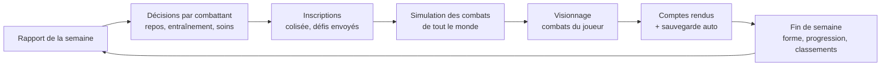

# Gladiator Manager — Plan de conception

Version du 19 octobre 2026

## Cadre du projet

Gladiator Manager est un projet passion et d'apprentissage, sans objectif commercial ni d'audience.

| Élément | Décision |
| --- | --- |
| Modèle | Gratuit, sans microtransactions |
| Plateforme | PC via Steam : Windows d'abord, puis Linux et Steam Deck |
| Web | Non prévu |
| Objectif de la publication | Apprendre tout le cycle, du prototype à la mise en ligne sur Steam |
| Coût à prévoir | 100 $ de Steam Direct (non remboursés pour un jeu gratuit) |

## Vision et piliers

Un jeu de management de gladiateurs en 2D, en Rust sur un moteur maison (voir la [feuille de route technique](feuille_de_route/README.md)), où le joueur dirige un club sans jamais contrôler les combats. Il prépare, inscrit et soigne ses combattants, puis regarde en spectateur une IA les faire combattre. Le joueur ne peut pas perdre : il vise la complétion de tous les succès, et chaque combattant perdu l'oblige à remonter la pente.

Quatre piliers guident toutes les décisions :

1. **Chaque décision a un coût.** Combattre rapporte de l'argent et de la renommée mais coûte de la forme, augmente le risque de blessure, de maladie et de mort.
2. **L'égalité matérielle.** Les colisées fournissent l'équipement : la différence vient uniquement du combattant (stats, personnalité, état) et du manager.
3. **Un monde vivant.** D'autres clubs jouent en même temps, les classements bougent chaque semaine, les champions changent.
4. **Une IA de combat qui apprend.** C'est la signature du jeu, mais le jeu doit rester jouable avec une IA scriptée si le machine learning prend du retard.

## Boucle de jeu et calendrier

Le jeu avance semaine par semaine, et chaque combattant fait au maximum un combat par semaine. Toutes les décisions se prennent avant la simulation ; ensuite le joueur regarde et subit les conséquences.



La fin de semaine applique tout ce qui ne dépend pas du joueur : récupération ou perte de forme, progression des stats, guérison, nouveaux risques de maladie, décisions des managers rivaux et mise à jour des classements.

### Structure d'une saison

Une saison correspond à une année de jeu, soit 30 semaines au total.

| Phase | Durée | Contenu |
| --- | --- | --- |
| Compétition | 22 semaines | La Classique dans chaque colisée, défis entre clubs |
| Grand événement | 4 semaines | Championnat du monde ou Inter-Coliseum selon l'année |
| Intersaison | 4 semaines | Vieillissement, retraites, arrivée des rookies, marché ouvert |

### Rythme des grands événements

Le championnat du monde a lieu aux saisons 4, 8, 12, etc. L'Inter-Coliseum a lieu aux saisons impaires (1, 3, 5, 7…). Ainsi il revient bien tous les deux ans sans jamais tomber la même année que le championnat du monde, et la règle du report devient inutile.

## Les combattants

Un combattant est défini par sept stats, un état physique (forme, blessures, maladie), une personnalité, un moral, une renommée et un âge. Tous ces éléments sont aussi des entrées de l'IA de combat, pour qu'un combattant blessé ou peureux se batte différemment.

### Stats

| Stat | Rôle |
| --- | --- |
| PV | Points de vie maximum |
| AC | Dégâts au corps à corps |
| AL | Dégâts à distance (armes et sorts) |
| PRÉ | Précision : chance de toucher, contre la VIT de la cible |
| VIT | Vitesse de déplacement, fréquence d'attaque et esquive |
| DC | Réduction des dégâts au corps à corps |
| DL | Réduction des dégâts à distance |

Formule de dégâts proposée (AC contre DC, AL contre DL) : la défense réduit sans jamais annuler, ce qui évite les combats infinis.

```latex
\text{Dégâts} = \text{Attaque} \times \frac{100}{100 + \text{Défense}}
```

Une attaque peut rater. La chance de toucher oppose la précision de l'attaquant à la vitesse de la cible, bornée pour qu'un coup ne soit jamais sûr ni impossible : à précision égale à la vitesse adverse, on touche à un taux de base (85 % pour l'instant), et jusqu'à deux fois ce taux avec une bien meilleure précision.

```latex
\text{Toucher} = \text{Base} \times \frac{2 \times \text{PRÉ}}{\text{PRÉ} + \text{VIT}_\text{cible}}
```

### Forme

La forme va de 0 à 100. Un combat la fait baisser, une défense de titre la fait baisser davantage, l'entraînement en coûte un peu et le repos en rend. Elle augmente le risque de blessure et de maladie :

```latex
\text{Risque} = \text{Risque de base} \times \left(1 + k \times \left(1 - \frac{\text{Forme}}{100}\right)\right)
```

Avec k = 2, le risque est triplé à forme nulle. La valeur de k sera réglée pendant l'équilibrage.

### Blessures

Chaque blessure a une localisation et une gravité (légère, moyenne, grave, permanente). Chaque combattant a une main dominante, ce qui donne du sens à la distinction gauche/droite.

| Localisation | Effet proposé | Cas permanent |
| --- | --- | --- |
| Tête | Baisse de précision, risque d'étourdissement accru | Séquelle : malus de précision définitif |

| Corps | Baisse de PV max et de DC | Baisse de PV définitive |
| Bras dominant | Baisse d'AC et d'AL | Bras estropié : AC et AL réduites définitivement |
| Bras secondaire | Baisse de DC (bouclier) | Bras estropié : DC réduite définitivement |
| Jambe (G ou D) | Baisse de VIT | Boiterie : VIT réduite définitivement |

Un coup tranchant peut aussi couper un membre : il est perdu, et cela se voit à l'écran, le combattant étant dessiné sans lui dès le coup et dans tous ses combats suivants. Il prend plus qu'une séquelle : le bras dominant, beaucoup d'AC et d'AL et un peu de précision (le combattant doit changer de style) ; le bras secondaire, beaucoup de DC et de DL (plus de bouclier) ; une jambe, la moitié de la VIT et un peu de DC. Aucun médecin ne le rend, et une blessure permanente de plus pèse sur la décision du combattant de partir. Un combattant peut perdre au plus un bras et une jambe : s'il perd son deuxième bras ou sa deuxième jambe, il prend sa retraite aussitôt. La tête tranchée tue sur le coup, et le corps reste sans tête.

### Maladies

| Niveau | Effet proposé | Durée indicative |
| --- | --- | --- |
| Faible | Petit malus sur toutes les stats | 1 à 2 semaines |
| Moyenne | Malus marqué, récupération de forme ralentie | 3 à 5 semaines |
| Sévère | Combat déconseillé, risque d'aggravation si le combattant combat | 6 semaines et plus |

### Soins

Les soins sont une décision du joueur, jamais automatique. Il peut soigner tout de suite (coût immédiat) ou attendre, par exemple pour ne pas payer une blessure légère qui guérira d'elle-même, ou pour éviter de gaspiller l'argent sur un rétablissement déjà en bonne voie.

### Personnalité, moral et mort

La personnalité est fixe (native) : un tempérament, que le joueur voit, et deux axes cachés, l'audace et l'ego. Chaque tempérament est un compromis, jamais un malus pur :

| Tempérament | En combat | Hors combat |
| --- | --- | --- |
| Téméraire | Presse sans relâche, abandonne très tard | Renommée accrue, meurt plus souvent |
| Cabotin | Garde son coup le plus spectaculaire pour le public | Renommée et moral qui montent et descendent plus vite |
| Méthodique | Se bat sans chercher à plaire | Renommée lente, moral stable |
| Survivant | Abandonne tôt, meurt rarement | Se blesse moins, mais chaque abandon coûte de la renommée |
| Enragé | Sans peur, s'acharne d'autant plus qu'il est blessé | Renommée accrue, se blesse plus, trahit ses alliés de mêlée |
| Orgueilleux | Abandonne bien plus tard face à plus faible | Renommée accrue, moral qui varie fort au gré des combats |

L'audace fixe le seuil d'abandon : un timide abandonne tôt et meurt rarement, un audacieux continue à PV critiques et peut recevoir un coup fatal. Le joueur n'a aucun contrôle sur ce seuil. L'ego dit le goût du public : il retient le combattant dans l'arène et le rend plus difficile à recruter pour un petit club.

Le moral monte avec les victoires et la renommée, baisse avec les défaites, les blessures et les maladies. Il donne un petit bonus ou malus en combat et module la progression. Il n'y a pas de loyauté.

À l'écran, la mort est représentée sobrement : une tâche de sang et une petite animation, à affiner selon ce qui est faisable.

### Renommée

Chaque combattant a une jauge de renommée qui dépend de son style et de son audace. Elle monte avec les actions spectaculaires, les victoires contre plus fort, les King of the hill et les combats sans l'équipement du colisée. Elle baisse avec les abandons, les fuites, et les combats sans relief. Elle augmente les recettes rapportées par le combattant.

### Progression, âge et retraite

Il n'y a pas de niveaux : les stats évoluent directement après chaque entraînement et chaque combat. Chaque combattant a un potentiel caché qui plafonne sa progression ; le recruteur aide à l'estimer. À la fin de chaque saison, son bilan de l'année (victoires, nuls, défaites) lui apporte un peu de stats en plus, d'autant plus que la saison a été bonne, toujours dans la limite de son potentiel.

| Âge | Effet proposé |
| --- | --- |
| 20 à 27 ans | Progression rapide |
| 28 à 35 ans | Plateau, progression lente ; retraite possible dès 30 ans |
| 36 à 39 ans | Progression très faible |
| 40 ans et plus | Déclin progressif des stats, surtout VIT |

La retraite est décidée uniquement par le combattant, selon sa personnalité, son âge et son état. Si le joueur veut s'en séparer, il le libère du club : le combattant rejoint alors le marché comme free agent.

## Le combat

Les combats se déroulent en temps réel dans une arène 2D vue de dessus, pilotés entièrement par l'IA. La même logique de combat sert à l'affichage, à la simulation invisible et à l'entraînement du machine learning.

### Classes, sorts et équipement

Chaque classe a son propre jeu de sorts, avec un temps de recharge et un coût en ressource (mana ou endurance). Le mana et l'endurance remontent un peu à chaque seconde du combat, chaque classe à son rythme : un combattant à court doit patienter avant de frapper de nouveau, mais n'est jamais à sec pour de bon. Pour le prototype : 2 classes et 3 sorts chacune, puis élargir. La liste définitive des classes et des sorts reste à écrire.

L'équipement est fourni par le colisée et identique pour tous. Un combattant peut refuser son armure, jamais ses armes. Sans armure, ses défenses baissent et il gagne un bonus de renommée.

| Pièce refusée | Malus | Bonus de renommée |
| --- | --- | --- |
| Armure | DC et DL fortement réduites | Moyen |
| Arme | AC et AL fortement réduites | Élevé |
| Tout l'équipement | Les deux malus cumulés | Très élevé |

### Armes et étourdissement

Chaque coup frappe avec un type de dégâts, qui vient de l'arme ou du sort. Une arme contondante (bouclier, bâton) étourdit plus souvent. Une arme tranchante (glaive) étourdit rarement, mais peut trancher un membre ou la tête. Les sorts sans élément pour l'instant (feu, éclair) n'étourdissent pas.

Plus le coup est fort, plus il risque d'étourdir, et une blessure à la tête augmente encore ce risque. Un combattant étourdi tombe : il ne fait plus rien et son adversaire attend qu'il se relève. Sa détermination décide s'il se relève, de moins en moins à chaque nouvel étourdissement du même combat. S'il se relève, le combat reprend et l'adversaire attaque de nouveau. Sinon, il est mis K.-O. : le combat s'arrête sur sa défaite, sans la honte d'un abandon, et il survit. Un combattant étourdi, relevé ou non, peut garder une blessure grave à la tête après le combat.

### Formats

| Format | Joueurs dans l'arène | Utilisé par |
| --- | --- | --- |
| Duel | 2 | Classique, Championnat du monde |
| Mêlée / King of the hill | 3 à 20 à la fois, chacun pour soi, pactes possibles | Ouverture de la Classique, une fois par saison |
| Équipe | 5 contre 5 | Inter-Coliseum |

La mêlée, ou King of the hill, ouvre chaque saison dans chaque colisée, la première semaine de compétition : elle fait le classement de début de saison. Jusqu'à 20 combattants sont dans l'arène en même temps ; le joueur peut en inscrire plusieurs, que rien ne lie d'office, et les rivaux et free agents complètent, puis le classement s'il manque du monde. En combat, deux voisins peuvent faire un pacte, selon leur prudence, et ne plus se viser ; un pacte se trahit, selon l'agressivité, et tous se rompent quand il ne reste que trois combattants. Il faut se battre : toutes les 15 secondes, ceux qui ont infligé le moins de dégâts depuis le palier précédent sont éliminés, vaincus sur-le-champ, 3, puis 3, 4, 2, 2, 2 et 2 dans une mêlée à 20, jusqu'aux 2 derniers qui jouent un duel final. L'écran montre le temps avant le prochain palier, les dégâts qu'il faut dépasser pour rester, et une jauge au-dessus de chaque combattant, rouge s'il serait éliminé. Plus on survit, plus on gagne d'Elo et de renommée ; seul le dernier debout compte une victoire à son bilan, et sa victoire rapporte la prime de mêlée. Les recettes grandissent avec la taille de la mêlée.

Chaque colisée a un type d'arène qui change la tactique : sable qui ralentit, piliers qui bloquent les tirs, arène étroite qui favorise le corps à corps.

### IA de combat en deux étapes

1. **IA scriptée (utility AI).** Chaque action reçoit un score selon la situation, l'IA joue la meilleure. Elle sert à valider les règles, de secours, et d'adversaire d'entraînement pour le ML.
2. **IA apprenante (algorithme PPO).** Un modèle par classe, entraîné en self-play en Python sur le moteur de combat du jeu, puis exporté au format ONNX et exécuté dans le jeu.

Entrées du modèle : ses stats, sa forme, ses blessures, sa maladie, sa personnalité, son moral, son équipement, le type d'arène, l'état de ses ressources et sorts, puis la position et l'état des adversaires et alliés les plus proches. Limiter l'observation aux 4 adversaires et 4 alliés les plus proches permet de gérer du duel au 20 joueurs avec le même modèle.

Ordre d'entraînement conseillé : duel, puis mêlée, puis équipe. L'expérience d'un combattant peut s'exprimer par la version du modèle qu'il utilise : une recrue joue avec une version peu entraînée, un vétéran avec la plus aboutie.

### Regarder plusieurs combats en même temps

Chaque combat affiché est rendu dans sa propre texture (render target) : un combat en grand, les autres combats du joueur en vignettes cliquables pour changer de focus, avec vitesse x0,5, x1, x1,5 et un bouton « passer au résultat ». Seuls les combats du joueur sont affichés ; tous les autres tournent sans rendu.

### Reproductibilité

Chaque combat a une graine (seed). Pour que la même graine redonne exactement le même combat, les déplacements et collisions sont calculés par notre propre code à pas de temps fixe, sans moteur physique. L'IA choisit son action de façon déterministe (l'action la plus probable, le hasard passant par la graine).

## Économie, marché et personnel

L'argent ne vient que des combattants : leurs combats et leur vente. Il sert à entretenir, soigner, entraîner et inscrire les combattants. Il n'y a pas de sponsor, et l'équipement est gratuit.

### Niveaux de richesse

Chaque club, celui du joueur comme les clubs rivaux, est pauvre, modeste ou riche. Le niveau fixe l'argent de départ ; il n'y a pas de mécène, et aucun argent n'arrive chaque semaine sans combat. Au début d'une partie, le joueur choisit un club pauvre, modeste ou riche. À chaque intersaison, le niveau suit l'argent du club, donc ses résultats et ses choix : un club monte d'un niveau s'il a assez d'argent, et redescend d'un niveau s'il en a moins de la moitié. Un club ne change que d'un niveau par saison. Le joueur ne voit pas l'argent des clubs rivaux, seulement leur niveau.

- Un club riche achète à volonté : chaque semaine, il cherche un combattant nettement meilleur que son plus faible, chez un club pas plus riche que lui, et libère son plus faible quand son effectif est plein. À l'intersaison, il libère à tout âge les combattants qui ne performent plus.
- Un club pauvre mise sur le recrutement : il engage un recruteur avant tout autre personnel, signe les rookies et les free agents du meilleur potentiel que voit son recruteur, et n'achète à personne. Il espère trouver un diamant et le revendre cher à un club plus riche.
- Un club modeste est entre les deux : il signe le free agent le plus fort, et achète à un autre club quand aucun ne lui convient.

Un club ne vend qu'à un club au moins aussi riche que lui, et n'achète qu'en gardant de quoi rester à son niveau.

### Flux d'argent

| Sens | Poste | Dépend de |
| --- | --- | --- |
| Entrée | Prime de victoire | Format et prestige du colisée |
| Entrée | Recettes du combat | Renommée des combattants, format (une mêlée à 20 attire plus) |
| Entrée | Bonus champion | Versé à chaque défense de titre réussie |
| Entrée | Vente d'un combattant | Prix négocié sur le marché |
| Sortie | Entretien | Coût hebdomadaire par combattant |
| Sortie | Soins | Gravité de la blessure ou maladie, niveau du médecin |
| Sortie | Entraînement | Par séance, niveau de l'entraîneur |
| Sortie | Inscription | Un frais par combattant inscrit, plus le voyage sur un autre continent |
| Sortie | Salaires du personnel | Hebdomadaire, une fois par tranche de 3 combattants en activité |
| Sortie | Achat d'un combattant | Prix du marché |

### Filet de sécurité

Le joueur ne peut jamais être bloqué. Le marché contient toujours des free agents disponibles, et chaque continent a au moins un colisée de bas niveau à entrée gratuite. Même sans argent, le joueur peut donc toujours recruter un combattant et le faire combattre pour remonter la pente.

### Marché et recrutement

Un club compte au plus 3 combattants en activité ; un combattant mort ou retraité libère sa place. Le marché permet l'achat et la vente, sans échange. Il contient les free agents toute l'année (dont les combattants libérés par les clubs) et une nouvelle promotion de rookies (20 ans) à chaque intersaison. Les free agents combattent aussi dans les colisées à entrée gratuite pour montrer leur valeur : ils y gagnent un Elo, un bilan et de la renommée (pas d'argent), qu'ils gardent une fois recrutés. Les combattants sont générés procéduralement : nom, classe, stats, potentiel caché, personnalité, main dominante.

Le statut d'observation ne montre d'abord que quelques stats, sous forme de fourchettes (par exemple AC entre 40 et 60), les autres restant cachées. Chaque semaine d'observation en révèle d'autres, puis resserre les fourchettes ; le recruteur accélère et donne une estimation du potentiel.

Le prix d'un combattant dépend de ses stats, de sa renommée et de son bilan (victoires, défaites, nuls). Acheter un combattant rival passe par une négociation : le joueur fait une offre, le club répond la semaine suivante (accord, contre-offre ou refus), puis le combattant accepte ou refuse de venir. Pour vendre, le joueur met un combattant sur la liste des transferts : il reste au club et continue de combattre jusqu'à ce que le joueur accepte une offre d'un club qui a une place. Un club rival a son propre effectif, avec un maximum ; plein, il n'achète personne. Trop petit, il recrute un free agent, ou achète à un autre club si aucun free agent ne lui convient. Un combattant qui quitte un club est vendu, libéré ou retraité.

### Personnel

| Poste | Effet | Idée d'évolution |
| --- | --- | --- |
| Entraîneur | Gains d'entraînement plus élevés, moins de perte de forme à l'entraînement | Niveaux 1 à 5, salaire croissant |
| Médecin | Guérison plus rapide, moins de séquelles ; ne peut rien contre une blessure permanente ni rendre un membre perdu | Niveaux 1 à 5 |
| Recruteur | Fourchettes plus précises, estimation du potentiel, détection de la personnalité | Niveaux 1 à 5 |

Le personnel s'engage au marché parmi des candidats, les mêmes pour le joueur et les clubs rivaux, qui repartent au bout de quelques semaines. Chaque candidat a un niveau ; ses stats et son salaire varient autour de ceux de ce niveau. À niveau égal, l'un coûte moins cher, un autre soigne mieux mais coûte plus. Ses stats se voient sans observation.

## Colisées, classements et compétitions

Chaque colisée a son type d'arène, son prestige, son classement et son champion. Un même combattant peut figurer dans plusieurs classements et détenir plusieurs titres, au prix de défenses plus fréquentes et donc de plus de fatigue.

Les colisées sont répartis sur cinq continents. Chacun a un colisée majeur, au prestige le plus haut : Rome (Europe), Karakorum (Asie), Tenochtitlan (Amériques), Musumba (Afrique) et Ngāpuhi (Océanie). Autour de lui, un ou deux colisées mineurs, dont un à entrée gratuite : Capoue et Pompéi en Europe, Samarcande et Chang'an en Asie, Cahokia et Cuzco dans les Amériques, Mbanza Kongo en Afrique, Nan Madol en Océanie. Le joueur choisit son continent en commençant une partie ; chaque club rival a le sien, celui de sa culture. Un club combat surtout chez lui : s'inscrire sur un autre continent coûte en plus le voyage. Un club rival ne part à l'étranger que si aucun colisée de chez lui ne lui convient.

### Classement

Le classement utilise le système Elo, calculé séparément pour chaque colisée. Seuls les 50 meilleurs sont affichés ; les autres sont « non classés » mais gardent un Elo caché. En mêlée, chaque participant est comparé à tous les autres selon l'ordre d'élimination, ce qui adapte Elo au format jusqu'à 20 joueurs : l'Elo de la saison passée est ajusté, et les nouveaux venus y entrent.

### Titre de champion

Le titre est distinct du rang 1. Le champion doit le défendre en duel contre un challenger du top 5 au minimum toutes les 4 semaines ; il est libre de le défendre plus souvent. Une défense coûte plus de forme qu'un combat normal et rapporte le bonus champion.

### Défis

Le joueur peut défier un combattant d'un club rival ; le club accepte si l'Elo donne à son combattant assez de chances de gagner. Les clubs rivaux ne défient pas les combattants du joueur : les défis reçus ont été retirés, faute d'apporter assez au jeu.

### Les trois compétitions

| Compétition | Fréquence | Participants | Format |
| --- | --- | --- | --- |
| La Classique | Toute la saison, dans chaque colisée | Tous les inscrits | Une mêlée d'ouverture (3 à 20), puis des duels, compte pour le classement |
| Championnat du monde | Saisons 4, 8, 12… | Top 5 de chaque colisée | Duels : phase de poules puis élimination directe |
| Inter-Coliseum | Saisons impaires | 5 combattants convoqués par colisée | 5 contre 5, colisée contre colisée |

Pour l'Inter-Coliseum, chaque colisée convoque ses 5 meilleurs selon son classement. Un combattant convoqué par deux colisées choisit : c'est le joueur qui décide pour ses combattants, et la personnalité décide pour les autres. Le colisée délaissé convoque alors le suivant de son classement.

Le nombre de participants au championnat du monde dépend du nombre de colisées : avec 8 colisées, on obtient 40 combattants, soit 8 poules de 5.

## Le monde : managers rivaux et simulation

Les clubs rivaux sont gérés par une IA à règles, et leurs combats sont résolus par un modèle statistique calibré sur des milliers de vrais combats simulés. Les combats impliquant un combattant du joueur sont toujours de vrais combats simulés.

### IA des managers rivaux

Les clubs rivaux sont tirés au début de la partie, une quarantaine, de toutes les cultures du monde : Rome, Grèce, Celtes, Germains, steppe, Asie de l'Est, Inde, Asie de l'Ouest, monde arabe, tribus d'Afrique, d'Amérique et d'Océanie. Chaque continent en a sa part, et un club a une culture de son continent. Le nom d'un club suit sa culture (un ludus à Rome, une palestre en Grèce, un ordu dans la steppe, un whare en Océanie). Beaucoup sont pauvres, peu sont riches.

Chaque club rival a un profil (prudent, agressif, marchand) qui règle ses seuils. Chaque semaine, pour chaque combattant, il applique des règles simples :

- Forme sous le seuil ou blessure : repos, et soins si le budget le permet et si la blessure le justifie.
- Forme correcte : inscription au colisée de son continent où ses chances sont les meilleures, à l'étranger seulement si aucun ne convient chez lui, sinon entraînement. Un club qui ne peut plus payer l'entraînement inscrit ses combattants au colisée gratuit de chez lui : les recettes sont son seul revenu.
- Défis : accepter ceux du joueur si la chance de victoire estimée dépasse son seuil.
- Marché : acheter si l'effectif est trop petit et le budget suffisant, libérer ou vendre les combattants âgés ou en déclin, selon son niveau de richesse (voir « Niveaux de richesse »).
- Personnel : engager parmi les candidats du marché le meilleur entraîneur puis le meilleur médecin (le moins cher à niveau égal) dont il peut payer les salaires assez longtemps (plus ou moins selon son profil), et les garder tant qu'il peut encore les payer moitié moins longtemps, sauf si un candidat d'un meilleur niveau se présente. Leurs effets valent pour ses combattants comme pour ceux du joueur. Un club pauvre engage d'abord un recruteur, pour voir le potentiel des rookies et des free agents ; les autres n'en engagent pas, jugeant un combattant sur ce qu'il montre.

### Simulation en arrière-plan

Avec par exemple 8 colisées et environ 500 combattants, il y a plusieurs centaines de combats par semaine. Les simuler tous en temps réel serait trop lent, d'où deux niveaux de résolution :

| Combat | Résolution |
| --- | --- |
| Implique un combattant du joueur | Vrai combat simulé (affiché ou non) |
| Entre rivaux | Modèle statistique calibré |

La calibration se fait hors du jeu : on lance des milliers de combats sans rendu, on enregistre les résultats, puis on ajuste un modèle qui prédit le vainqueur, les dégâts, les blessures et les morts à partir des stats et de l'état des combattants. Une régression logistique suffit pour le vainqueur, et c'est déjà du machine learning. On vérifie ensuite que les taux de victoire, de blessure et de mort sont les mêmes dans les deux modes.

## Interface, comptes rendus, sauvegarde et tutoriel

L'interface compte huit écrans ; dans un jeu de management, elle représente souvent la moitié du travail et doit être planifiée comme telle.

### Écrans

| Écran | Contenu principal |
| --- | --- |
| Menu général | Semaine en cours, argent, alertes (blessures, offres reçues), bouton « semaine suivante » |
| Colisées | Liste des colisées, type d'arène, champion, top 50, inscriptions |
| Liste des combattants | Effectif avec forme, état, rang ; choix repos, entraînement ou soins en un clic |
| Fiche combattant | Stats, historique, blessures, maladie, personnalité, moral, renommée, âge ; bouton « libérer » |
| Marché | Rookies et free agents, fourchettes d'observation, achat et vente |
| Personnel | Entraîneur, médecin, recruteur : niveau, salaire, embauche |
| Combat | Combat principal et vignettes des autres, contrôles de vitesse |
| Résumé de combat | Compte rendu détaillé |

### Compte rendu de combat

Pour chaque combattant : dégâts infligés, dégâts reçus, sorts utilisés, blessures reçues, argent gagné, renommée gagnée ou perdue. On y ajoute la variation de forme et d'Elo, et la graine du combat pour pouvoir le revoir.

### Sauvegarde

Une sauvegarde automatique après chaque semaine, plus une sauvegarde manuelle. Format : un fichier JSON avec un numéro de version, pour que les anciennes sauvegardes restent lisibles quand le jeu évolue, à partir de la sortie sur Steam ; d'ici là, une sauvegarde ancienne peut devenir illisible et la partie recommence. Les graines permettent de ne stocker que les résultats, pas les combats entiers.

### Tutoriel et manuel

Chaque fonctionnalité est débloquée progressivement, présentée par une pop-up à sa première apparition, puis inscrite dans le manuel du jeu. Ordre de déblocage proposé : combat et compte rendu, repos et entraînement, blessures et soins, marché, personnel, défis, mêlées, titres de champion, puis les grands événements.

## Architecture technique et feuille de route

Le plan Godot (C#, Godot RL Agents) est abandonné pour un moteur maison en Rust. La pile technique, l'architecture, les règles de déterminisme, les outils et les phases du développement, avec leurs jalons, sont tenus dans la [feuille de route technique](feuille_de_route/README.md), qui fait foi. La règle d'or reste celle du départ : la logique du jeu est séparée de l'affichage, pour pouvoir simuler sans rendu, entraîner l'IA et tester ; le même moteur de combat tourne à l'écran, en arrière-plan et pendant l'entraînement. Le jeu est complet avec l'IA scriptée à la fin de la phase 6 ; le machine learning arrive ensuite comme amélioration.

## Décisions prises et points ouverts

### Décisions prises

| Sujet | Décision |
| --- | --- |
| Filet de sécurité | Toujours des free agents disponibles, et un colisée de bas niveau à entrée gratuite |
| Retraite | Décidée uniquement par le combattant ; le joueur peut le libérer du club |
| Soins | Choisis par le joueur, jamais automatiques |
| Durée de la compétition | 22 semaines par saison, puis 4 de grand événement et 4 d'intersaison |
| Titre de champion | Défense au minimum toutes les 4 semaines, plus souvent si le champion le souhaite |
| Combat sans armure | Défenses réduites, bonus de renommée ; les armes ne se refusent pas |
| Mêlée | Une par colisée et par saison, plusieurs combattants d'un même club autorisés, sans lien d'office, pactes spontanés en combat |
| Mort à l'écran | Tâche de sang et petite animation, selon ce qui est faisable |

### Points encore ouverts

- [ ] Taille du monde : nombre de colisées et de clubs rivaux (13 colisées sur cinq continents et 40 clubs générés pour l'instant).
- [ ] Liste des classes et de leurs sorts.
- [ ] Calendrier des grands événements : confirmer l'Inter-Coliseum aux saisons impaires, ou revenir à la règle du report.

### Risques

| Risque | Conséquence | Parade |
| --- | --- | --- |
| Équilibrage difficile entre classes, sorts et malus | Une classe domine, les autres sont inutiles | Mode de simulation de masse dès la phase 1, suivi des taux de victoire |
| Entraînement ML lent ou instable | Phase 7 qui s'éternise | Jeu complet avec l'IA scriptée ; self-play contre d'anciennes versions et contre l'IA scriptée |
| Récompenses mal conçues | Comportements absurdes (fuite permanente) | Récompenser dégâts et victoire, légère pénalité de temps, revoir les combats régulièrement |
| Performances en mêlée à 20 avec vue multi-combats | Ralentissements | IA appelée quelques fois par seconde, pas à chaque image ; limiter le nombre de vignettes |
| Écart entre modèle statistique et vrais combats | Résultats incohérents entre joueur et rivaux | Recalibrer après chaque changement d'équilibrage |
| Interface sous-estimée | Retard général | L'inclure explicitement dans chaque phase |
| Portée trop large pour un développeur seul | Projet jamais terminé | Respecter l'ordre des phases, 2 classes et 2 colisées au départ |
