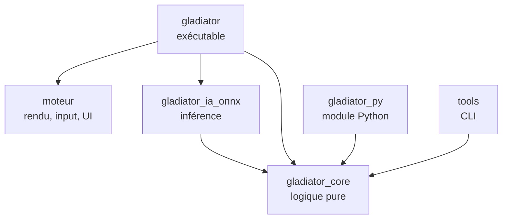

# Gladiator Manager — Feuille de route technique (Rust)

Version du 11 octobre 2026. Ce document remplace la partie technique du plan de conception du 27 septembre 2026 (architecture Godot, outils, feuille de route). Les règles du jeu (combattants, combat, économie, colisées, compétitions) restent décrites dans le plan de conception, qui demeure la référence pour le gameplay.

## Changement de cap

| Avant | Maintenant |
| --- | --- |
| Godot 4.7.2 .NET (C#) | Moteur maison en Rust, construit sur macroquad |
| Interface Godot (Control) | egui, avec un thème personnalisé |
| SubViewports | Render targets de macroquad |
| Godot RL Agents | Module Python compilé depuis Rust avec PyO3 + Stable-Baselines3 |
| ONNX dans Godot via C# | Crate `tract` (100 % Rust) |
| Steamworks.NET | Crate `steamworks` |
| Rider | VS Code + rust-analyzer |

Ce qui ne change pas : la règle d'or. La logique du jeu est séparée de l'affichage, pour pouvoir simuler sans rendu, entraîner l'IA et tester. En Rust, cette règle n'est plus une discipline : c'est le compilateur qui l'impose, puisque la crate de logique ne dépend d'aucune bibliothèque graphique.

## Pile technique

| Besoin | Choix | Remarque |
| --- | --- | --- |
| Langage | Rust stable, édition la plus récente | Installé avec `rustup` |
| Fenêtre, rendu, input, audio | macroquad | Simple, compile vite, Windows et Linux |
| Interface | egui (intégration macroquad) | Tableaux, listes, fiches, pop-ups ; thème à travailler |
| Hasard reproductible | `rand` + `rand_chacha` | Une graine par combat |
| Maths déterministes | `libm` | Mêmes résultats de `sin`, `sqrt`, etc. sur toutes les plateformes |
| Sérialisation | `serde`, `serde_json`, `ron` | JSON pour les sauvegardes, RON pour les données de design |
| Compression des sauvegardes | `flate2` | GZip, seulement si besoin |
| Historique volumineux | `rusqlite` | Seulement si le JSON devient trop lourd |
| Parallélisme des simulations | `rayon` | Simulation de masse, calibration |
| Rechargement à chaud des données | `notify` | Pratique pendant l'équilibrage |
| Inférence ML | `tract` (100 % Rust) | Derrière le trait commun d'IA ; préféré à `ort` en phase 0 : aucune bibliothèque native à livrer |
| Pont Python | `pyo3` + `maturin` | Le moteur de combat devient un module Python |
| Entraînement | Python, Gymnasium, Stable-Baselines3 (PPO) | Environnement virtuel `venv` |
| Steam | crate `steamworks` | Succès, sauvegarde cloud |
| Tests | `cargo test`, `proptest`, `insta` | Invariants, combats de référence |
| Mesures de performance | `criterion` | Vitesse de simulation |
| Qualité | `rustfmt`, `clippy` | Lancés en CI |
| Éditeur | VS Code + rust-analyzer + CodeLLDB | CodeLLDB pour le débogueur |
| Sprites | Aseprite, Kenney.nl, OpenGameArt | Export en spritesheets PNG, formats dans [Formats_graphiques.md](../Formats_graphiques.md) |
| Versionnage | Git + Git LFS + GitHub | LFS pour les PNG, sons, fichiers Aseprite |

Toutes les versions de crates sont figées par le `Cargo.lock`, versionné dans le dépôt puisque le projet produit un exécutable.

## Moteur et jeu : un seul dépôt

### Décision

Un seul dépôt Git, organisé en **workspace Cargo** avec plusieurs crates. Le moteur et le jeu sont séparés en crates distinctes, pas en dépôts distincts.

### Pourquoi pas deux dépôts avec un fork

- Un fork sert à créer une copie qui diverge de l'original. Ici le jeu doit *utiliser* le moteur, pas en posséder une copie : on passerait son temps à synchroniser les deux.
- Au début, presque chaque fonctionnalité touche les deux côtés (une nouvelle animation demande du code moteur et du code jeu). Avec deux dépôts, chaque changement devient deux commits, deux pushes et une mise à jour de version.
- On ne sait pas encore ce qui est « générique » et ce qui est propre au jeu. Le découpage se clarifie en construisant le jeu.

### Ce qu'apporte le workspace

- La séparation reste stricte : `moteur` ne connaît pas `gladiator_core`, et `gladiator_core` ne connaît pas `moteur`. Toute dépendance interdite provoque une erreur de compilation.
- Un seul `cargo build`, un seul `cargo test`, un seul historique.
- Extraire le moteur plus tard reste simple.

### Si un jour le moteur doit vivre seul

Quand le moteur sera stable et réutilisé pour un autre projet :

1. Extraire son historique avec `git subtree split` ou `git filter-repo` vers un nouveau dépôt.
2. Publier des versions taguées (`v0.1.0`, `v0.2.0`…).
3. Dans le jeu, remplacer la dépendance locale par une dépendance Git :

```toml
# Aujourd'hui (workspace)
moteur = { path = "../moteur" }

# Plus tard (dépôt séparé)
moteur = { git = "https://github.com/<toi>/moteur", tag = "v0.2.0" }
```

Pas de fork, pas de sous-module Git : Cargo sait récupérer une dépendance depuis un dépôt et une version précise.

## Architecture du workspace

```
gladiator-manager/
├── Cargo.toml              # workspace, profils de compilation
├── Cargo.lock
├── crates/
│   ├── moteur/             # générique : boucle, sprites, animations, input, audio,
│   │                       # ressources, caméra, render targets, egui, pile d'écrans
│   ├── gladiator_core/     # logique pure : combat, IA scriptée, combattants, monde,
│   │                       # économie, classements, rivaux, sauvegarde
│   ├── gladiator_ia_onnx/  # inférence ONNX derrière le trait CombatAi
│   ├── gladiator/          # l'exécutable du jeu : écrans, rendu des combats, Steam
│   ├── gladiator_py/       # module Python (PyO3) pour l'entraînement
│   └── tools/              # binaires en ligne de commande
├── python/                 # environnement Gymnasium, entraînement, export ONNX
├── data/                   # classes, sorts, arènes, noms (RON)
├── assets/                 # sprites, sons, polices (Git LFS)
└── docs/                   # plan de conception, cette feuille de route
```

### Règles de dépendance



| Crate | Peut dépendre de | Ne doit jamais dépendre de |
| --- | --- | --- |
| `gladiator_core` | serde, rand, libm | macroquad, egui, tract, pyo3 |
| `moteur` | macroquad, egui | `gladiator_core` (il reste générique) |
| `gladiator_ia_onnx` | `gladiator_core`, tract | macroquad |
| `gladiator` | tout | — |
| `gladiator_py` | `gladiator_core`, pyo3 | macroquad, egui |
| `tools` | `gladiator_core`, rayon | macroquad |

### Modules de `gladiator_core`

| Module | Responsabilité |
| --- | --- |
| `state` | `GameState` : état global de la partie, point d'entrée de la sauvegarde |
| `calendar` | Semaines, saisons, grands événements, intersaison |
| `fighter` | Stats, forme, blessures, maladies, soins, progression, âge, retraite, mort |
| `combat` | Arène, déplacements, collisions, dégâts, sorts, équipement, pas de temps fixe |
| `ai` | Trait `CombatAi`, utility AI |
| `stat_model` | Résolution statistique des combats entre rivaux |
| `rivals` | Profils, effectifs et décisions hebdomadaires des clubs rivaux |
| `economy`, `market`, `staff` | Argent, achats, ventes, libérations, personnel |
| `colosseum` | Colisées, résidents, classement Elo, champion et défis de chaque colisée |
| `rankings` | Titres, défis, compétitions |
| `save` | JSON versionné, migrations entre versions |
| `achievements` | Succès du jeu, indépendants de Steam |
| `design_data` | Chargement des classes, sorts et arènes depuis `data/` |

### Principes Rust pour ce projet

- **Le code est en anglais.** Modules, types, fonctions, variables, constantes, tests, fichiers de code et commentaires sont en anglais. Restent en français : les textes affichés au joueur et les documents de `docs/`. Les abréviations des stats du plan de conception sont traduites (PV → `hp`, AC → `melee_attack`, AL → `ranged_attack`, VIT → `speed`, DC → `melee_defense`, DL → `ranged_defense`).
- **Le français est la langue de référence.** Les textes du joueur ne sont pas dans le code mais dans les fichiers Fluent `assets/lang/<langue>.ftl`, lus par clé (`tr!("clé", …)`). `fr.ftl` est écrit en premier et fait foi : une nouvelle clé y entre d'abord, et un test exige que chaque clé de `fr.ftl` (comme chaque clé du code et des données) existe dans le fichier de chaque autre langue, si bien qu'une traduction incomplète fait échouer les tests. Le français est aussi la langue par défaut, la première de `lang::LANGUAGES` : les tests ne lisent pas le choix du joueur, et ceux qui comparent des textes les comparent en français, quelles que soient les langues ajoutées.
- **Des identifiants plutôt que des références.** Les combattants vivent dans des `Vec` ou des tables, et se désignent par un `FighterId(u32)`. Un combattant qui cible un adversaire stocke son identifiant, jamais une référence. C'est ce qui évite de se battre avec le borrow checker.
- **Une semaine est une fonction.** `fn next_week(state: &mut GameState, decisions: &Decisions)`. L'interface ne fait que construire les décisions et lire l'état.
- **Un combat est une fonction.** `fn tick(arena: &mut Arena, ais: &mut [Box<dyn CombatAi>])`. Le même code tourne à l'écran, en arrière-plan, dans les outils et dans Python.
- **Les données de design hors du code.** Classes, sorts et arènes en fichiers RON, rechargés à chaud pendant l'équilibrage.

### Déterminisme : les pièges à éviter

| Piège | Pourquoi | Parade |
| --- | --- | --- |
| `HashMap` / `HashSet` | Ordre de parcours aléatoire à chaque lancement | `BTreeMap`, `Vec` triés, ou un hasher fixe ; une règle clippy `disallowed_types` pour l'interdire dans `gladiator_core` |
| `f32::sin`, `sqrt`, etc. | Peuvent différer entre Windows et Linux | Passer par `libm` partout dans la logique |
| `thread_rng()` | Hasard non reproductible | Un seul `ChaCha8Rng` par combat, créé depuis la graine |
| Temps réel (`Instant::now`) | Dépend de la machine | La logique ne connaît que des ticks |
| Parallélisme | Ordre d'exécution variable | Paralléliser entre combats indépendants, jamais à l'intérieur d'un combat |

Ce point compte d'autant plus qu'une sauvegarde peut passer de Windows au Steam Deck par la sauvegarde cloud, et que les graines servent à revoir les combats.

### Boucle de jeu

La logique avance à cadence fixe (par exemple 30 ticks par seconde), l'IA décide quelques fois par seconde (par exemple 5), et l'affichage interpole entre deux ticks pour rester fluide à n'importe quelle fréquence d'écran. Les vitesses x0,5, x1 et x1,5 exécutent simplement moins ou plus de ticks par image ; « passer au résultat » exécute tous les ticks restants sans rendu.

## Feuille de route

Le développement se fait en onze phases (0 à 10), plus les phases 5 bis et 6 bis, chacune terminée par un jalon vérifiable. Par rapport au plan Godot, une phase est ajoutée (phase 2 : le socle du moteur). À la fin de la phase 6, le jeu est complet avec l'IA scriptée ; le machine learning arrive ensuite comme amélioration.

| Phase | Contenu | Jalon |
| --- | --- | --- |
| 0. Préparation | Outils, workspace, Git, trois prototypes techniques | Une fenêtre avec un sprite et un bouton egui ; Python importe le module Rust |
| 1. Combat de base | Moteur de combat en duel, sans affichage | La même graine redonne le même combat ; 10 000 duels simulés en ligne de commande |
| 2. Socle du moteur | Crate `moteur` : boucle, sprites, animations, UI, écrans | Le duel de la phase 1 s'affiche en sprites animés avec contrôles de vitesse |
| 3. Le combattant complet | Forme, blessures, maladies, personnalité, mort, progression | Un combattant enchaîne 10 semaines avec des effets visibles |
| 4. Management | Calendrier, économie, écrans principaux, sauvegarde | Une saison entière jouable avec un seul club |
| 5. Le monde | Colisées, Elo, rivaux, marché, personnel, modèle statistique | Plusieurs saisons où les classements vivent sans le joueur |
| 5 bis. Précision et personnel | Précision en combat, blessures à la tête sur la précision, étourdissement selon l'arme, personnel sur le marché et chez les rivaux, mortalité revue, free agents qui combattent, niveaux de richesse des clubs, tempérament des combattants | Une blessure à la tête fait rater des coups ; les rivaux engagent du personnel sur le marché ; les libérations de l'intersaison arrivent |
| 6. Formats et spectacle | Mêlée (King of the hill) d'ouverture de saison, équipement refusable, types d'arène, apparence, vue multi-combats | Regarder 3 combats du joueur en même temps, dont une mêlée à 20 |
| 6 bis. Un monde vivant | Des dizaines de clubs générés aux influences du monde entier, colisées sur cinq continents, relations entre clubs, rivalités déclarées | Trois saisons où un club devient rival du joueur par ce qui s'est passé entre eux, et où un club ferme et un autre se crée |
| 7. IA apprenante | PyO3, Gymnasium, PPO en self-play, export et inférence ONNX | Le modèle appris bat nettement l'IA scriptée |
| 8. Grands événements | Championnat du monde, Inter-Coliseum, succès, tutoriel | Un cycle complet de 4 saisons avec les deux événements |
| 9. Contenu et équilibrage | Classes, sorts, arènes, simulations de masse, finitions | Taux de victoire par classe entre 45 et 55 % |
| 10. Publication Steam | Steamworks, page du magasin, builds, test Steam Deck | Le jeu est disponible gratuitement sur Steam |

### Détail des phases

Chaque phase a son fichier : ce qu'elle contient, comment elle est faite, son jalon.

- [Phase 0 — Préparation](phase-0.md)
- [Phase 1 — Combat de base](phase-1.md)
- [Phase 2 — Socle du moteur](phase-2.md)
- [Phase 3 — Le combattant complet](phase-3.md)
- [Phase 4 — Management](phase-4.md)
- [Phase 5 — Le monde](phase-5.md)
- [Phase 5 bis — Précision et personnel](phase-5-bis.md)
- [Phase 6 — Formats et spectacle](phase-6.md)
- [Phase 6 bis — Un monde vivant](phase-6-bis.md)
- [Phase 7 — IA apprenante](phase-7.md)
- [Phase 8 — Grands événements](phase-8.md)
- [Phase 9 — Contenu et équilibrage](phase-9.md)
- [Phase 10 — Publication Steam](phase-10.md)

## Risques

| Risque | Conséquence | Parade |
| --- | --- | --- |
| Apprentissage de Rust | Phases 0 et 1 plus lentes | Phase 1 sans affichage, idéale pour apprendre ; identifiants plutôt que références |
| Portée trop large pour un développeur seul | Projet jamais terminé | Respecter l'ordre des phases, 2 classes et 2 colisées au départ ; le moteur ne contient que ce dont le jeu a besoin |
| Moteur qui grossit pour lui-même | Le jeu n'avance plus | Toute fonctionnalité du moteur doit servir une phase du jeu en cours |
| Compatibilité macroquad / egui | Blocage à la mise à jour | Vérifier en phase 0, figer les versions, solution de repli avec egui sur miniquad |
| Interface sous-estimée | Retard général | Écrans inclus explicitement dans chaque phase, thème egui commencé en phase 2 |
| Déterminisme cassé | Graines qui ne redonnent pas le même combat | `libm`, pas de `HashMap` dans la logique, tests de combats de référence en CI sous Windows et Linux |
| Pont PyO3 et versions de Python | Module qui ne se charge plus | Mode `abi3`, environnement virtuel figé dans `requirements.txt` |
| Distribution d'ONNX Runtime | Jeu qui ne se lance pas sur Linux ou Steam Deck | Tester tôt, `tract` en solution de secours |
| Entraînement ML lent ou instable | Phase 7 qui s'éternise | Jeu complet dès la phase 6 avec l'IA scriptée |
| Récompenses mal conçues | Comportements absurdes | Récompenses simples, revoir des combats régulièrement |
| Performances en mêlée à 20 avec multi-vue | Ralentissements | IA à basse fréquence, mesures `criterion`, nombre de vignettes limité |
| Écart entre modèle statistique et vrais combats | Résultats incohérents | Outil `compare`, recalibrage après chaque changement d'équilibrage |
| Monde de 40 clubs et jusqu'à 15 colisées | Saisons lentes, sauvegarde lourde, équilibre perdu | Combats entre clubs de l'ordinateur par le modèle statistique, mesure d'une saison, recalibrage par étapes |
| Graphismes et sons sans auteur désigné | Jeu publié avec des formes et des sons provisoires, ou phase 9 bloquée | Décider tôt qui les produit (points ouverts), formats fixés dans [Formats_graphiques.md](../Formats_graphiques.md) pour remplacer les fichiers sans toucher au code |
| Temps de compilation | Itérations lentes | Workspace découpé, profil dev optimisé pour les dépendances, données en RON hors du code |

## Points encore ouverts

- [ ] Taille du monde : nombre de colisées et de clubs (15 colisées sur cinq continents et 40 clubs générés au départ, au plus 100 ouverts à la fois, dans `data/world.ron`). Décidé pour la phase 6 bis : un colisée majeur par continent (Rome, Karakorum, Tenochtitlan, Musumba, Ngāpuhi), un ou deux colisées mineurs autour, une quarantaine de clubs générés de toutes cultures ; les nombres exacts restent à caler.
- [ ] Liste des classes et de leurs sorts.
- [ ] Calendrier des grands événements : confirmer l'Inter-Coliseum aux saisons impaires.
- [x] `ort` ou `tract` pour l'inférence : `tract`, tranché en phase 0.
- [x] Cadence de la logique et fréquence de décision de l'IA : 30 ticks par seconde, 5 décisions par seconde, retenus en phase 1 (à revoir si l'équilibrage l'exige).
- [ ] Production des graphismes et des sons (sprites, arènes, effets, interface, musique), à décider avant la phase 9 : dessinés soi-même dans Aseprite, repris de bibliothèques libres (Kenney.nl en CC0, OpenGameArt en vérifiant la licence de chaque fichier), ou commandés à un artiste et un compositeur (budget, droits cédés par contrat). Le choix dépend aussi de la licence retenue pour les graphismes et les sons (point suivant). Inventaire de ce qui est provisoire : [phase 9](phase-9.md).
- [ ] Extraction du moteur dans son propre dépôt : à reconsidérer après la publication, pas avant.
- [ ] Ouverture du code : le jeu sera gratuit, sans microtransactions, et son code open-source sur GitHub. Le dépôt dit encore le contraire (`LICENSE` « all rights reserved », « proprietary » dans AGENTS.md). Reste à décider et à faire :
  - la licence du code : MIT/Apache-2.0 (réutilisable partout, même dans un jeu fermé) ou GPL-3.0 (les versions modifiées restent ouvertes) ;
  - une licence à part pour les graphismes et les sons (par exemple CC BY-NC, ou tous droits réservés) ;
  - mettre le dépôt d'accord : `LICENSE`, AGENTS.md, `license-file` dans `[workspace.package]`, et `deny.toml`, qui ne vérifie pas aujourd'hui la licence des crates du workspace grâce à `publish = false` (vérifier que les licences des dépendances sont compatibles, surtout avec une GPL) ;
  - la langue des documents de conception, en français pour l'instant ;
  - accueillir les contributeurs : README qui présente le jeu, CONTRIBUTING (règles de déterminisme, outils), modèles d'issues, et un AGENTS.md plus court qui renvoie le détail des phases ici.
